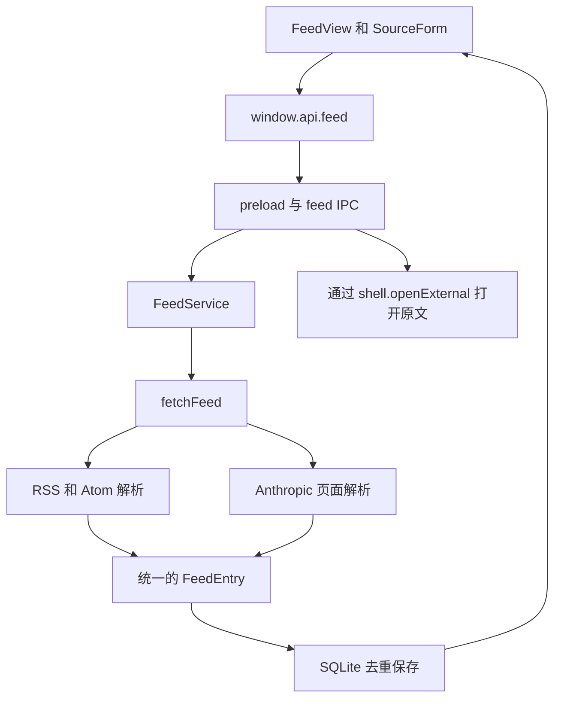

# Feed 实现说明

Feed 用于追踪论文和实验室博客，完成“添加来源 → 抓取更新 → 展示标题和摘要 → 打开原文”的流程。当前实现支持 RSS、Atom、arXiv 查询以及 Anthropic 官网列表页，内容和阅读状态保存在本地 SQLite 数据库中。

本模块对应[板块 1 用户需求](用户需求/LB-USR-1.md)中的基础订阅流程。目前通过手动刷新获取更新，尚未实现定时抓取、订阅分组和文献入库。

## 使用方式

进入工作区后，点击侧边栏的订阅图标打开 Feed。已有订阅标签页时会切换到该页。点击“添加来源”，填写名称并选择添加方式，保存时会立即抓取并校验来源。

| 添加方式 | 抓取方式 | 每次导入范围 |
| --- | --- | --- |
| 普通 RSS 或 Atom 地址 | 下载 XML，使用 `rss-parser` 解析 | 非 arXiv 来源去重后按日期取最新 10 条 |
| arXiv 仅填写领域 | 使用领域对应的 Atom 每日公告 | 来源返回的全部公告条目，可能超过 10 篇 |
| arXiv 填写关键词 | 调用 arXiv 查询接口，返回 Atom | 最近提交的最多 10 篇匹配论文 |
| OpenAI News | 使用 `https://openai.com/news/rss.xml` | 最新 10 篇 |
| Anthropic News | 解析 `https://www.anthropic.com/news` | 最新 10 篇 |
| Anthropic Engineering | 解析 `https://www.anthropic.com/engineering` | 最新 10 篇 |

“10 篇”是单次抓取的导入上限，已经保存的文章会继续累积。列表每页显示 50 条，因此长期使用后的总数可以超过 10。直接填写 arXiv 地址时，数量取决于该地址及其查询参数；抓取层不会再统一截断为 10 篇。

添加 arXiv 来源时，例如填写领域 `cs.AI, cs.LG`、关键词 `large language model`，会生成以下查询条件，再由 `URLSearchParams` 编码成地址：

```text
(cat:cs.AI OR cat:cs.LG) AND (ti:"large language model" OR abs:"large language model")
```

多个领域之间取“或”，领域条件与关键词条件之间取“且”；关键词按完整短语匹配标题或摘要。接口参数使用 `sortBy=submittedDate`、`sortOrder=descending`、`start=0` 和 `max_results=10`。只有领域时生成的地址形如 `https://rss.arxiv.org/atom/cs.AI+cs.LG`。

页面上的“标题或摘要”输入框只筛选已保存内容，不会重新搜索远程网站。可以按来源筛选、只显示未读条目、刷新单个来源或刷新全部来源。点击条目会标为已读并展示摘要，也可以手动改回未读。

## 模块组织

Feed 沿用项目的 Electron 主进程、preload 接口和 Svelte 页面结构。桌面端的数据流如下：



| 文件 | 职责 |
| --- | --- |
| [FeedView.svelte](../renderer/components/Feed/FeedView.svelte) | 来源切换、列表筛选、摘要阅读、刷新和阅读状态操作 |
| [SourceForm.svelte](../renderer/components/Feed/SourceForm.svelte) | 来源表单、博客预设和 arXiv 查询条件 |
| [shared/utils/feed.ts](../shared/utils/feed.ts) | URL 校验与 arXiv 地址生成 |
| [shared/types/feed.ts](../shared/types/feed.ts) | 前后端共享的数据结构和 `FeedAPI` 接口 |
| [main/feed/ipc.ts](../main/feed/ipc.ts) | 注册桌面端接口，接入工作区数据库和系统浏览器 |
| [main/feed/service.ts](../main/feed/service.ts) | 来源管理、刷新、事务、去重、查询和阅读状态保存 |
| [main/feed/parser.ts](../main/feed/parser.ts) | 网络请求、RSS 和 Atom 解析、数量限制及 arXiv 请求排队 |
| [main/feed/anthropic.ts](../main/feed/anthropic.ts) | Anthropic News 和 Engineering 页面适配 |

`FeedView` 接受一个 `FeedAPI` 参数，桌面端默认使用 `window.api.feed`。浏览器预览传入使用 HTTP 的实现，因此预览与桌面端复用同一套页面和服务逻辑。

## 抓取与解析

### RSS 和 Atom

`fetchFeed` 先检查来源地址，再下载内容。桌面端使用 Electron 的 `net.fetch`，浏览器预览的服务端使用 Node.js 的 `fetch`。请求超时为 30 秒，响应体最多读取 10 MB；HTTP 错误会转换为可显示的错误信息。

`parseFeed` 使用 `rss-parser`，将条目转换成统一的 `FeedEntry`：

| 字段 | 内容 |
| --- | --- |
| `externalId` | 来源中的条目标识，用于去重 |
| `title` | 标题，合并多余空白 |
| `url` | 可用的原文 HTTP 或 HTTPS 地址，缺失时为 `null` |
| `authors` | 来源提供的作者，兼容 Atom 作者列表和 RSS creator 字段 |
| `summary` | 来源摘要或内容的纯文本片段 |
| `publishedAt` | 规范化为 ISO 格式的发布时间，缺失或无效时为 `null` |

条目标识依次取 RSS `guid`、Atom `id`、原文 URL；这些字段均缺失时，对标题、作者和日期计算 SHA-256。XML 中的 `DOCTYPE` 和实体声明会被拒绝，页面按普通文本展示摘要。

非 arXiv 来源先按条目标识去重，再按日期从新到旧取 10 条，缺失日期的条目排在后面。原始 RSS 文件仍会完整下载和解析，数量限制发生在保存之前。

### arXiv

arXiv 的 Atom 数据进入同一个 XML 解析流程。查询接口返回的错误条目会作为失败处理，避免保存成一篇普通论文。

发往 `arxiv.org` 及其子域的请求共用串行队列，上一个请求结束后至少等待 3 秒再开始下一个请求。这是请求间隔控制，定时刷新仍需后续实现。带版本号的 arXiv 条目标识会被保留，不同版本不会自动合并。

### Anthropic

适配器只识别 Anthropic 的 `/news` 和 `/engineering` 列表地址。它从 HTML 中提取 `self.__next_f.push` 携带的公开 JSON 数据，合并数据分片并遍历文章对象，不执行网页脚本。

News 读取 `post` 和 `featuredGridLink`，Engineering 读取 `engineeringArticle`。普通文章使用 `slug.current` 生成原文地址，置顶链接使用页面提供的 URL；标题、摘要和日期分别取对应数据字段。相同 URL 的文章合并后，再按日期选取最新 10 篇，因此置顶位置不会直接决定导入顺序。

来源未提供摘要时保持为空，界面提示“来源未提供摘要”。如果页面中没有识别出文章，刷新会报错并保留旧数据。官网更改数据结构后，需要调整这个适配器。

## 数据保存与刷新

桌面端在首次使用 Feed 接口时创建 `FeedService`，复用当前工作区的 `workspace.sqlite`。服务通过 `CREATE TABLE IF NOT EXISTS` 建立以下两张表：

| 表 | 主要字段与约束 |
| --- | --- |
| `feed_sources` | `id`、`name`、唯一的 `url`、`last_refreshed`、`last_added`、`error` |
| `feed_items` | `id`、`source_id`、`external_id`、标题、链接、作者、摘要、发布时间、`is_read`；`(source_id, external_id)` 唯一 |

新增来源或修改地址时，先抓取并校验内容，成功后在事务中保存来源和条目。校验失败不会替换原有配置。只修改名称时不重新抓取；修改地址后也会保留此来源原先保存的内容。

每次成功刷新使用 `INSERT ... ON CONFLICT DO NOTHING` 插入条目，同时更新最后成功刷新时间、新增数量并清除错误。已有条目的阅读状态会保留，已有标题和摘要也不会被新返回的内容覆盖。去重以来源为单位，同一文章出现在两个订阅来源中时仍会保存两份。

刷新失败只记录当前来源的错误并将本次新增数量设为 0，保留最后成功刷新时间和全部已保存内容。刷新全部来源时逐个处理，一个来源失败不会阻止后续来源。对同一来源的并发刷新共用一个进行中的请求；刷新期间不允许修改或取消该来源。

查询通过 SQLite 完成，支持来源、标题或摘要的子串匹配、仅未读和分页。结果固定按发布时间从新到旧排列，缺失时间的条目显示“未提供时间”。每页 50 条，通过 `offset` 翻页。未读数量从保存的条目实时计算。

取消订阅前会显示确认提示，确认后利用外键级联删除该来源的条目和阅读状态。单纯刷新不会删除旧条目。

## 前后端接口

接口定义在 `FeedAPI` 中，由 preload 映射到 `feed:*` IPC 通道。主进程校验调用来自应用窗口的主框架，业务参数由服务层继续检查。

| API | 作用 |
| --- | --- |
| `getState(query)` | 返回来源列表、当前页条目和匹配总数 |
| `saveSource(input)` | 添加或编辑来源，返回来源 ID |
| `removeSource(id)` | 删除来源及关联条目 |
| `refresh(sourceId?)` | 刷新单个来源，省略 ID 时刷新全部 |
| `setRead(id, isRead)` | 保存单条内容的已读或未读状态 |
| `openItem(id)` | 从数据库读取原文地址，校验后调用系统浏览器 |

URL 校验允许 HTTP 和 HTTPS，拒绝用户名、密码及其他协议，并去除片段标识。原文链接无效时条目仍可保存，但“打开原文”不可用。

## 当前限制与后续衔接

- 每日自动刷新、可配置刷新间隔、暂停来源和订阅分组尚未实现；“每日公告”表示 arXiv 来源的内容类型。
- 不补齐全部历史。如果两次刷新之间新增内容超过单次上限，或公告已从来源移除，部分条目可能错过。
- 来源内容按纯文本展示，尚未提供图片、富文本正文、字体大小设置或阅读位置恢复。
- 已实现单条已读切换和仅未读筛选，批量标记、独立的“仅已读”筛选、排序切换及持久化关注关键词尚未实现。
- 打开原文使用外部浏览器；文献入库、PDF 下载、Reader 联动和 AI 摘要还需要后续接入。对接时可以从 `FeedItem` 取得标题、作者、摘要、日期和原文 URL。