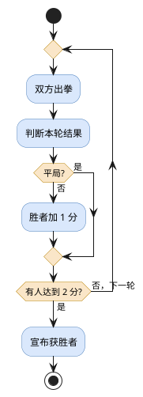
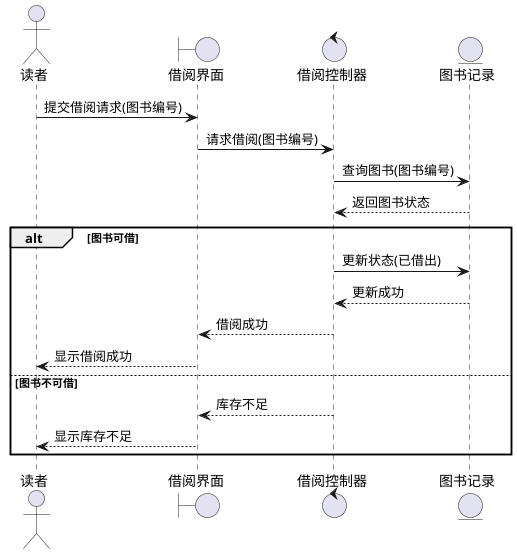
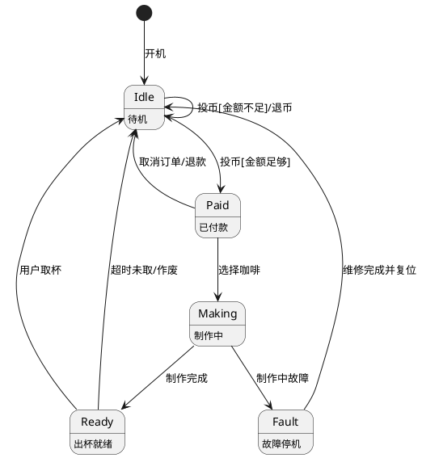

# Chapter 3 建模
## 3.1 理解需求

### 3.1.1 需求工程

**需求工程 (Requirement Engineering)**：搞清楚用户需要什么软件，软件要干啥

需求工程包含 7 项任务，分别是：
1. **起始 (Inception )**：确定谁需要软件、为什么需要。
2. **获取 (Elicitation)** ：与用户沟通，收集需求。
3. **细化 (Elaboration)**：分析并完善需求，构建模型。
4.  **协商(Negotiation)**：解决不同需求之间的冲突。
5. **规格说明 (Specification)**：把需求整理成正式文档。
6.  **确认 (Validation)**：检查需求是否正确、完整、一致。
7. **管理 (Management)**：跟踪和管理需求变化。

建立根基，需要搞清楚项目的背景，需要掌握：
* **利益相关者 (Stakeholders)**，所有会影响系统，或受系统影响者
* **多重观点 (Multiple Viewpoints)**，不同利益相关者，可能有不同需求甚至相互冲突
* **首次提问 (First Questions)**，先问谁使用系统、为什么开发、要解决什么问题
### 3.1.2 获取需求

需求可以分为功能需求和非功能需求

| 类型                                 | 含义                | 示例           |
| ---------------------------------- | ----------------- | ------------ |
| 功能需求 (Functional Requirement)      | 软件做什么             | 用户可以选座位、完成支付 |
| 非功能需求 (Non-functional Requirement) | 软件做得怎么样，以及需满足什么约束 | 查询响应时间不超过3秒  |
| 实现决策 (Implementation Decisio)      | 软件具体怎么实现          | 使用Java开发     |

完成 需求获取 活动之后，得到的成果，称为**工作产品 (work products)**，包括：
- 可行性说明
- 利益相关者列表
- 需求列表
- 系统环境描述
- 用例及必要的原型
> **技术解决方案 (technical solution)** 不是需求获取阶段，直接产出的工作产品
### 3.1.3 分析模型

把文字需求转化为的更清晰、结构化的模型，称为**分析模型 (Analysis Model)**，它的目的是：
- 描述用户需求
- 为后续软件设计提供基础
- 定义**能够被确认和检查的软件需求**

分析模型可以分为

| 类型                   | 描述什么       | 典型模型   |
| -------------------- | ---------- | ------ |
| Scenario-based（基于场景） | 用户如何使用系统   | 用例、活动图 |
| Class-based（基于类）     | 系统包含哪些类及关系 | 类图     |
| Behavioral（基于行为）     | 系统如何响应事件   | 状态图    |
| Flow-oriented（面向流）   | 数据如何流动、被处理 | 数据流图   |

## 3.2 需求分析
### 3.2.1 目标与原则

**需求分析 (requirement analysis)** 的核心是搞清楚软件要做啥，不关注具体怎么实现
### 3.2.2 基于场景的建模 用例图

**用例 (use case)**：描述用户为了完成某目标，如何一步步地与系统交互，它的核心元素如下

| 概念                          | 含义          | 举例           |
| --------------------------- | ----------- | ------------ |
| **参与者 (actor)**             | 与系统交互的外部角色  | 学生、银行系统      |
| **用例 (use case)**           | 参与者想完成的目标   | 校园卡充值        |
| **基本流程 (main flow)**        | 正常情况下的操作    | 输入金额→确认→充值成功 |
| **备选流程 (alternative flow)** | 特殊或异常情况下的操作 | 密码错误→重新输入    |
**用例规约 (Use Case Specification)**：规定了一个用例如何执行，除了上述的元素之外，还包括**前置条件 (precondition)**，**后置条件 (postcondition)**，**基本事件流 (basic flow)** 和**备选事件流 (alternative flow)**

**问题**：某图书馆需要开发一套图书借阅管理系统
读者可以通过系统查询图书信息，并提交借书申请。收到借书申请后，系统首先检查读者是否具有借阅资格，再检查图书是否有可借库存。
如果读者具有借阅资格，且图书有库存，则由图书管理员确认借出，系统生成借阅记录、更新库存，并提示借阅成功。
如果读者不具有借阅资格，系统拒绝借阅申请；如果图书库存不足，读者可以选择预约图书，系统生成预约记录。
此外，读者可以在管理员确认借出前取消申请。图书管理员还可以办理图书归还，系统更新借阅记录及库存
写出这个问题用例有哪些
**解决**：

|题目中的描述|识别的用例|主要参与者|
|---|---|---|
|读者查询图书信息|查询图书|读者|
|读者提交借书申请|借阅图书|读者|
|读者选择预约图书|预约图书|读者|
|管理员办理图书归还|归还图书|图书管理员|

**问题**：在上面问题的背景中，写出**借阅图书**的用例
**解决**：
```UML
# 用例 1：UC01 借阅图书

**用例 ID：** UC01
**用例名称：** 借阅图书
**参与者：** 读者（主参与者）、图书管理员

**前置条件：** 读者已进入图书借阅管理系统，系统正常运行。
**后置条件**
1. 分支 A（借阅成功）：生成借阅记录，更新图书库存。
2. 分支 B（库存不足）：若读者选择预约，则生成预约记录，库存不变。
3. 分支 C（申请终止）：不生成借阅记录，库存不变。
    
**基本事件流**
1. 读者提交借阅申请（图书信息）。
2. 系统检查读者借阅资格。
3. 系统查询图书库存。
4. 系统确认库存充足，图书管理员确认借出。
5. 系统生成借阅记录。
6. 系统更新图书库存。
7. 系统提示借阅成功，用例结束。

**备选事件流**
4a. **申请终止：**读者取消申请，系统取消申请，用例结束。
3a. **库存不足：**若图书库存不足，系统提示读者。用例结束
```

**用例图 (Use Case Diagram)**：UML 中描述谁实用系统，系统提供什么功能的图

在用例图中，用椭圆表示用例名称，用小人来表示 Actor。每个 Actor 和他们参与的用例相连即可

**问题**：在上面的问题背景下，画出用例图
**解决**：

%22%20viewBox%3D%220%200%20510%20290%22%20width%3D%22100%25%22%20xmlns%3D%22http%3A%2F%2Fwww.w3.org%2F2000%2Fsvg%22%3E%3Crect%20x%3D%22142%22%20y%3D%2212%22%20width%3D%22240%22%20height%3D%22263%22%20fill%3D%22none%22%20stroke%3D%22currentColor%22%20stroke-width%3D%221.4%22%20rx%3D%222%22%2F%3E%3Ctext%20x%3D%22262%22%20y%3D%2234%22%20text-anchor%3D%22middle%22%20font-size%3D%2214%22%20font-weight%3D%22600%22%20fill%3D%22currentColor%22%3E%E5%9B%BE%E4%B9%A6%E5%80%9F%E9%98%85%E7%AE%A1%E7%90%86%E7%B3%BB%E7%BB%9F%3C%2Ftext%3E%3Cellipse%20cx%3D%22262%22%20cy%3D%2275%22%20rx%3D%2274%22%20ry%3D%2220%22%20fill%3D%22%23e4efff%22%20stroke%3D%22%235686bb%22%20stroke-width%3D%221.4%22%2F%3E%3Ctext%20x%3D%22262%22%20y%3D%2279%22%20text-anchor%3D%22middle%22%20font-size%3D%2213%22%20fill%3D%22%23224d82%22%3E%E6%9F%A5%E8%AF%A2%E5%9B%BE%E4%B9%A6%3C%2Ftext%3E%3Cellipse%20cx%3D%22262%22%20cy%3D%22134%22%20rx%3D%2274%22%20ry%3D%2220%22%20fill%3D%22%23e4efff%22%20stroke%3D%22%235686bb%22%20stroke-width%3D%221.4%22%2F%3E%3Ctext%20x%3D%22262%22%20y%3D%22138%22%20text-anchor%3D%22middle%22%20font-size%3D%2213%22%20fill%3D%22%23224d82%22%3E%E5%80%9F%E9%98%85%E5%9B%BE%E4%B9%A6%3C%2Ftext%3E%3Cellipse%20cx%3D%22262%22%20cy%3D%22193%22%20rx%3D%2274%22%20ry%3D%2220%22%20fill%3D%22%23e4efff%22%20stroke%3D%22%235686bb%22%20stroke-width%3D%221.4%22%2F%3E%3Ctext%20x%3D%22262%22%20y%3D%22197%22%20text-anchor%3D%22middle%22%20font-size%3D%2213%22%20fill%3D%22%23224d82%22%3E%E9%A2%84%E7%BA%A6%E5%9B%BE%E4%B9%A6%3C%2Ftext%3E%3Cellipse%20cx%3D%22262%22%20cy%3D%22242%22%20rx%3D%2274%22%20ry%3D%2220%22%20fill%3D%22%23e4efff%22%20stroke%3D%22%235686bb%22%20stroke-width%3D%221.4%22%2F%3E%3Ctext%20x%3D%22262%22%20y%3D%22246%22%20text-anchor%3D%22middle%22%20font-size%3D%2213%22%20fill%3D%22%23224d82%22%3E%E7%A1%AE%E8%AE%A4%E5%80%9F%E5%87%BA%3C%2Ftext%3E%3Cg%20stroke%3D%22currentColor%22%20stroke-width%3D%221.5%22%20fill%3D%22none%22%20stroke-linecap%3D%22round%22%3E%3Ccircle%20cx%3D%2265%22%20cy%3D%22116%22%20r%3D%2212%22%2F%3E%3Cpath%20d%3D%22M65%20128%20V165%20M41%20143%20H89%20M65%20165%20L45%20192%20M65%20165%20L85%20192%22%2F%3E%3Ccircle%20cx%3D%22451%22%20cy%3D%22179%22%20r%3D%2212%22%2F%3E%3Cpath%20d%3D%22M451%20191%20V226%20M427%20203%20H475%20M451%20226%20L431%20251%20M451%20226%20L471%20251%22%2F%3E%3C%2Fg%3E%3Cg%20stroke%3D%22currentColor%22%20stroke-width%3D%221.15%22%20fill%3D%22none%22%3E%3Cpath%20d%3D%22M87%20138%20L188%2075%22%2F%3E%3Cpath%20d%3D%22M89%20144%20L188%20134%22%2F%3E%3Cpath%20d%3D%22M88%20160%20L188%20193%22%2F%3E%3Cpath%20d%3D%22M427%20210%20L336%20242%22%2F%3E%3C%2Fg%3E%3Ctext%20x%3D%2265%22%20y%3D%22214%22%20fill%3D%22currentColor%22%20font-size%3D%2213%22%20font-weight%3D%22600%22%20text-anchor%3D%22middle%22%3E%E8%AF%BB%E8%80%85%3C%2Ftext%3E%3Ctext%20x%3D%22451%22%20y%3D%22270%22%20fill%3D%22currentColor%22%20font-size%3D%2212%22%20font-weight%3D%22600%22%20text-anchor%3D%22middle%22%3E%E5%9B%BE%E4%B9%A6%E7%AE%A1%E7%90%86%E5%91%98%3C%2Ftext%3E%3C%2Fsvg%3E)

### 3.2.3 活动图 泳道图

**活动图 (activity diagram)**：用于描述一个业务流程，包含了哪些活动，要按什么顺序执行。它就像一个流程图

**问题**：在剪刀石头布系统中，玩家和 AI 各自出拳一次，由系统判断胜负；胜者+1 分，平局都不得分。若一方累积达到两分，则游戏结束；否则继续下一轮。画出活动图
**解决**：



**泳道图 (swimlane diagram)** 是活动图的一种变体，它还会展示，整个活动的各个参与方
### 3.2.4 基于类的建模

**类 (class)** 在 SE 中和编程中的类很像，都是一组有相同属性的行为和对象的抽象。类是模板 (temp)，而对象 (object) 是实例 (instance)
> 注意区别类，和类的属性

**问题**：从下列自然语言中，选出类。
`学生登录选课系统，查询课程信息，选择课程。系统检查课程是否还有空位，若有空位，生成选课记录。`
$$
\begin{align*}
&A. \text{学生} \quad &B. \text{课程} \\
&C. \text{选课记录} \quad &D. \text{课程名称}
\end{align*}
$$
**解决**：ABC 可以作为类，但 D 只能作为 B 的一个属性

**属性 (attribute)** 用于描述类所具有的数据或者特征，在 UML 中，常用符号如下

|符号|含义|
|---|---|
| `+` |public（公开）|
| `-` |private（私有）|
| `#` |protected（受保护）|
属性不能都设置为 `public`，这违反了**封装 (encapsulation)** 的原则。对于某些私有属性，需要用共用方法来进行修改，不能直接访问私有属性修改

**操作 (operation)** 描述类可执行的行为，对应程序设计中的**方法 (method)**。对比属性，操作通常是动词，而属性通常是名词

类之间分为 5 种常见的关系，分别是：

|关系|含义|例子|
|---|---|---|
|关联 Association|两个类之间存在稳定联系|学生选修课程|
|聚合 Aggregation|弱整体—部分关系|班级与学生|
|组合 Composition|强整体—部分关系，部分依赖整体的生命周期|订单与订单明细|
|继承 Generalization|is-a，子类是一种父类|学生是一种用户|
|依赖 Dependency|一个类临时使用另一个类|报表生成器调用导出服务|
注意区分**聚合 (aggregation)** 和**组合 (composition)**，前者是弱用有关系，例如班级解散，学生还在；后者是强拥有关系，例如订单删除，订单明细也随之消失
> 关联和依赖的关系是，前者是只表示对象之间需要保持联系；后者则是一个类，必须依赖另一个类提供的能力
### 3.2.4 类图

**边界-控制-实体 (Boundary-Control-Entity, BCE)** 建模法，将类划分为了 3 种职责类型： ^c09f48

|类型|作用|通俗理解|例子|
|---|---|---|---|
|实体类（Entity Class）|保存和管理业务信息|系统里有什么东西|学生、课程、选课记录|
|边界类（Boundary Class）|负责系统与外界交互|用户通过什么操作系统|登录界面、选课界面|
|控制类（Control Class）|协调流程、控制业务操作|谁来组织完成这件事|登录控制器、选课控制器|

一个类通常用一个三层的矩形表示：

|                      Student                       |
| :------------------------------------------------: |
|          `- name: String`<br>`- age: int`          |
| `+ selectCourse(): void`<br>`+ dropCourse(): void` |
其中第一层表示类的名称，第二层描述属性，第三层描述操作/方法

类之间的关系，需要用箭头连接表示

| 线条      | UML 关系             | 含义        |
| ------- | ------------------ | --------- |
| 实线，无箭头  | Association（关联）    | 两个类之间存在联系 |
| **虚线＋普通箭头** | **Dependency（依赖）**     | **A 使用 B**    |
| 实线＋空心三角 | Generalization（泛化） | A 继承 B    |
| 实线＋空心菱形 | Aggregation（聚合）    | 弱整体—部分    |
| 实线＋实心菱形 | Composition（组合）    | 强整体—部分    |
> 一般来说用虚线箭头就够了

### 3.2.5 行为模型 顺序图 状态图

**行为模型 (behavioral model)** 通过对象之间如何交互，对象的状态如何变化描述系统运行过程中的事件响应

**顺序图 (sequence diagram)** 描述哪些对象参与，按照什么顺序，互相发送信息

**问题**：某图书借阅管理系统的“借阅图书”用例如下：
1. 读者在借阅界面输入图书编号，提交借阅请求。
2. 借阅界面将请求发送给借阅控制器。
3. 借阅控制器查询图书记录，判断该图书是否可借。
4. 如果可借，系统更新图书状态为“已借出”，并显示“借阅成功”。
5. 如果不可借，系统显示“库存不足”。
要求： 使用 UML 顺序图描述上述过程，包含参与对象、消息调用及条件分支

**解决**：


**状态图 (state machine diagram)** 其实就是有限状态机的图形化表示。每个矩形包含状态名，以及下方的对这个状态含义的注释。每个矩形 (状态) 之间通过箭头连接，箭头上用文字注释，状态转换的条件

**问题**：商用自助咖啡机开机之后会自动进入**待机状态**, 日常情况下静静等待顾客使用, 当顾客投入钱币后, 机器会先核对投币金额, 如果投的钱不够咖啡售价, 机器会自动退回钱币并继续保持待机等待, 如果金额足够, 机器就会**确认收款成功**, 此时顾客可以自由选择想要的咖啡品类; 选好品类后机器就会自动启动**开始制作咖啡**, 制作过程中如果机器突发故障, 会立刻进入**故障停机模式**, 等待工作人员检修, 若制作过程一切正常, 咖啡制作完成后机器就会**出杯就绪**, 提醒顾客取走咖 啡; 咖啡就绪后, 顾客及时取走饮品, 机器就会恢复待机状态, 要是长时间无人取杯, 超过规定时间后饮品会自动作废, 机器也会重新回到待机状态; 另外顾客付款之后, 如果不想购买了, 也可以直接取消订单, 机器会自动退款并回到待机 模式; 如果机器出现故障停机, 只有工作人员完成维修并手动复位后, 机器才能 重新恢复正常待机使用, 全程机器循环运行, 持续为顾客提供服务。


### 3.2.6 面向流分析 数据流图

**面向流分析 (flow-orented analysis)** 是一种将软件系统视为一个数据加工系统，研究数据如何输入，经过哪些处理，最后怎么输出的需求分析方法

面向流分析使用**数据流图 (Data Flow Diagram, DFD)** 来分析数据的流动，例如图书管理系统的 DFD 可以画成：
%22%20viewBox%3D%220%200%20340%20208%22%20width%3D%22100%25%22%20xmlns%3D%22http%3A%2F%2Fwww.w3.org%2F2000%2Fsvg%22%3E%3Crect%20x%3D%224%22%20y%3D%2265%22%20width%3D%2278%22%20height%3D%2238%22%20rx%3D%222%22%20fill%3D%22%2364748b%22%20fill-opacity%3D%22.14%22%20stroke%3D%22%2364748b%22%2F%3E%3Ctext%20x%3D%2243%22%20y%3D%2288%22%20text-anchor%3D%22middle%22%20fill%3D%22currentColor%22%20font-size%3D%2212%22%3E%E8%AF%BB%E8%80%85%3C%2Ftext%3E%3Cellipse%20cx%3D%22177%22%20cy%3D%2285%22%20rx%3D%2251%22%20ry%3D%2231%22%20stroke%3D%22%232563eb%22%20stroke-width%3D%221.6%22%20fill%3D%22%233b82f6%22%20fill-opacity%3D%22.13%22%2F%3E%3Ctext%20x%3D%22177%22%20y%3D%2281%22%20fill%3D%22currentColor%22%20font-size%3D%2211%22%20text-anchor%3D%22middle%22%3E%E5%A4%84%E7%90%86%E5%80%9F%E9%98%85%3C%2Ftext%3E%3Ctext%20x%3D%22177%22%20y%3D%2294%22%20fill%3D%22currentColor%22%20font-size%3D%2211%22%20text-anchor%3D%22middle%22%3E%E8%AF%B7%E6%B1%82%3C%2Ftext%3E%3Cpath%20d%3D%22M82%2075%20H123%22%20stroke%3D%22%2364748b%22%20stroke-width%3D%221.5%22%20fill%3D%22none%22%2F%3E%3Cpath%20d%3D%22M117%2071%20L123%2075%20L117%2079%22%20stroke%3D%22%2364748b%22%20stroke-width%3D%221.5%22%20fill%3D%22none%22%2F%3E%3Ctext%20x%3D%22103%22%20y%3D%2264%22%20fill%3D%22currentColor%22%20font-size%3D%2210%22%20text-anchor%3D%22middle%22%3E%E5%80%9F%E9%98%85%E8%AF%B7%E6%B1%82%3C%2Ftext%3E%3Cpath%20d%3D%22M127%2096%20H85%22%20stroke%3D%22%2364748b%22%20stroke-width%3D%221.5%22%20fill%3D%22none%22%2F%3E%3Cpath%20d%3D%22M91%2092%20L85%2096%20L91%20100%22%20stroke%3D%22%2364748b%22%20stroke-width%3D%221.5%22%20fill%3D%22none%22%2F%3E%3Ctext%20x%3D%22106%22%20y%3D%22112%22%20fill%3D%22currentColor%22%20font-size%3D%2210%22%20text-anchor%3D%22middle%22%3E%E5%80%9F%E9%98%85%E7%BB%93%E6%9E%9C%3C%2Ftext%3E%3Crect%20x%3D%22272%22%20y%3D%2265%22%20width%3D%2265%22%20height%3D%2238%22%20rx%3D%221%22%20fill%3D%22%2364748b%22%20fill-opacity%3D%22.10%22%20stroke%3D%22%2364748b%22%2F%3E%3Ctext%20x%3D%22304%22%20y%3D%2281%22%20font-size%3D%2210%22%20text-anchor%3D%22middle%22%20fill%3D%22currentColor%22%3E%E5%9B%BE%E4%B9%A6%E7%AE%A1%E7%90%86%E5%91%98%3C%2Ftext%3E%3Ctext%20x%3D%22304%22%20y%3D%2293%22%20font-size%3D%229%22%20text-anchor%3D%22middle%22%20fill%3D%22currentColor%22%3E%EF%BC%88%E5%A4%96%E9%83%A8%E5%AE%9E%E4%BD%93%EF%BC%89%3C%2Ftext%3E%3Cpath%20d%3D%22M228%2084%20H269%22%20stroke%3D%22%2364748b%22%20stroke-width%3D%221.5%22%2F%3E%3Cpath%20d%3D%22M263%2080%20L269%2084%20L263%2088%22%20stroke%3D%22%2364748b%22%20stroke-width%3D%221.5%22%20fill%3D%22none%22%2F%3E%3Ctext%20x%3D%22248%22%20y%3D%2273%22%20text-anchor%3D%22middle%22%20font-size%3D%2210%22%20fill%3D%22currentColor%22%3E%E5%80%9F%E5%87%BA%E9%80%9A%E7%9F%A5%3C%2Ftext%3E%3Crect%20x%3D%22122%22%20y%3D%22169%22%20width%3D%22110%22%20height%3D%2230%22%20fill%3D%22%2394a3b8%22%20fill-opacity%3D%22.12%22%2F%3E%3Cpath%20d%3D%22M122%20169%20H232%20M122%20199%20H232%22%20stroke%3D%22%2364748b%22%20stroke-width%3D%221.7%22%2F%3E%3Ctext%20x%3D%22177%22%20y%3D%22188%22%20font-size%3D%2211%22%20fill%3D%22currentColor%22%20text-anchor%3D%22middle%22%3E%E5%9B%BE%E4%B9%A6%E6%95%B0%E6%8D%AE%3C%2Ftext%3E%3Cpath%20d%3D%22M167%20117%20V166%22%20stroke%3D%22%232563eb%22%20stroke-width%3D%221.5%22%2F%3E%3Cpath%20d%3D%22M163%20160%20L167%20166%20L171%20160%22%20stroke%3D%22%232563eb%22%20stroke-width%3D%221.5%22%20fill%3D%22none%22%2F%3E%3Cpath%20d%3D%22M190%20169%20V117%22%20stroke%3D%22%232563eb%22%20stroke-width%3D%221.5%22%2F%3E%3Cpath%20d%3D%22M186%20123%20L190%20117%20L194%20123%22%20stroke%3D%22%232563eb%22%20stroke-width%3D%221.5%22%20fill%3D%22none%22%2F%3E%3Ctext%20x%3D%22140%22%20y%3D%22147%22%20font-size%3D%2210%22%20fill%3D%22currentColor%22%20text-anchor%3D%22end%22%3E%E6%9B%B4%E6%96%B0%3C%2Ftext%3E%3Ctext%20x%3D%22198%22%20y%3D%22147%22%20font-size%3D%2210%22%20fill%3D%22currentColor%22%3E%E6%9F%A5%E8%AF%A2%3C%2Ftext%3E%3C%2Fsvg%3E)
DFD 包含 4 个基本元素：

| 元素                        | 图形          | 含义            | 举例     |
| ------------------------- | ----------- | ------------- | ------ |
| **外部实体（External Entity）** | 矩形          | 系统外部的数据来源或接收者 | 读者     |
| **处理（Process）**           | 圆形          | 对数据进行加工、转换    | 处理借阅请求 |
| **数据流（Data Flow）**        | 带名称的箭头      | 数据从哪里流向哪里     | 借阅请求   |
| **数据存储（Data Store）**      | 两条平行线之间的名称等 | 保存数据，供后续读写    | 图书数据   |
## 3.3 设计工程
### 3.3.1 设计概念

**抽象 (abstraction)** 分为**数据抽象 (data abstraction)** 和**过程抽象 (procedural abstraction)**。前者将一个现实的事物表达成一组属性，后者将一系列的复杂操作，封装为一个简单的操作

**模块化 (Modulariry)**：将一个复杂的软件系统，划分为若干相对独立的模块，每个模块负责特定功能

模块化的好处包括：
* 降低单个模块复杂度
* 便于并行开发
* 便于测试、维护和复用
* 一个模块修改，尽可能不影响别的模块
但是模块的数量需要权衡，并不是越多越好

**信息隐藏 (information hiding)**：模块内部实现的细节对外部不可见，外部只可通过规定接口访问模块
> 从面向对象的基础上看，就是私有属性必须通过公有方法来修改

信息隐藏的好处包括：
* 降低模块之间的依赖
* 减少修改带来的副作用
* 限制局部修改对整个系统的影响
* 提高软件的可维护性

设计软件的一个原则是**功能独立 (functional independece)**，也就是一个模块相对独立地完成自己的功能，减少对其它模块的依赖。它有两个重要的指标，分别是**内聚 (cohesion)** 和**耦合 (coupling)**

内聚衡量的是模块内部各个元素的关联程度

| 类型                                 | 含义               | 例子             |
| ---------------------------------- | ---------------- | -------------- |
| **功能内聚（Functional Cohesion）**      | 所有操作共同完成一个明确功能   | 借书模块完成借书       |
| **顺序内聚（Sequential Cohesion）**      | 一个操作的输出是下一个操作的输入 | 读取数据→清洗数据→分析数据 |
| **通信内聚（Communicational Cohesion）** | 多个操作使用相同的数据      | 多个操作处理同一份用户信息  |

耦合衡量不同的模块之间的依赖程度

| 类型                         | 含义                   |
| -------------------------- | -------------------- |
| **数据耦合（Data Coupling）**    | 模块之间通过简单数据参数通信       |
| **标记耦合（Stamp Coupling）**   | 模块之间传递整个复合数据结构       |
| **控制耦合（Control Coupling）** | 一个模块通过控制参数决定另一个模块的行为 |

**重构 (refactoring)**：不改变软件外部行为的前提下，改善软件内部结构
> 注意重构不改变外部的行为；新增功能并非严格重构

在**面向对象的设计概念 (OO Design Concepts)** 中：
* **继承 (inheritance)** 指的是子类继承父类的属性和方法实现代码的复用
* **多态 (ploymorphism)** 指的是同一个操作，对不同的对象产生不同的行为
* **消息 (messages)** 指的是对象之间通过消息进行通信，表现为方法的调用

**设计类 (design class)** 分为 5 类：

| 计类                                 | 作用          | 例子               |
| ---------------------------------- | ----------- | ---------------- |
| **用户界面类（User Interface Classes）**  | 处理用户交互和界面展示 | `LoginPage`      |
| **业务领域类（Business Domain Classes）** | 表示业务实体和业务规则 | `Book`           |
| **过程类（Process Classes）**           | 实现业务流程      | `BorrowProcess`  |
| **持久类（Persistent Classes）**        | 管理长期数据存储    | `BookRepository` |
| **系统类（System Classes）**            | 提供系统级服务     | `Logger`         |
> 注意[[#^c09f48|分析类]]有 3 类
### 3.3.2 设计模型

**数据设计 (Data Design)** 包括数据结构和数据库及其组织方式

**体系结构设计 (Architectural Design Elements)** 主要解决系统由哪些部分组成，这些部分如何组织交互
> [[#3.1.3 分析模型|分析模型]]考虑的是做什么，体系结构考虑的是怎么做，后者偏向于如何组织系统

**设计接口 (interface design)** 分为：
* 用户接口，即用户如何和软件交互
* 外部接口，即软件如何与外部系统交互
* 内部接口，即软件内部的不同模块，如何交互
接口定义提供什么操作，不考虑如何实现

**构建级设计 (component-level design)** 关注每个模块内部具体如何实现

**部署级设计 (deployment design)** 解决软件构件，在硬件环境中该如何分布，需要考虑硬件分配、网络拓扑等
> 例如后端放在服务器上，数据库放在数据库服务器上


