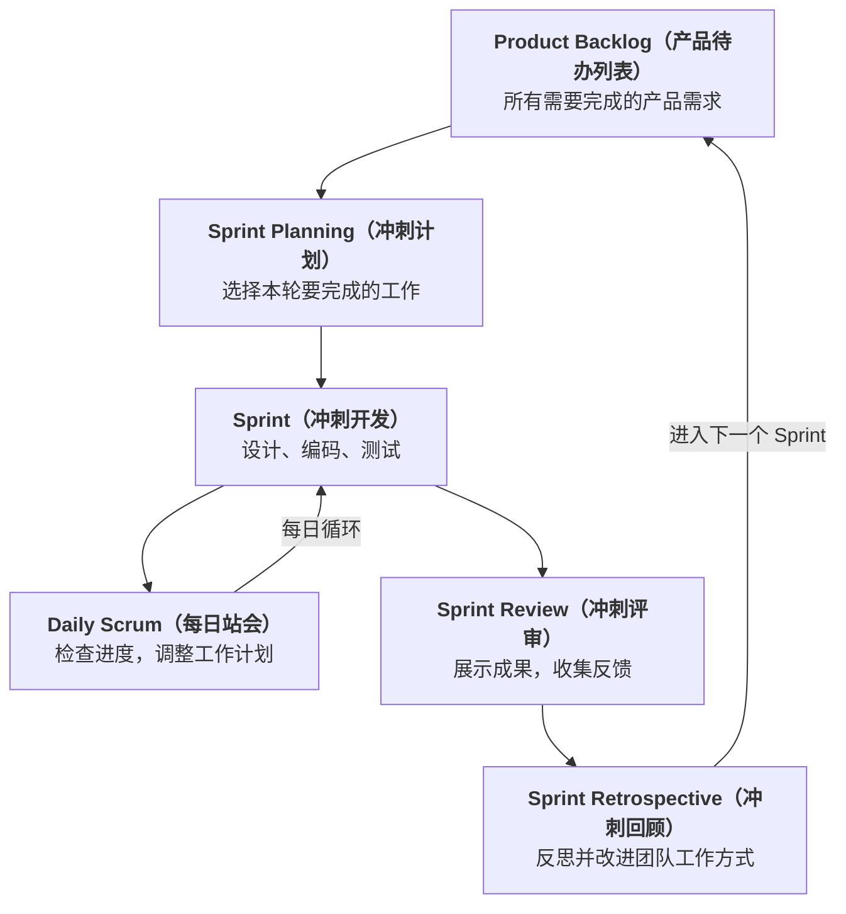

# Chapter 2  过程模型

## 2.1 软件工程定义与分层
### 2.1.1 软件工程的定义

**软件工程 (software engineering)**：对软件的开发运行维护，采用**系统化 (systematic)**，**规范化 (disciplined)** 和**可量化 (quantifiable)** 的方法和对方法的研究

软件工程分为：
* 质量关注
* 过程
* 方法，技术上怎么做
* 工具，CASE 工具，为过程和方法提供自动化支持
### 2.1.2 软件工程分层

工作产品构建过程中，一系列的活动，动作和任务的集合，称为**过程 (Process)**

过程的层次结构如下，过程向下分解为：
$$
\text{活动 Activity} \implies \text{动作 Action}
\implies \text{任务 Task} 
\implies \text{工作产品 Work Product}
$$
其中下层是上层的实现手段，上层是下层的目标
### 2.1.3 过程框架

**过程框架 (Process Framework)** 是适用于所有项目的通用骨架

沿着主线依次进行的活动，就是**框架活动 (framework activity)**。所有的项目都有，是通用的, 通常是顺序进行的：

|活动|核心内容|
|---|---|
|**Communication 沟通**|与利益相关者交流，需求收集|
|**Planning 策划**|资源、进度、风险评估|
|**Modeling 建模**|需求分析、架构与组件设计|
|**Construction 构造**|编码与测试|
|**Deployment 部署**|交付、培训、维护与支持|

在整个软件工程过程中，还有 8 项**伞形活动 (umbrella activity)**，它们是贯穿整个主线，持续存在的：

|#|活动|英文|做什么|
|---|---|---|---|
|1|**软件项目管理**|Software Project Management|计划、跟踪、控制项目的进度、资源和交付物|
|2|**正式技术评审**|Formal Technical Reviews|系统地评审工作产品，发现缺陷，确保符合标准|
|3|**软件质量保证**|Software Quality Assurance (SQA)|通过审计、度量、过程监控，确保达到质量标准|
|4|**软件配置管理**|Software Configuration Management (SCM)|管理工作产品的版本、变更和基线|
|5|**工作产品准备**|Work Product Preparation|创建并维护文档、模型等工作产品|
|6|**可复用性管理**|Reusability Management|识别、创建、归档并复用组件和模式，提高效率|
|7|**度量**|Measurement|收集分析过程和产品指标，评估质量、效率与进度|
|8|**风险管理**|Risk Management|识别、分析、排序并缓解可能影响成功的风险|
### 2.1.4 过程流

|模式|特点|适用|
|---|---|---|
|**线性（瀑布）**|简单、里程碑清晰；不灵活、反馈晚|需求稳定|
|**迭代（增量）**|早交付、适应变化；需有经验团队|需求演化、复杂系统|
|**演化（敏捷）**|高适应性；可预测性差、文档少|高不确定性、创新产品|
|**并行**|高吞吐、缩短周期；协调复杂|子任务相互独立|
### 2.1.5 任务集 裁剪

**任务集 (task set)**：完成某个 Action，需要做的一组具体任务、工作产品、里程碑和质量检查点

框架活动是通用的，但是每个活动，具体做多少任务，多严格，是需要调整的，这就是**任务集裁剪 (tailoring the task set)**
> 活动不能少，任务/严格程度可以增减

|因素|例子|
|---|---|
|**项目类型**|网页应用 vs 嵌入式医疗设备（安全关键系统需要大量正式评审）|
|**项目特征**|规模、复杂度、不确定性；团队大则沟通需更正式|
|**团队判断**|常识判断，团队一致同意后调整|
### 2.1.6 过程模式

针对 SE 开发过程中，反复出现的某类问题总结出的解决方案，称为**过程模式 (Process Pattern)**

过程模式有 3 种类型，分别是

| 类型                      | 定义                             | 例子        |
| ----------------------- | ------------------------------ | --------- |
| **步骤模式**（stage pattern） | 与**框架活动**相关的问题，包含多个任务模式        | 建立沟通      |
| **任务模式**（task pattern）  | 与某个**软件工程动作或工作任务**相关、关系实践成败的问题 | 需求收集      |
| **阶段模式**（phase pattern） | 过程中发生的**框架活动序列**，即使活动流本质上是迭代的  | 螺旋模型、原型开发 |
过程模式需要用 Ambler 模板填写信息栏，参见 [[Ambler 模板]]
### 2.1.7 能力成熟度模型

**能力成熟度模型 (Capability Maturity Model, CMM)** 是用来评价一个软件开发组织的软件开发有多成熟/规范的标准
> 评价开发方式是否可靠而不是软件本身好不好

CMM 可以分为：
1. 初始级 (initial)。依赖个人能力，过程混乱
2. 可重复级 (repeatable)。有基本管理，成功经验可复现
3. 已定义级 (defined)。组织有统一和标化流程
4. 已管理级 (managed)。数据定量管理过程
5. 优化级 (optimizing)。持续改进开发过程

## 2.2 软件生存周期与过程模型
### 2.2.1 软件生存周期

**软件生存周期**可分为若干阶段，每个阶段都包括**计划**，**开发**，**运行与维护** 3 个时期：
1. 计划时期，做调查和分析，有**问题定义**和**可行性研究**两个阶段
2. 开发时期，完成**设计**和**实现**，前者包括**需求分析**和**软件设计** 2 个阶段，后者包括**编码**和**测试**
	1. 需求分析。解决**目标系统必须做什么**，要描述软件的功能和性能
	2. 软件设计。把需求转换为相应的体系结构
	3. 编码。写代码，得到源程序清单
	4. 测试。尽可能发现问题，**设计测试用例**
3. 运行时期，软件的最后生命时期，需要做好**运行和维护**
### 2.2.2 过程模型

| 模型                       | 核心思想                | 适用场景       |
| ------------------------ | ------------------- | ---------- |
| Waterfall（瀑布模型）          | 按阶段依次开发，不容易回头修改     | 需求明确、稳定    |
| Incremental（增量模型）        | **分批交付**，每次增加功能     | 希望尽早获得可用产品 |
| RAD（快速应用开发）              | **多团队并行**、组件复用，快速交付 | 时间紧、容易模块化  |
| Prototyping（原型模型）        | **先做原型**，让用户反馈，再修改  | 需求不明确      |
| Spiral（螺旋模型）             | **反复迭代**，每轮都分析和降低风险 | 大型、高风险项目   |
RAD 是团队并发开发模块，并发模型是活动状态并存，参见[[惯用过程模型]]

另有**专用过程模型**：
1. 基于构件的开发。也就是拼软件
2. 形式化方法模型。用数学描述和说明 
3. 面向方面。关注哪个就开发哪个

### 2.2.3 统一过程

**统一过程 (UP)**：也是一种软件过程模型，特点包括，

| 特征                             | 简单理解                |
| ------------------------------ | ------------------- |
| **Use-Case Driven（用例驱动）**          | 以用户需要的功能为出发点，贯穿开发过程 |
| **Architecture-Centric（以架构为中心）**   | 重视系统整体结构，先建立稳定的架构   |
| **Iterative & Incremental（迭代与增量）** | 反复开发、改进，每次增加功能      |

UP 的四个阶段是**初始 (inception)**，即明确范围；**细化 (elaboration)**，即确定架构；**构建 (construction)**，即开发系统；**移交 (transition)**，即交付给用户

构建是实现和测试软件，移交则需要用户试用、反馈迭代

UP 的 5 个核心工作流如下：

| 工作流                | 主要工作       | 产物    |
| ------------------ | ---------- | ----- |
| Requirements（需求）   | 明确系统要做什么   | 用例模型  |
| Analysis（分析）       | 分析业务逻辑，识别类 | 分析模型  |
| Design（设计）         | 确定技术实现方案   | 设计模型  |
| Implementation（实现） | 编写代码       | 可执行软件 |
| Test（测试）           | 验证正确性      | 测试模型  |

4 个阶段和 5 个工作流不是一一对应关系，每个阶段可有多个工作流

UP 还包含 3 个**分析类**

|类型|作用|例子|
|---|---|---|
|Boundary（边界类）|负责用户与系统交互|登录界面|
|Control（控制类）|控制业务流程与逻辑|登录控制器|
|Entity（实体类）|保存业务数据及相关行为|用户、订单|
### 2.2.4 敏捷开发

**敏捷开发 (Agile Development)** 是一种以**迭代、增量、快速响应变化**为核心的软件开发方法论
> 相比于增量模型，敏捷开发会反复改进同一块功能，而前者基本是做完不回头

敏捷宣言：

|更重视|相比之下|
|---|---|
|个体和互动|流程和工具|
|可工作的软件|详尽的文档|
|客户合作|合同谈判|
|响应变化|遵循计划|
敏捷开发的 3 个核心概念是：
- **迭代（Iteration）：** 反复经历开发、反馈、改进的过程。
- **增量（Increment）：** 每次开发都增加一部分可用功能。
- **自组织（Self-Organizing）：** 团队能够自主安排具体工作，而不完全依赖上级逐项指挥。

**极限编程 (Extreme Programming, XP)** 是一种具体的敏捷开发方法，有 4 个框架活动：
1. **计划 (planing)**，将客户需求记录为**用户故事 (user story)**，估算工作量，确定本轮开发哪些
2. **设计 (design)**，采用简单设计，不为了不确定要的功能，过度设计
3. **编码 (coding)**，实现功能，强调**结对编程 (pair programing)**，即两个程序员共同编码和检查；**测试先行 (test first)**，先写测试，再写功能代码；**持续集成 (continuous integration)**，频繁整合代码并运行测试
4. **测试 (testing)**，包括**单元测试 (unit tesing)**，即检查某个函数或模块和**验收测试 (acceptance testing)**，检查系统是否满足客户需求

**scrum**是一种敏捷开发框架，包含 3 个角色：
* **产品负责人 (product owner)**，确定产品价值和需求的优先级
* **主管 (scrum master)**，帮助团队正确实施 scrum，解决写作障碍
* **开发者 (developers)**，负责完成开发工作
它的工作被划分为一个个的**冲刺 (sprint)**，每个 sprint 是一个固定长度的开发周期：

Scurm 关注团队如何管理和协作，而 XP 更强调程序员如何编写和测试高质量代码

