# 知织（Labloom）软件设计说明书

## 1. 引言

### 1.1 编写目的

本设计说明书根据《知织（Labloom）需求规格说明书》（1.3 版）中的需求分析与 OOA 分析模型，对知织课程实验版进行详细设计。文档涵盖体系结构设计、数据设计、接口设计及构件级设计，并给出用户界面设计、非功能设计和部署约束，为后续编码、测试及维护提供依据。

### 1.2 范围

本系统用于支持学生科研与课程调研中的资料获取、阅读、记录和查找，核心功能包括：创建或打开本地工作区、添加／修改／移除订阅源、刷新与阅读订阅条目、导入与阅读 PDF、创建与编辑笔记、在笔记中引用文献、自动保存笔记以及按类型检索资料，对应用例 UC01～UC06 和功能需求 FR-01～FR-13。本系统为单用户桌面应用，一次运行仅打开一个工作区；笔记内容块仅属于一个页面；重复导入同一 PDF 时生成独立的文献记录和附件副本。

### 1.3 术语定义

- OOA：面向对象分析（Object-Oriented Analysis）
- UC：用例（Use Case）
- DAO：数据访问对象（Data Access Object），封装对数据库的访问
- PO：持久化对象（Persistent Object），即实体类，作为数据载体
- DTO：数据传输对象（Data Transfer Object），在界面、桥接层与控制类之间传递参数和结果
- IPC：进程间通信（Inter-Process Communication），Electron 渲染进程与主进程之间的调用通道
- AppAPI：preload 脚本向渲染进程公开的 window.labloom 接口对象，方法均为异步调用
- 工作区：由 workspace.sqlite 数据库、attachments 附件目录和 .imports 导入目录组成的本地资料目录
- Tx：同一次数据库事务的连接上下文，由 UnitOfWork 创建
- UUID：实体稳定标识，数据库中以 TEXT 保存
- Timestamp：UTC 毫秒时间戳，数据库中以 INTEGER 保存
- note / paper：页面类型，分别表示笔记页和文献页
- paragraph / heading / list：内容块类型，分别表示段落、标题和列表
- NORMAL：订阅源正常状态
- REFRESHING：订阅源刷新中状态
- FETCH_FAILED：订阅源抓取失败状态
- EDITING：笔记编辑中状态
- SAVING：笔记保存中状态
- SAVED：笔记已保存状态
- SAVE_FAILED：笔记保存失败状态
- BUILDING：检索索引构建中状态
- READY：检索索引就绪状态
- FAILED：检索索引构建失败状态
- `Result<T>`：统一返回结果对象，包含 success、code、msg、data 四个字段；code 为错误代码，取值见 7.3
- `PageResult<T>`：分页结果对象，包含 items、page、pageSize、hasMore、queryId 五个字段，pageSize 固定为 50
- WorkspaceSession：工作区会话，包含 sessionId、workspaceId、name、indexStatus
- SourceInput：订阅源输入，包含 name、url
- FeedFilter：条目筛选条件，包含 sourceId（可为空）、unreadOnly 和 queryId（可为空，用于固定本次浏览的条目顺序）
- ParsedFeed：订阅解析结果，包含来源标题和条目列表（title、url、summary、publishedAt）
- RefreshSummary：刷新汇总，按来源列出 sourceId、success、added、duplicate、skipped、code
- ImportTicket：导入凭据，包含 importId、attachmentId、tempPath、relativePath、size
- PDFResource：PDF 读取结果，包含 attachmentId、originalName、bytes
- NoteSnapshot：笔记快照，包含 pageId、title、blocks、paperIds、version
- NoteSaveInput：笔记保存输入，包含 pageId、title、blocks、baseVersion、clientRevision
- SaveReceipt：保存回执，包含 pageId、version、clientRevision、savedAt
- SearchInput：检索输入，包含 keyword、scope（all / note / paper / feed）、page、queryId（可为空）
- SearchHit：检索结果项，包含 kind、targetId、title、snippet
- SearchDocument：检索文档，包含 kind、targetId、title、searchText、updatedAt
- IndexTask：索引任务，包含 kind、targetId、revision
- IndexStatus：索引状态，包含 status、processed、total、generation

### 1.4 参考资料

- 《知织（Labloom）需求规格说明书》1.3 版（OOA 分析文档，LB-SE-SRS-0001）
- 《知织（Labloom）系统概要设计说明书》1.2 版（LB-SDD-0001）
- 《软件工程——实践者的研究方法》
- UML 2.5 规范
- 《J2EE 核心模式》——DAO 模式

## 2. 体系结构设计

### 2.1 分层架构

系统采用四层架构（表示层、业务逻辑层、数据访问层、数据库），并引入 MVC 模式进行职责分离。表示层运行于 Electron 渲染进程，业务逻辑层和数据访问层运行于主进程，两者之间由 AppAPI、preload 和 IPCHandler 组成的跨进程桥接传递请求；文件、网络和操作系统访问由平台服务承担。实体类（PO）不作为独立层存在，而是作为跨层传递的数据载体。各构件分别归入概要设计中的界面表示包、接口控制包、应用服务包、平台支撑包、数据持久化包和领域模型包。

| 层次 | 职责 | 代表构件 | 是否在调用链上 |
| --- | --- | --- | --- |
| 表示层（边界类） | 接收用户输入、展示结果 | WorkspaceUI、SourceUI、FeedUI、PaperUI、NoteUI、SearchUI | 是 |
| 跨进程桥接 | 转发请求，校验发送窗口、参数与会话 | AppAPI（preload）、IPCHandler | 是 |
| 业务逻辑层（控制类） | 业务规则、流程控制、事务边界 | WorkspaceController、SourceController、RefreshController、PaperController、NoteController、SearchController、IndexService | 是 |
| 平台服务 | 文件选择、受管文件、目录锁、网络抓取、系统浏览器 | FileDialog、FileStore、WorkspaceLock、FeedGateway、ExternalBrowser | 是（被控制类调用） |
| 数据访问层（DAO） | SQL、连接、事务、类型转换 | WorkspaceDAO、FeedSourceDAO、FeedItemDAO、PageDAO、BlockDAO、AttachmentDAO、ReferenceDAO、SearchDAO、UnitOfWork、MigrationRunner | 是 |
| 数据库 | 数据持久化存储 | SQLite（每个工作区一个 workspace.sqlite） | 是（被 DAO 访问） |
| 实体类（PO） | 承载数据，无持久化职责 | Workspace、FeedSource、FeedItem、Page、NotePage、PaperPage、Block、Attachment | 否，被传递 |

**关键约束**：

- 表示层只通过 AppAPI 发起请求，不直接访问数据库、文件系统和网络；表示层对控制类的调用均经 preload 和 IPCHandler 转发。
- IPCHandler 校验发送窗口、参数类型和 sessionId，校验通过后调用控制类接口。
- 业务逻辑层只调用 DAO 接口和平台服务接口，不直接访问数据库，不关心 SQL 与存储实现。
- DAO 层只负责数据访问（增删改查），不包含业务规则；接收/返回实体对象或对象列表；写操作使用控制类传入的 Tx。
- 实体类只承载数据属性与轻量业务方法（如状态设置、内容整理），不涉及持久化操作，不主动参与调用链。
- 一次运行只关联一个工作区会话；涉及多个 DAO 的业务操作由控制类在同一 Tx 中统一提交或回滚。

### 2.2 构件及其依赖关系

| 层次 | 构件 | 对外提供的接口 | 依赖的接口 |
| --- | --- | --- | --- |
| 表示层 | WorkspaceUI | IWorkspaceUI | IWorkspaceController（经 AppAPI） |
| 表示层 | SourceUI | ISourceUI | ISourceController（经 AppAPI） |
| 表示层 | FeedUI | IFeedUI | IRefreshController（经 AppAPI） |
| 表示层 | PaperUI | IPaperUI | IPaperController（经 AppAPI） |
| 表示层 | NoteUI | INoteUI | INoteController（经 AppAPI）、IPaperController（经 AppAPI） |
| 表示层 | SearchUI | ISearchUI | ISearchController（经 AppAPI）、INoteUI、IPaperUI、IFeedUI |
| 跨进程桥接 | AppAPI | IAppAPI | IPC 通道 |
| 跨进程桥接 | IPCHandler | IPC 通道 | IWorkspaceController、ISourceController、IRefreshController、IPaperController、INoteController、ISearchController |
| 业务逻辑层 | WorkspaceController | IWorkspaceController | IFileDialog、IFileStore、IWorkspaceLock、IUnitOfWork、IMigrationRunner、IWorkspaceDAO、IAttachmentDAO、IIndexService |
| 业务逻辑层 | SourceController | ISourceController | IFeedGateway、IUnitOfWork、IFeedSourceDAO |
| 业务逻辑层 | RefreshController | IRefreshController | IFeedGateway、IExternalBrowser、IUnitOfWork、IFeedSourceDAO、IFeedItemDAO、ISearchDAO |
| 业务逻辑层 | PaperController | IPaperController | IFileDialog、IFileStore、IUnitOfWork、IPageDAO、IAttachmentDAO、ISearchDAO |
| 业务逻辑层 | NoteController | INoteController | IUnitOfWork、IPageDAO、IBlockDAO、IReferenceDAO、ISearchDAO |
| 业务逻辑层 | SearchController | ISearchController | IIndexService、ISearchDAO |
| 业务逻辑层 | IndexService | IIndexService | IUnitOfWork、ISearchDAO、IPageDAO、IBlockDAO、IFeedItemDAO |
| 平台服务 | FileDialog | IFileDialog | 操作系统文件选择窗口 |
| 平台服务 | FileStore | IFileStore | 工作区目录、应用数据目录 |
| 平台服务 | WorkspaceLock | IWorkspaceLock | 工作区锁文件 |
| 平台服务 | FeedGateway | IFeedGateway | HTTP 客户端、RSS／Atom 解析器 |
| 平台服务 | ExternalBrowser | IExternalBrowser | 系统默认浏览器 |
| 数据访问层 | WorkspaceDAO | IWorkspaceDAO | Workspace（PO，使用） |
| 数据访问层 | FeedSourceDAO | IFeedSourceDAO | FeedSource（PO，使用） |
| 数据访问层 | FeedItemDAO | IFeedItemDAO | FeedItem（PO，使用） |
| 数据访问层 | PageDAO | IPageDAO | Page、NotePage、PaperPage（PO，使用） |
| 数据访问层 | BlockDAO | IBlockDAO | Block（PO，使用） |
| 数据访问层 | AttachmentDAO | IAttachmentDAO | Attachment（PO，使用） |
| 数据访问层 | ReferenceDAO | IReferenceDAO | — |
| 数据访问层 | SearchDAO | ISearchDAO | SearchDocument、IndexTask（DTO，使用） |
| 数据访问层 | UnitOfWork | IUnitOfWork | SQLite 连接 |
| 数据访问层 | MigrationRunner | IMigrationRunner | IUnitOfWork、IFileStore |
| 数据库 | workspace_meta / schema_migrations / feed_sources / feed_items / pages / paper_metadata / blocks / note_paper_refs / attachments / search_documents / search_terms / index_queue / index_state | — | — |

### 2.3 接口定义

#### 2.3.1 表示层接口

- **IWorkspaceUI：**
  - `createWorkspace(name: String): Result<WorkspaceSession>`
  - `openWorkspace(): Result<WorkspaceSession>`
  - `closeWorkspace(): Result<Void>`
- **ISourceUI：**
  - `querySources(): List<FeedSource>`
  - `addSource(name: String, url: String): Result<FeedSource>`
  - `editSource(sourceId: UUID, name: String, url: String): Result<FeedSource>`
  - `removeSource(sourceId: UUID): Result<Void>`
- **IFeedUI：**
  - `refreshFeed(sourceId: UUID): Result<RefreshSummary>`
  - `queryItems(filter: FeedFilter, page: Integer): PageResult<FeedItem>`
  - `openItem(itemId: UUID): Result<FeedItem>`
  - `openOriginal(itemId: UUID): Result<Void>`
- **IPaperUI：**
  - `importPDF(): Result<PaperPage>`
  - `queryPapers(page: Integer): PageResult<PaperPage>`
  - `openPaper(paperId: UUID): Result<PDFResource>`
  - `turnPage(pageNo: Integer): void`
  - `zoom(scale: Float): void`
  - `findText(keyword: String): Integer`
  - `cancelFind(): void`
- **INoteUI：**
  - `createNote(title: String): Result<NoteSnapshot>`
  - `queryNotes(page: Integer): PageResult<NotePage>`
  - `openNote(noteId: UUID): Result<NoteSnapshot>`
  - `editNote(title: String, blocks: List<Block>): void`
  - `insertPaperLink(paperId: UUID): void`
  - `retrySave(): Result<SaveReceipt>`
- **ISearchUI：**
  - `submitSearch(keyword: String, scope: String): PageResult<SearchHit>`
  - `changePage(page: Integer): PageResult<SearchHit>`
  - `openResult(hit: SearchHit): void`
- **IAppAPI（window.labloom，由 preload 公开）：**
  - `workspace.create(name: String): Result<WorkspaceSession>`
  - `workspace.open(): Result<WorkspaceSession>`
  - `workspace.close(sessionId: String): Result<Void>`
  - `sources.list(sessionId: String): Result<List<FeedSource>>`
  - `sources.add(sessionId: String, input: SourceInput): Result<FeedSource>`
  - `sources.update(sessionId: String, sourceId: UUID, input: SourceInput): Result<FeedSource>`
  - `sources.remove(sessionId: String, sourceId: UUID): Result<Void>`
  - `feed.refresh(sessionId: String, sourceId: UUID): Result<RefreshSummary>`
  - `feed.list(sessionId: String, filter: FeedFilter, page: Integer): Result<PageResult<FeedItem>>`
  - `feed.read(sessionId: String, itemId: UUID): Result<FeedItem>`
  - `feed.openOriginal(sessionId: String, itemId: UUID): Result<Void>`
  - `papers.importPDF(sessionId: String): Result<PaperPage>`
  - `papers.list(sessionId: String, page: Integer): Result<PageResult<PaperPage>>`
  - `papers.readPDF(sessionId: String, paperId: UUID): Result<PDFResource>`
  - `notes.create(sessionId: String, title: String): Result<NoteSnapshot>`
  - `notes.list(sessionId: String, page: Integer): Result<PageResult<NotePage>>`
  - `notes.load(sessionId: String, noteId: UUID): Result<NoteSnapshot>`
  - `notes.save(sessionId: String, input: NoteSaveInput): Result<SaveReceipt>`
  - `search.status(sessionId: String): Result<IndexStatus>`
  - `search.rebuild(sessionId: String): Result<IndexStatus>`
  - `search.query(sessionId: String, input: SearchInput): Result<PageResult<SearchHit>>`

#### 2.3.2 业务逻辑层接口

- **IWorkspaceController：**
  - `createWorkspace(name: String): Result<WorkspaceSession>`
  - `openWorkspace(): Result<WorkspaceSession>`
  - `closeWorkspace(): Result<Void>`
- **ISourceController：**
  - `listSources(): Result<List<FeedSource>>`
  - `addSource(input: SourceInput): Result<FeedSource>`
  - `updateSource(sourceId: UUID, input: SourceInput): Result<FeedSource>`
  - `removeSource(sourceId: UUID): Result<Void>`
- **IRefreshController：**
  - `refresh(sourceId: UUID): Result<RefreshSummary>`
  - `listItems(filter: FeedFilter, page: Integer): Result<PageResult<FeedItem>>`
  - `readItem(itemId: UUID): Result<FeedItem>`
  - `openOriginal(itemId: UUID): Result<Void>`
- **IPaperController：**
  - `importPDF(): Result<PaperPage>`
  - `listPapers(page: Integer): Result<PageResult<PaperPage>>`
  - `readPDF(paperId: UUID): Result<PDFResource>`
- **INoteController：**
  - `createNote(title: String): Result<NoteSnapshot>`
  - `listNotes(page: Integer): Result<PageResult<NotePage>>`
  - `loadNote(noteId: UUID): Result<NoteSnapshot>`
  - `saveNote(input: NoteSaveInput): Result<SaveReceipt>`
- **ISearchController：**
  - `getIndexStatus(): Result<IndexStatus>`
  - `rebuildIndex(): Result<IndexStatus>`
  - `search(input: SearchInput): Result<PageResult<SearchHit>>`
- **IIndexService：**
  - `start(): void`
  - `stop(): void`
  - `getStatus(): IndexStatus`
  - `rebuild(): void`
  - `processQueue(): Integer`
  - `tokenize(text: String): List<String>`

平台服务接口（由控制类调用，运行于主进程）：

- **IFileDialog：**
  - `chooseDirectory(mode: String): Result<String>`
  - `choosePDF(): Result<String>`
- **IFileStore：**
  - `checkDirectory(path: String, mode: String): Result<String>`
  - `initLayout(rootPath: String): void`
  - `removeLayout(rootPath: String): void`
  - `backupDatabase(dbPath: String): String`
  - `checkPDF(path: String): Result<Integer>`
  - `prepareImport(path: String, attachmentId: UUID): ImportTicket`
  - `publishImport(ticket: ImportTicket): String`
  - `finishImport(ticket: ImportTicket): void`
  - `rollbackImport(ticket: ImportTicket): Boolean`
  - `listPendingImports(): List<ImportTicket>`
  - `readAttachment(relativePath: String): Byte[]`
- **IWorkspaceLock：**
  - `acquire(rootPath: String): Result<String>`
  - `release(lockHandle: String): void`
- **IFeedGateway：**
  - `fetchAndParse(url: String, timeoutMs: Integer): Result<ParsedFeed>`
- **IExternalBrowser：**
  - `open(url: String): Result<Void>`

#### 2.3.3 数据访问层接口（DAO 层）

- **IWorkspaceDAO：**
  - `insertMeta(workspace: Workspace, tx: Tx): void`
  - `selectMeta(): Workspace`
  - `selectSchemaVersion(): Integer`
- **IFeedSourceDAO：**
  - `insert(source: FeedSource, tx: Tx): void`
  - `update(source: FeedSource, tx: Tx): void`
  - `updateRefreshTime(sourceId: UUID, time: Timestamp, tx: Tx): void`
  - `delete(sourceId: UUID, tx: Tx): void`
  - `selectAll(): List<FeedSource>`
  - `selectById(sourceId: UUID): FeedSource`
  - `selectByUrl(url: String): FeedSource`
- **IFeedItemDAO：**
  - `insert(item: FeedItem, tx: Tx): void`
  - `updateRead(itemId: UUID, tx: Tx): void`
  - `selectById(itemId: UUID): FeedItem`
  - `selectByUrl(url: String): FeedItem`
  - `selectPage(filter: FeedFilter, page: Integer): PageResult<FeedItem>`
  - `selectIndexInput(): List<FeedItem>`
- **IPageDAO：**
  - `insert(page: Page, tx: Tx): void`
  - `updateNote(note: NotePage, expectedVersion: Integer, tx: Tx): Integer`
  - `selectById(pageId: UUID): Page`
  - `selectByIds(pageIds: List<UUID>): List<Page>`
  - `selectByKind(kind: String, page: Integer): PageResult<Page>`
  - `selectIndexInput(): List<Page>`
- **IBlockDAO：**
  - `batchInsert(blocks: List<Block>, tx: Tx): void`
  - `deleteByPage(pageId: UUID, tx: Tx): void`
  - `selectByPage(pageId: UUID): List<Block>`
  - `selectByIds(blockIds: List<UUID>): List<Block>`
  - `selectNoteText(pageId: UUID): String`
- **IAttachmentDAO：**
  - `insert(attachment: Attachment, tx: Tx): void`
  - `selectById(attachmentId: UUID): Attachment`
  - `selectByPaper(paperId: UUID): Attachment`
- **IReferenceDAO：**
  - `batchInsert(noteId: UUID, paperIds: List<UUID>, tx: Tx): void`
  - `deleteByNote(noteId: UUID, tx: Tx): void`
  - `selectByNote(noteId: UUID): List<UUID>`
- **ISearchDAO：**
  - `insertTask(kind: String, targetId: UUID, tx: Tx): void`
  - `deleteTask(task: IndexTask, tx: Tx): void`
  - `updateDocument(document: SearchDocument, terms: List<String>, tx: Tx): void`
  - `updateStatus(status: String, errorCode: String, tx: Tx): void`
  - `selectPendingTasks(limit: Integer): List<IndexTask>`
  - `selectCandidates(terms: List<String>, scope: String): List<SearchDocument>`
  - `selectStatus(): IndexStatus`

数据访问支撑接口：

- **IUnitOfWork：**
  - `open(dbPath: String): void`
  - `begin(): Tx`
  - `commit(tx: Tx): void`
  - `rollback(tx: Tx): void`
  - `close(): void`
- **IMigrationRunner：**
  - `migrate(fromVersion: Integer): Result<Integer>`

**\*命名约定**：DAO 层方法采用 insert / update / select / delete 前缀，与 SQL 语义对齐；业务逻辑层方法采用业务语义命名（如 openWorkspace、saveNote）。

#### 2.3.4 实体类接口

实体类不定义持久化方法，仅保留属性与轻量业务方法：

- **IWorkspace：**
  - `rename(name: String): void`
  - `getName(): String`
- **IFeedSource：**
  - `rename(name: String): void`
  - `changeUrl(url: String): void`
  - `recordRefresh(time: Timestamp): void`
  - `getStatus(): String`
  - `setStatus(status: String): void`
- **IFeedItem：**
  - `markRead(): void`
  - `isRead(): Boolean`
- **IPage：**
  - `rename(title: String): void`
  - `getKind(): String`
  - `getVersion(): Integer`
- **INotePage：**
  - `applyContent(blocks: List<Block>, paperIds: List<UUID>): void`
  - `getBlocks(): List<Block>`
  - `getPaperIds(): List<UUID>`
  - `getSaveStatus(): String`
  - `setSaveStatus(status: String): void`
- **IPaperPage：**
  - `bindAttachment(attachmentId: UUID): void`
  - `getAttachmentId(): UUID`
- **IBlock：**
  - `changeContent(type: String, content: JSON): void`
  - `moveTo(order: Integer): void`
- **IAttachment：**
  - `getRelativePath(): String`
  - `getSize(): Integer`

### 2.4 体系结构图

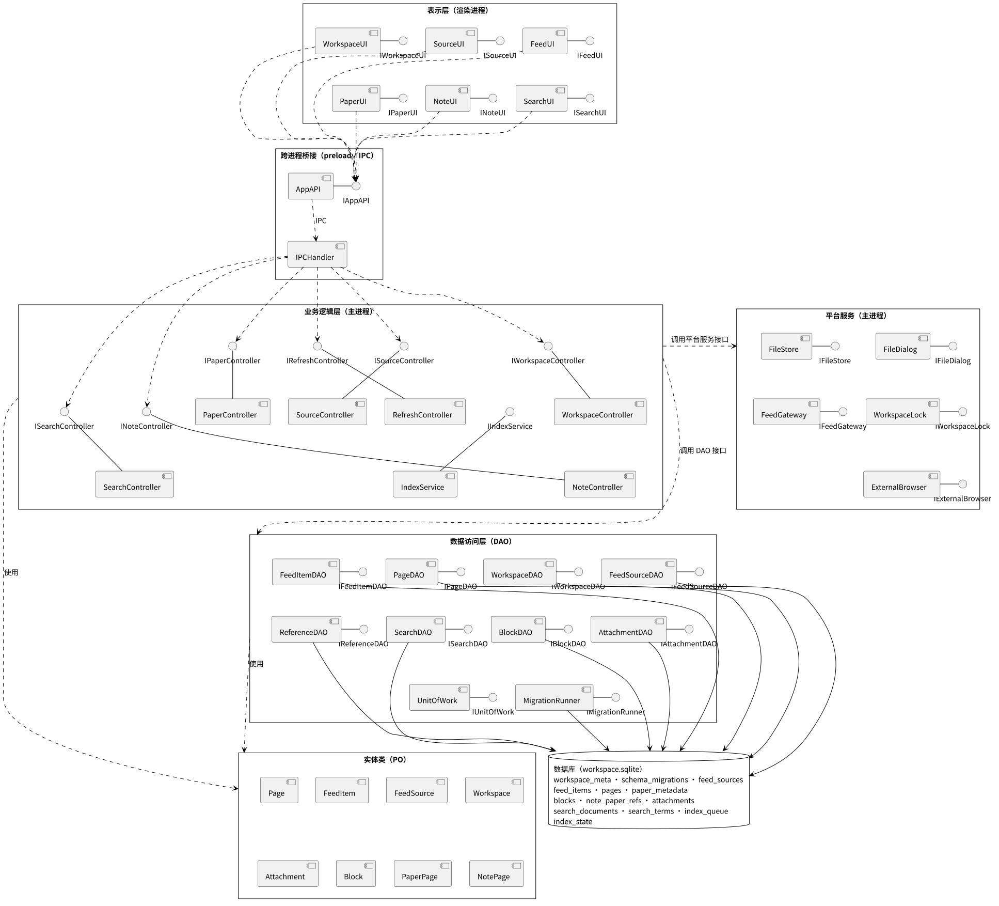

## 3. 数据设计

### 3.1 实体类设计（PO，纯数据载体）

#### 3.1.1 Workspace（工作区）

| 属性 | 类型 | 说明 |
| --- | --- | --- |
| id | UUID | 工作区稳定标识 |
| name | String | 工作区名称 |
| rootPath | String | 当前打开目录的规范化路径；运行时属性，由会话维护 |
| schemaVersion | Integer | 数据库结构版本 |
| createdAt | Timestamp | 创建时间 |

**业务方法（非持久化）：**
- `rename(name: String): void` — 修改工作区名称
- `getName(): String`

#### 3.1.2 FeedSource（订阅源）

| 属性 | 类型 | 说明 |
| --- | --- | --- |
| id | UUID | 订阅源标识 |
| name | String | 来源名称 |
| url | String | 规范化订阅地址 |
| lastRefreshedAt | Timestamp | 最近一次成功刷新时间，可为空 |
| status | String | 状态：NORMAL / REFRESHING / FETCH_FAILED；运行时属性，由会话维护 |

**业务方法：**
- `rename(name: String): void` — 修改来源名称
- `changeUrl(url: String): void` — 修改订阅地址
- `recordRefresh(time: Timestamp): void` — 记录成功刷新时间
- `getStatus(): String` / `setStatus(status: String): void`

#### 3.1.3 FeedItem（订阅条目）

| 属性 | 类型 | 说明 |
| --- | --- | --- |
| id | UUID | 条目标识 |
| sourceId | UUID | 所属订阅源标识，来源移除后为空 |
| sourceName | String | 首次保存时的来源名称快照 |
| title | String | 条目标题 |
| url | String | 规范化原文链接，工作区内唯一 |
| summary | String | 条目摘要 |
| publishedAt | Timestamp | 来源提供的发布时间，可为空 |
| fetchedAt | Timestamp | 首次获取时间 |
| isRead | Boolean | 已读状态 |

**业务方法：**
- `markRead(): void` — 将已读状态设为 true
- `isRead(): Boolean`

#### 3.1.4 Page（页面，抽象类）

| 属性 | 类型 | 说明 |
| --- | --- | --- |
| id | UUID | 页面标识 |
| kind | String | 页面类型：note / paper |
| title | String | 页面标题 |
| createdAt | Timestamp | 创建时间 |
| updatedAt | Timestamp | 最近保存时间 |
| version | Integer | 持久化版本号，从 1 开始，每次保存加 1 |

**业务方法：**
- `rename(title: String): void` — 修改页面标题
- `getKind(): String`
- `getVersion(): Integer`

#### 3.1.5 NotePage（笔记页，继承 Page）

| 属性 | 类型 | 说明 |
| --- | --- | --- |
| blocks | `List<Block>` | 页内有序内容块 |
| paperIds | `List<UUID>` | 引用的文献页标识集合 |
| saveStatus | String | 保存状态：EDITING / SAVING / SAVED / SAVE_FAILED；运行时属性，由 NoteUI 维护 |

**业务方法：**
- `applyContent(blocks: List<Block>, paperIds: List<UUID>): void` — 按 order 整理内容块并设置文献引用集合
- `getBlocks(): List<Block>`
- `getPaperIds(): List<UUID>`
- `getSaveStatus(): String` / `setSaveStatus(status: String): void`

#### 3.1.6 PaperPage（文献页，继承 Page）

| 属性 | 类型 | 说明 |
| --- | --- | --- |
| authors | String | 作者，可为空字符串 |
| doi | String | DOI，可为空字符串 |
| attachmentId | UUID | PDF 附件标识 |

**业务方法：**
- `bindAttachment(attachmentId: UUID): void` — 建立文献与附件的关联
- `getAttachmentId(): UUID`

#### 3.1.7 Block（内容块）

| 属性 | 类型 | 说明 |
| --- | --- | --- |
| id | UUID | 内容块标识 |
| pageId | UUID | 所属笔记页标识 |
| order | Integer | 页内顺序，从 0 开始连续排列 |
| type | String | 块类型：paragraph / heading / list |
| content | JSON | 文本、格式及行内文献链接 |

**业务方法：**
- `changeContent(type: String, content: JSON): void` — 更新块类型和内容
- `moveTo(order: Integer): void` — 调整页内顺序

#### 3.1.8 Attachment（附件）

| 属性 | 类型 | 说明 |
| --- | --- | --- |
| id | UUID | 附件标识 |
| paperId | UUID | 所属文献页标识 |
| relativePath | String | `工作区内相对路径 attachments/<attachmentId>.pdf` |
| originalName | String | 导入时的文件名 |
| size | Integer | 文件字节数 |
| mediaType | String | 媒体类型 application/pdf |

**业务方法：**
- `getRelativePath(): String`
- `getSize(): Integer`

### 3.2 数据库表设计

#### 3.2.1 workspace_meta 表（工作区元数据表）

| 字段 | 类型 | 约束 | 说明 |
| --- | --- | --- | --- |
| singleton | INTEGER | PK；CHECK (singleton = 1) | 单行标记 |
| id | TEXT | NOT NULL；UNIQUE | 工作区标识 |
| name | TEXT | NOT NULL | 工作区名称 |
| created_at | INTEGER | NOT NULL | 创建时间（UTC 毫秒） |

#### 3.2.2 schema_migrations 表（结构版本表）

| 字段 | 类型 | 约束 | 说明 |
| --- | --- | --- | --- |
| version | INTEGER | PK | 已完成迁移的结构版本 |
| checksum | TEXT | NOT NULL | 迁移脚本校验值 |
| applied_at | INTEGER | NOT NULL | 迁移完成时间 |

#### 3.2.3 feed_sources 表（订阅源表）

| 字段 | 类型 | 约束 | 说明 |
| --- | --- | --- | --- |
| id | TEXT | PK | 订阅源标识 |
| name | TEXT | NOT NULL | 来源名称 |
| url | TEXT | NOT NULL；UNIQUE | 规范化订阅地址 |
| last_refreshed_at | INTEGER | — | 最近成功刷新时间，可为空 |

#### 3.2.4 feed_items 表（订阅条目表）

| 字段 | 类型 | 约束 | 说明 |
| --- | --- | --- | --- |
| id | TEXT | PK | 条目标识 |
| source_id | TEXT | FK → feed_sources.id，ON DELETE SET NULL；INDEX | 所属订阅源，可为空 |
| source_name | TEXT | NOT NULL | 来源名称快照 |
| title | TEXT | NOT NULL | 条目标题 |
| url | TEXT | NOT NULL；UNIQUE | 规范化原文链接 |
| summary | TEXT | NOT NULL DEFAULT '' | 摘要 |
| published_at | INTEGER | INDEX (coalesce(published_at, fetched_at) DESC, id) | 发布时间，可为空 |
| fetched_at | INTEGER | NOT NULL | 首次获取时间 |
| is_read | INTEGER | NOT NULL DEFAULT 0；CHECK (0, 1) | 已读状态 |

#### 3.2.5 pages 表（页面表）

| 字段 | 类型 | 约束 | 说明 |
| --- | --- | --- | --- |
| id | TEXT | PK | 页面标识 |
| kind | TEXT | NOT NULL；CHECK (note, paper)；INDEX (kind, updated_at DESC, id) | 页面类型 |
| title | TEXT | NOT NULL | 页面标题 |
| created_at | INTEGER | NOT NULL | 创建时间 |
| updated_at | INTEGER | NOT NULL | 最近保存时间 |
| version | INTEGER | NOT NULL DEFAULT 1 | 乐观锁版本号 |

#### 3.2.6 paper_metadata 表（文献元数据表）

| 字段 | 类型 | 约束 | 说明 |
| --- | --- | --- | --- |
| page_id | TEXT | PK；FK → pages.id | 文献页标识 |
| authors | TEXT | NOT NULL DEFAULT '' | 作者 |
| doi | TEXT | NOT NULL DEFAULT '' | DOI |

#### 3.2.7 blocks 表（内容块表）

| 字段 | 类型 | 约束 | 说明 |
| --- | --- | --- | --- |
| id | TEXT | PK | 内容块标识 |
| page_id | TEXT | NOT NULL；FK → pages.id | 所属笔记页 |
| position | INTEGER | NOT NULL；CHECK (position >= 0)；UNIQUE (page_id, position) | 页内顺序 |
| type | TEXT | NOT NULL；CHECK (paragraph, heading, list) | 块类型 |
| content_json | TEXT | NOT NULL | 块内容 JSON |

#### 3.2.8 note_paper_refs 表（笔记文献引用表）

| 字段 | 类型 | 约束 | 说明 |
| --- | --- | --- | --- |
| note_id | TEXT | PK (note_id, paper_id)；FK → pages.id | 笔记页标识 |
| paper_id | TEXT | FK → pages.id；INDEX (paper_id, note_id) | 文献页标识 |

#### 3.2.9 attachments 表（附件表）

| 字段 | 类型 | 约束 | 说明 |
| --- | --- | --- | --- |
| id | TEXT | PK | 附件标识 |
| paper_id | TEXT | NOT NULL；UNIQUE；FK → pages.id | 所属文献页 |
| relative_path | TEXT | NOT NULL；UNIQUE | 受管相对路径 |
| original_name | TEXT | NOT NULL | 导入时文件名 |
| size | INTEGER | NOT NULL；CHECK (size >= 0) | 文件字节数 |
| media_type | TEXT | NOT NULL DEFAULT 'application/pdf' | 媒体类型 |

#### 3.2.10 search_documents 表（检索文档表）

| 字段 | 类型 | 约束 | 说明 |
| --- | --- | --- | --- |
| kind | TEXT | PK (kind, target_id)；CHECK (note, paper, feed) | 资料类型 |
| target_id | TEXT | NOT NULL | 资料标识 |
| title | TEXT | NOT NULL | 显示标题 |
| search_text | TEXT | NOT NULL | 规范化后的检索文本 |
| updated_at | INTEGER | NOT NULL | 索引更新时间 |

#### 3.2.11 search_terms 表（检索词项表）

| 字段 | 类型 | 约束 | 说明 |
| --- | --- | --- | --- |
| term | TEXT | PK (term, kind, target_id) | 词项 |
| kind | TEXT | FK (kind, target_id) → search_documents，ON DELETE CASCADE | 资料类型 |
| target_id | TEXT | NOT NULL | 资料标识 |

#### 3.2.12 index_queue 表（索引任务表）

| 字段 | 类型 | 约束 | 说明 |
| --- | --- | --- | --- |
| kind | TEXT | PK (kind, target_id)；CHECK (note, paper, feed) | 资料类型 |
| target_id | TEXT | NOT NULL | 资料标识 |
| revision | INTEGER | NOT NULL | 任务版本，同一目标保留最新值 |

#### 3.2.13 index_state 表（索引状态表）

| 字段 | 类型 | 约束 | 说明 |
| --- | --- | --- | --- |
| singleton | INTEGER | PK；CHECK (singleton = 1) | 单行标记 |
| status | TEXT | NOT NULL；CHECK (BUILDING, READY, FAILED) | 索引状态 |
| generation | INTEGER | NOT NULL DEFAULT 0 | 已完成构建次数 |
| error_code | TEXT | — | 最近一次失败原因，可为空 |

### 3.3 实体类与数据库表的映射关系

| 实体类 | 数据库表 | 映射要点 |
| --- | --- | --- |
| Workspace | workspace_meta、schema_migrations | id ↔ id（UNIQUE）；<br>createdAt ↔ created_at（UTC 毫秒）；<br>schemaVersion ↔ MAX(schema_migrations.version)；<br>rootPath 不持久化，由会话维护 |
| FeedSource | feed_sources | id ↔ id（PK）；<br>url ↔ url（UNIQUE）；<br>lastRefreshedAt ↔ last_refreshed_at；<br>status 不持久化，由会话维护 |
| FeedItem | feed_items | id ↔ id（PK）；<br>sourceId ↔ source_id（FK，可为空）；<br>sourceName ↔ source_name；<br>isRead ↔ is_read（0 / 1） |
| Page | pages | id ↔ id（PK）；<br>kind ↔ kind（note / paper）；<br>version ↔ version（乐观锁） |
| NotePage | pages、blocks、note_paper_refs | kind = note；<br>blocks ↔ blocks（按 position 排序）；<br>paperIds ↔ note_paper_refs.paper_id；<br>saveStatus 不持久化 |
| PaperPage | pages、paper_metadata、attachments | kind = paper；<br>authors、doi ↔ paper_metadata；<br>attachmentId ↔ attachments.id（按 paper_id 关联） |
| Block | blocks | id ↔ id（PK）；<br>pageId ↔ page_id（FK）；<br>order ↔ position；<br>content ↔ content_json（JSON 文本） |
| Attachment | attachments | id ↔ id（PK）；<br>paperId ↔ paper_id（FK，UNIQUE）；<br>relativePath ↔ relative_path（UNIQUE） |

### 3.4 DAO 与表映射关系

| DAO 构件 | 对应表 | 主要 SQL 操作 |
| --- | --- | --- |
| WorkspaceDAO | workspace_meta / schema_migrations | INSERT / SELECT |
| FeedSourceDAO | feed_sources | INSERT / UPDATE / DELETE / SELECT |
| FeedItemDAO | feed_items | INSERT / UPDATE / SELECT |
| PageDAO | pages / paper_metadata | INSERT / UPDATE / SELECT |
| BlockDAO | blocks | INSERT / DELETE / SELECT |
| AttachmentDAO | attachments | INSERT / SELECT |
| ReferenceDAO | note_paper_refs | INSERT / DELETE / SELECT |
| SearchDAO | search_documents / search_terms / index_queue / index_state | INSERT / UPDATE / DELETE / SELECT |
| MigrationRunner | schema_migrations | CREATE / ALTER / INSERT |

### 3.5 数据设计类图

（1）工作区与订阅

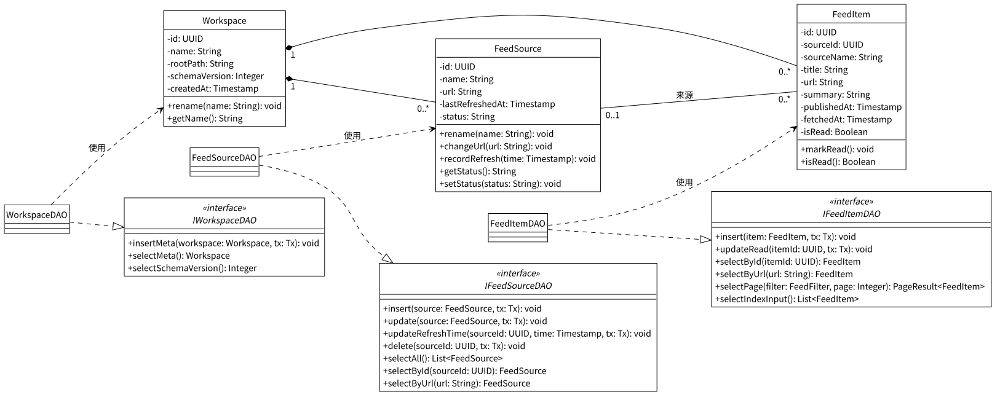

（2）页面、内容块与附件

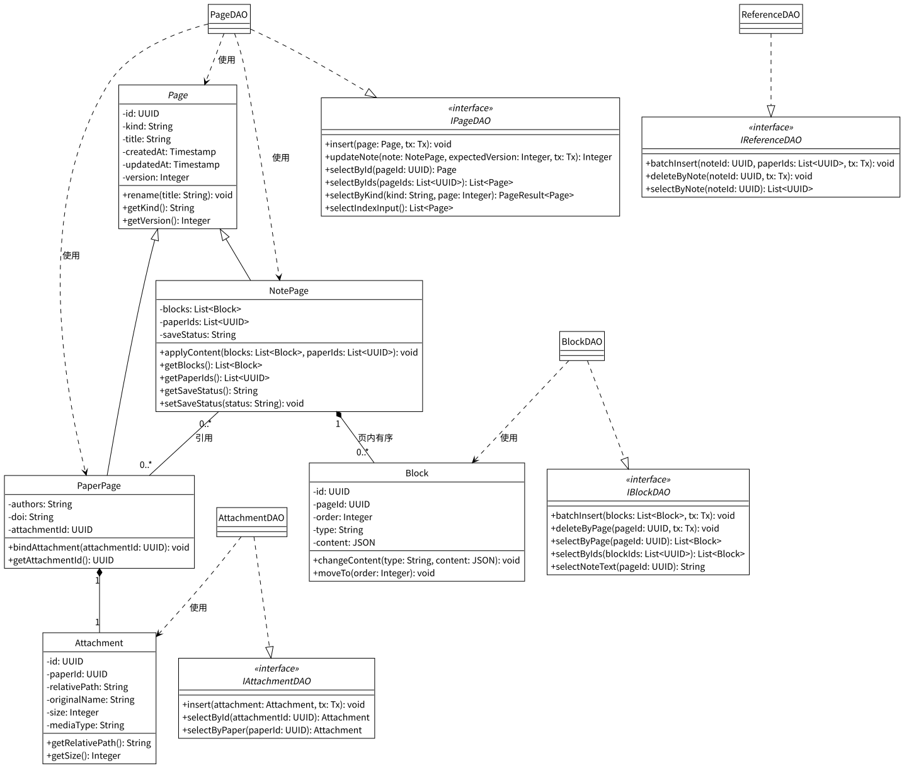

（3）检索索引

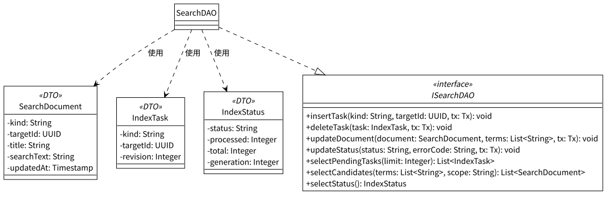

## 4. 接口设计

### 4.1 边界类接口

#### 4.1.1 IWorkspaceUI

- `createWorkspace(name: String): Result<WorkspaceSession>`
- `openWorkspace(): Result<WorkspaceSession>`
- `closeWorkspace(): Result<Void>`

#### 4.1.2 ISourceUI

- `querySources(): List<FeedSource>`
- `addSource(name: String, url: String): Result<FeedSource>`
- `editSource(sourceId: UUID, name: String, url: String): Result<FeedSource>`
- `removeSource(sourceId: UUID): Result<Void>`

#### 4.1.3 IFeedUI

- `refreshFeed(sourceId: UUID): Result<RefreshSummary>`
- `queryItems(filter: FeedFilter, page: Integer): PageResult<FeedItem>`
- `openItem(itemId: UUID): Result<FeedItem>`
- `openOriginal(itemId: UUID): Result<Void>`

#### 4.1.4 IPaperUI

- `importPDF(): Result<PaperPage>`
- `queryPapers(page: Integer): PageResult<PaperPage>`
- `openPaper(paperId: UUID): Result<PDFResource>`
- `turnPage(pageNo: Integer): void`
- `zoom(scale: Float): void`
- `findText(keyword: String): Integer`
- `cancelFind(): void`

#### 4.1.5 INoteUI

- `createNote(title: String): Result<NoteSnapshot>`
- `queryNotes(page: Integer): PageResult<NotePage>`
- `openNote(noteId: UUID): Result<NoteSnapshot>`
- `editNote(title: String, blocks: List<Block>): void`
- `insertPaperLink(paperId: UUID): void`
- `retrySave(): Result<SaveReceipt>`

#### 4.1.6 ISearchUI

- `submitSearch(keyword: String, scope: String): PageResult<SearchHit>`
- `changePage(page: Integer): PageResult<SearchHit>`
- `openResult(hit: SearchHit): void`

#### 4.1.7 IAppAPI（window.labloom）

- `workspace.create(name: String): Result<WorkspaceSession>`
- `workspace.open(): Result<WorkspaceSession>`
- `workspace.close(sessionId: String): Result<Void>`
- `sources.list(sessionId: String): Result<List<FeedSource>>`
- `sources.add(sessionId: String, input: SourceInput): Result<FeedSource>`
- `sources.update(sessionId: String, sourceId: UUID, input: SourceInput): Result<FeedSource>`
- `sources.remove(sessionId: String, sourceId: UUID): Result<Void>`
- `feed.refresh(sessionId: String, sourceId: UUID): Result<RefreshSummary>`
- `feed.list(sessionId: String, filter: FeedFilter, page: Integer): Result<PageResult<FeedItem>>`
- `feed.read(sessionId: String, itemId: UUID): Result<FeedItem>`
- `feed.openOriginal(sessionId: String, itemId: UUID): Result<Void>`
- `papers.importPDF(sessionId: String): Result<PaperPage>`
- `papers.list(sessionId: String, page: Integer): Result<PageResult<PaperPage>>`
- `papers.readPDF(sessionId: String, paperId: UUID): Result<PDFResource>`
- `notes.create(sessionId: String, title: String): Result<NoteSnapshot>`
- `notes.list(sessionId: String, page: Integer): Result<PageResult<NotePage>>`
- `notes.load(sessionId: String, noteId: UUID): Result<NoteSnapshot>`
- `notes.save(sessionId: String, input: NoteSaveInput): Result<SaveReceipt>`
- `search.status(sessionId: String): Result<IndexStatus>`
- `search.rebuild(sessionId: String): Result<IndexStatus>`
- `search.query(sessionId: String, input: SearchInput): Result<PageResult<SearchHit>>`

### 4.2 控制类接口

#### 4.2.1 IWorkspaceController

- `createWorkspace(name: String): Result<WorkspaceSession>`
- `openWorkspace(): Result<WorkspaceSession>`
- `closeWorkspace(): Result<Void>`

#### 4.2.2 ISourceController

- `listSources(): Result<List<FeedSource>>`
- `addSource(input: SourceInput): Result<FeedSource>`
- `updateSource(sourceId: UUID, input: SourceInput): Result<FeedSource>`
- `removeSource(sourceId: UUID): Result<Void>`

#### 4.2.3 IRefreshController

- `refresh(sourceId: UUID): Result<RefreshSummary>`
- `listItems(filter: FeedFilter, page: Integer): Result<PageResult<FeedItem>>`
- `readItem(itemId: UUID): Result<FeedItem>`
- `openOriginal(itemId: UUID): Result<Void>`

#### 4.2.4 IPaperController

- `importPDF(): Result<PaperPage>`
- `listPapers(page: Integer): Result<PageResult<PaperPage>>`
- `readPDF(paperId: UUID): Result<PDFResource>`

#### 4.2.5 INoteController

- `createNote(title: String): Result<NoteSnapshot>`
- `listNotes(page: Integer): Result<PageResult<NotePage>>`
- `loadNote(noteId: UUID): Result<NoteSnapshot>`
- `saveNote(input: NoteSaveInput): Result<SaveReceipt>`

#### 4.2.6 ISearchController

- `getIndexStatus(): Result<IndexStatus>`
- `rebuildIndex(): Result<IndexStatus>`
- `search(input: SearchInput): Result<PageResult<SearchHit>>`

#### 4.2.7 IIndexService

- `start(): void`
- `stop(): void`
- `getStatus(): IndexStatus`
- `rebuild(): void`
- `processQueue(): Integer`
- `tokenize(text: String): List<String>`
#### 4.2.8 平台服务接口

- **IFileDialog：**
  - `chooseDirectory(mode: String): Result<String>`
  - `choosePDF(): Result<String>`
- **IFileStore：**
  - `checkDirectory(path: String, mode: String): Result<String>`
  - `initLayout(rootPath: String): void`
  - `removeLayout(rootPath: String): void`
  - `backupDatabase(dbPath: String): String`
  - `checkPDF(path: String): Result<Integer>`
  - `prepareImport(path: String, attachmentId: UUID): ImportTicket`
  - `publishImport(ticket: ImportTicket): String`
  - `finishImport(ticket: ImportTicket): void`
  - `rollbackImport(ticket: ImportTicket): Boolean`
  - `listPendingImports(): List<ImportTicket>`
  - `readAttachment(relativePath: String): Byte[]`
- **IWorkspaceLock：**
  - `acquire(rootPath: String): Result<String>`
  - `release(lockHandle: String): void`
- **IFeedGateway：**
  - `fetchAndParse(url: String, timeoutMs: Integer): Result<ParsedFeed>`
- **IExternalBrowser：**
  - `open(url: String): Result<Void>`

### 4.3 DAO 接口

#### 4.3.1 IWorkspaceDAO

- `insertMeta(workspace: Workspace, tx: Tx): void`
- `selectMeta(): Workspace`
- `selectSchemaVersion(): Integer`

#### 4.3.2 IFeedSourceDAO

- `insert(source: FeedSource, tx: Tx): void`
- `update(source: FeedSource, tx: Tx): void`
- `updateRefreshTime(sourceId: UUID, time: Timestamp, tx: Tx): void`
- `delete(sourceId: UUID, tx: Tx): void`
- `selectAll(): List<FeedSource>`
- `selectById(sourceId: UUID): FeedSource`
- `selectByUrl(url: String): FeedSource`

#### 4.3.3 IFeedItemDAO

- `insert(item: FeedItem, tx: Tx): void`
- `updateRead(itemId: UUID, tx: Tx): void`
- `selectById(itemId: UUID): FeedItem`
- `selectByUrl(url: String): FeedItem`
- `selectPage(filter: FeedFilter, page: Integer): PageResult<FeedItem>`
- `selectIndexInput(): List<FeedItem>`

#### 4.3.4 IPageDAO

- `insert(page: Page, tx: Tx): void`
- `updateNote(note: NotePage, expectedVersion: Integer, tx: Tx): Integer`
- `selectById(pageId: UUID): Page`
- `selectByIds(pageIds: List<UUID>): List<Page>`
- `selectByKind(kind: String, page: Integer): PageResult<Page>`
- `selectIndexInput(): List<Page>`

#### 4.3.5 IBlockDAO

- `batchInsert(blocks: List<Block>, tx: Tx): void`
- `deleteByPage(pageId: UUID, tx: Tx): void`
- `selectByPage(pageId: UUID): List<Block>`
- `selectByIds(blockIds: List<UUID>): List<Block>`
- `selectNoteText(pageId: UUID): String`

#### 4.3.6 IAttachmentDAO

- `insert(attachment: Attachment, tx: Tx): void`
- `selectById(attachmentId: UUID): Attachment`
- `selectByPaper(paperId: UUID): Attachment`

#### 4.3.7 IReferenceDAO

- `batchInsert(noteId: UUID, paperIds: List<UUID>, tx: Tx): void`
- `deleteByNote(noteId: UUID, tx: Tx): void`
- `selectByNote(noteId: UUID): List<UUID>`

#### 4.3.8 ISearchDAO

- `insertTask(kind: String, targetId: UUID, tx: Tx): void`
- `deleteTask(task: IndexTask, tx: Tx): void`
- `updateDocument(document: SearchDocument, terms: List<String>, tx: Tx): void`
- `updateStatus(status: String, errorCode: String, tx: Tx): void`
- `selectPendingTasks(limit: Integer): List<IndexTask>`
- `selectCandidates(terms: List<String>, scope: String): List<SearchDocument>`
- `selectStatus(): IndexStatus`

#### 4.3.9 IUnitOfWork

- `open(dbPath: String): void`
- `begin(): Tx`
- `commit(tx: Tx): void`
- `rollback(tx: Tx): void`
- `close(): void`

#### 4.3.10 IMigrationRunner

- `migrate(fromVersion: Integer): Result<Integer>`

### 4.4 实体类接口

- **IWorkspace：**
  - `rename(name: String): void`
  - `getName(): String`
- **IFeedSource：**
  - `rename(name: String): void`
  - `changeUrl(url: String): void`
  - `recordRefresh(time: Timestamp): void`
  - `getStatus(): String`
  - `setStatus(status: String): void`
- **IFeedItem：**
  - `markRead(): void`
  - `isRead(): Boolean`
- **IPage：**
  - `rename(title: String): void`
  - `getKind(): String`
  - `getVersion(): Integer`
- **INotePage：**
  - `applyContent(blocks: List<Block>, paperIds: List<UUID>): void`
  - `getBlocks(): List<Block>`
  - `getPaperIds(): List<UUID>`
  - `getSaveStatus(): String`
  - `setSaveStatus(status: String): void`
- **IPaperPage：**
  - `bindAttachment(attachmentId: UUID): void`
  - `getAttachmentId(): UUID`
- **IBlock：**
  - `changeContent(type: String, content: JSON): void`
  - `moveTo(order: Integer): void`
- **IAttachment：**
  - `getRelativePath(): String`
  - `getSize(): Integer`

### 4.5 接口交互顺序图

#### 4.5.1 UC01 创建或打开工作区顺序图

（1）创建工作区


（2）打开工作区


#### 4.5.2 UC02 管理订阅源顺序图

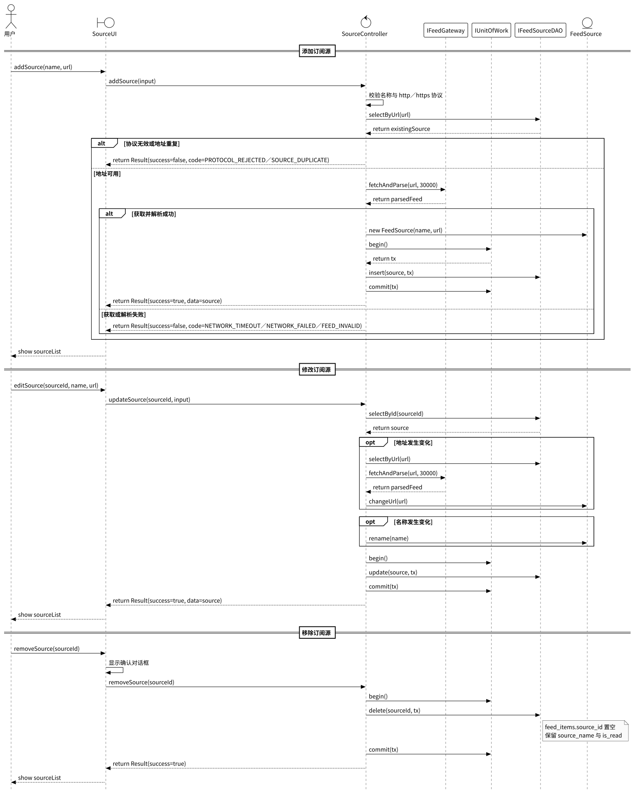

#### 4.5.3 UC03 刷新与阅读订阅顺序图


#### 4.5.4 UC04 导入与阅读 PDF 顺序图


#### 4.5.5 UC05 编辑与保存笔记顺序图


#### 4.5.6 UC06 检索资料顺序图


## 5. 构件级设计

### 5.1 构件列表

| 构件名 | 类型 | 实现接口 | 依赖接口 |
| --- | --- | --- | --- |
| WorkspaceUI | 边界类 | IWorkspaceUI | IWorkspaceController（经 AppAPI） |
| SourceUI | 边界类 | ISourceUI | ISourceController（经 AppAPI） |
| FeedUI | 边界类 | IFeedUI | IRefreshController（经 AppAPI） |
| PaperUI | 边界类 | IPaperUI | IPaperController（经 AppAPI） |
| NoteUI | 边界类 | INoteUI | INoteController（经 AppAPI）、IPaperController（经 AppAPI） |
| SearchUI | 边界类 | ISearchUI | ISearchController（经 AppAPI）、INoteUI、IPaperUI、IFeedUI |
| AppAPI | 桥接类 | IAppAPI | IPC 通道 |
| IPCHandler | 桥接类 | IPC 通道 | IWorkspaceController、ISourceController、IRefreshController、IPaperController、INoteController、ISearchController |
| WorkspaceController | 控制类 | IWorkspaceController | IFileDialog、IFileStore、IWorkspaceLock、IUnitOfWork、IMigrationRunner、IWorkspaceDAO、IAttachmentDAO、IIndexService |
| SourceController | 控制类 | ISourceController | IFeedGateway、IUnitOfWork、IFeedSourceDAO |
| RefreshController | 控制类 | IRefreshController | IFeedGateway、IExternalBrowser、IUnitOfWork、IFeedSourceDAO、IFeedItemDAO、ISearchDAO |
| PaperController | 控制类 | IPaperController | IFileDialog、IFileStore、IUnitOfWork、IPageDAO、IAttachmentDAO、ISearchDAO |
| NoteController | 控制类 | INoteController | IUnitOfWork、IPageDAO、IBlockDAO、IReferenceDAO、ISearchDAO |
| SearchController | 控制类 | ISearchController | IIndexService、ISearchDAO |
| IndexService | 服务类 | IIndexService | IUnitOfWork、ISearchDAO、IPageDAO、IBlockDAO、IFeedItemDAO |
| FileDialog | 平台服务类 | IFileDialog | 操作系统文件选择窗口 |
| FileStore | 平台服务类 | IFileStore | 工作区目录、应用数据目录 |
| WorkspaceLock | 平台服务类 | IWorkspaceLock | 工作区锁文件 |
| FeedGateway | 平台服务类 | IFeedGateway | HTTP 客户端、RSS／Atom 解析器 |
| ExternalBrowser | 平台服务类 | IExternalBrowser | 系统默认浏览器 |
| WorkspaceDAO | DAO 类 | IWorkspaceDAO | Workspace（PO，使用） |
| FeedSourceDAO | DAO 类 | IFeedSourceDAO | FeedSource（PO，使用） |
| FeedItemDAO | DAO 类 | IFeedItemDAO | FeedItem（PO，使用） |
| PageDAO | DAO 类 | IPageDAO | Page、NotePage、PaperPage（PO，使用） |
| BlockDAO | DAO 类 | IBlockDAO | Block（PO，使用） |
| AttachmentDAO | DAO 类 | IAttachmentDAO | Attachment（PO，使用） |
| ReferenceDAO | DAO 类 | IReferenceDAO | — |
| SearchDAO | DAO 类 | ISearchDAO | SearchDocument、IndexTask（DTO，使用） |
| UnitOfWork | 数据访问支撑类 | IUnitOfWork | SQLite 连接 |
| MigrationRunner | 数据访问支撑类 | IMigrationRunner | IUnitOfWork、IFileStore |
| Workspace | 实体类 | IWorkspace | — |
| FeedSource | 实体类 | IFeedSource | — |
| FeedItem | 实体类 | IFeedItem | — |
| Page | 实体类 | IPage | — |
| NotePage | 实体类 | INotePage | — |
| PaperPage | 实体类 | IPaperPage | — |
| Block | 实体类 | IBlock | — |
| Attachment | 实体类 | IAttachment | — |

### 5.2 构件级类图

（1）UC01 创建或打开工作区

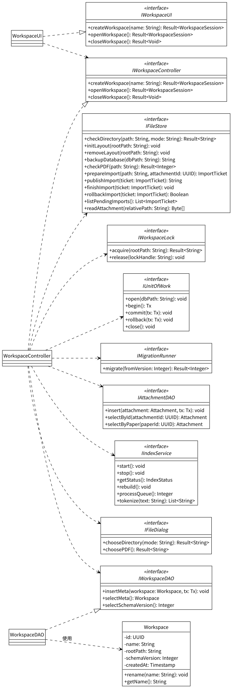

（2）UC02 管理订阅源、UC03 刷新与阅读订阅

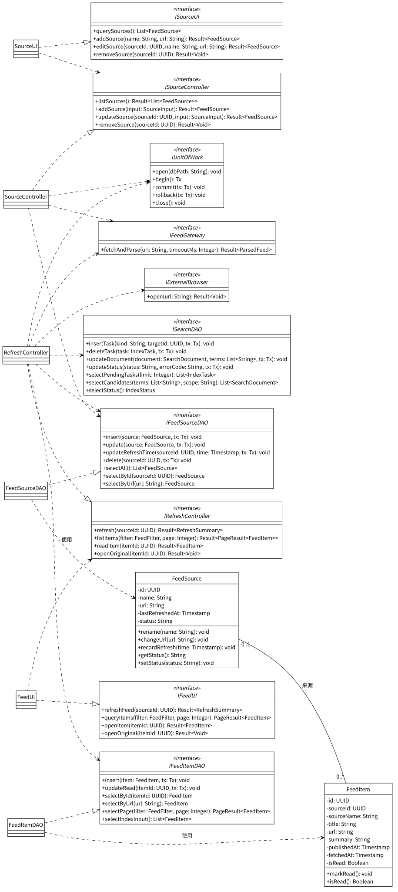

（3）UC04 导入与阅读 PDF

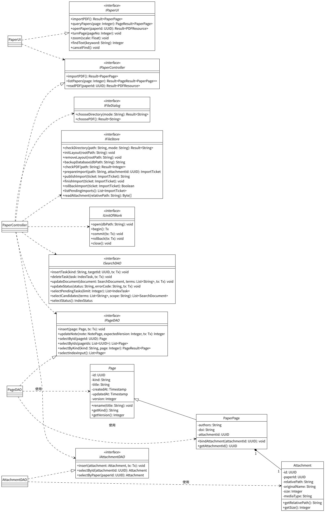

（4）UC05 编辑与保存笔记

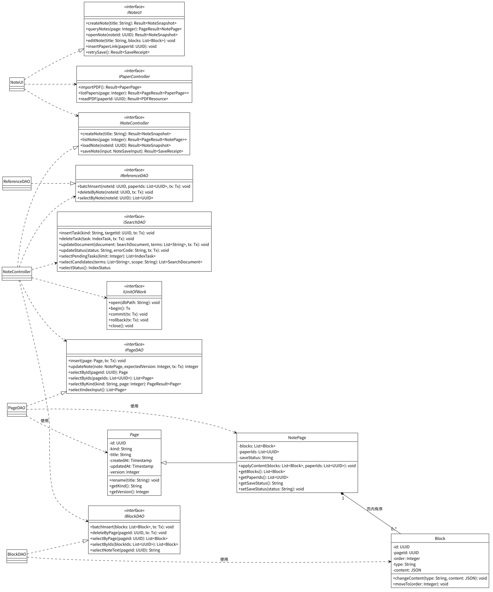

（5）UC06 检索资料

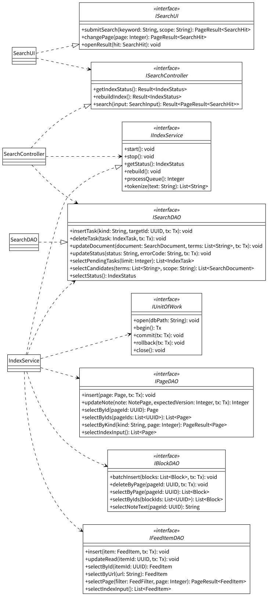

### 5.3 关键构件详细设计

#### 5.3.1 WorkspaceController.createWorkspace

**输入**：name

**输出**：Result（success, code, msg, data=WorkspaceSession）

**流程**：

1. 调用 IFileDialog.chooseDirectory("create") 选择目录；用户取消时返回 Result(success=false, code=CANCELLED)。
2. 调用 IFileStore.checkDirectory(path, "create") 规范化路径并检查目录可写；目录无效时返回 Result(success=false, code=INVALID_ARGUMENT)。
3. 调用 IWorkspaceLock.acquire(rootPath) 取得目录锁；目录已被其他实例打开时返回 Result(success=false, code=WORKSPACE_BUSY)。
4. 调用 IFileStore.initLayout(rootPath) 建立 attachments 和 .imports 目录。
5. 调用 IUnitOfWork.open(dbPath) 创建数据库连接，调用 IMigrationRunner.migrate(0) 建立全部表结构。
6. 创建 Workspace 对象，调用 IUnitOfWork.begin() 开始事务，调用 IWorkspaceDAO.insertMeta(workspace, tx) 写入工作区元数据，调用 IUnitOfWork.commit(tx) 提交。
7. 若初始化成功：
    * 创建 sessionId，装配 DAO、控制类及 IndexService。
    * 调用 IIndexService.start() 启动索引服务。
    * 返回 Result(success=true, data=session)。
8. 若初始化失败：
    * 调用 IUnitOfWork.rollback(tx) 和 IUnitOfWork.close() 关闭本次连接。
    * 调用 IFileStore.removeLayout(rootPath) 清理本次创建的文件。
    * 调用 IWorkspaceLock.release(lockHandle) 释放目录锁。
    * 返回 Result(success=false, code=STORAGE_FAILED)。
9. 返回结果。

#### 5.3.2 WorkspaceController.openWorkspace

**输入**：无（目录由用户在选择窗口中指定）

**输出**：Result（success, code, msg, data=WorkspaceSession）

**流程**：

1. 调用 IFileDialog.chooseDirectory("open") 选择目录；用户取消时返回 Result(success=false, code=CANCELLED)。
2. 调用 IFileStore.checkDirectory(path, "open") 规范化路径并检查工作区结构；结构无效时返回 Result(success=false, code=WORKSPACE_INVALID)。
3. 调用 IWorkspaceLock.acquire(rootPath) 取得目录锁；目录已被其他实例打开时返回 Result(success=false, code=WORKSPACE_BUSY)。
4. 调用 IUnitOfWork.open(dbPath) 打开数据库，调用 IWorkspaceDAO.selectSchemaVersion() 读取结构版本。
5. 若结构版本低于当前版本：
    * 调用 IMigrationRunner.migrate(schemaVersion)；MigrationRunner 先调用 IFileStore.backupDatabase(dbPath) 在应用数据目录生成保护副本，再在事务中执行迁移并写入 schema_migrations。
    * 迁移失败时回滚迁移事务并保留保护副本。
6. 调用 IWorkspaceDAO.selectMeta() 读取 Workspace。
7. 调用 IFileStore.listPendingImports() 读取未完成的导入，对每条记录：
    * 调用 IAttachmentDAO.selectById(attachmentId) 查询附件记录。
    * 记录存在时调用 IFileStore.finishImport(ticket)，保留受管副本并删除恢复记录。
    * 记录缺失时调用 IFileStore.rollbackImport(ticket)，删除本次临时及已发布文件。
8. 若打开成功：
    * 创建 sessionId，装配 DAO、控制类及 IndexService。
    * 调用 IIndexService.start() 启动索引服务。
    * 返回 Result(success=true, data=session)。
9. 若迁移或读写失败：
    * 调用 IUnitOfWork.close() 关闭本次连接。
    * 调用 IWorkspaceLock.release(lockHandle) 释放目录锁。
    * 返回 Result(success=false, code=MIGRATION_FAILED／STORAGE_FAILED)。
10. 返回结果。

#### 5.3.3 WorkspaceController.closeWorkspace

**输入**：无

**输出**：Result（success, code, msg）

**流程**：

1. 调用 IIndexService.stop() 结束后台索引处理。
2. 调用 IUnitOfWork.close() 关闭数据库连接。
3. 调用 IWorkspaceLock.release(lockHandle) 释放目录锁，清除 sessionId。
4. 返回 Result(success=true)。

#### 5.3.4 SourceController.addSource

**输入**：input（name, url）

**输出**：Result（success, code, msg, data=FeedSource）

**流程**：

1. 校验 name 非空，解析 url 并校验 http／https 协议，生成规范化地址；协议无效时返回 Result(success=false, code=PROTOCOL_REJECTED)。
2. 调用 IFeedSourceDAO.selectByUrl(url) 查重；地址已存在时返回 Result(success=false, code=SOURCE_DUPLICATE)。
3. 调用 IFeedGateway.fetchAndParse(url, 30000) 联网校验订阅内容；请求总超时 30 秒，重定向后的每个地址均校验协议，内容须为 RSS 2.0 或 Atom 1.0。
4. 若获取并解析成功：
    * 创建 FeedSource 对象，状态为 NORMAL。
    * 调用 IUnitOfWork.begin()，调用 IFeedSourceDAO.insert(source, tx)，调用 IUnitOfWork.commit(tx)。
    * 提交失败时调用 IUnitOfWork.rollback(tx)，返回 Result(success=false, code=STORAGE_FAILED)。
    * 返回 Result(success=true, data=source)。
5. 若获取或解析失败：
    * 返回 Result(success=false, code=NETWORK_TIMEOUT／NETWORK_FAILED／FEED_INVALID)，界面保留输入。
6. 返回结果。

#### 5.3.5 SourceController.updateSource

**输入**：sourceId, input（name, url）

**输出**：Result（success, code, msg, data=FeedSource）

**流程**：

1. 调用 IFeedSourceDAO.selectById(sourceId) 读取来源；来源不存在时返回 Result(success=false, code=TARGET_NOT_FOUND)。
2. 若地址发生变化：
    * 校验 http／https 协议，调用 IFeedSourceDAO.selectByUrl(url) 查重。
    * 调用 IFeedGateway.fetchAndParse(url, 30000) 联网校验订阅内容。
    * 校验通过后调用 source.changeUrl(url)；校验失败时返回对应错误代码并保留输入。
3. 若名称发生变化，调用 source.rename(name)；仅修改名称时不访问网络。
4. 调用 IUnitOfWork.begin()，调用 IFeedSourceDAO.update(source, tx)，调用 IUnitOfWork.commit(tx)。
5. 返回 Result(success=true, data=source)。

#### 5.3.6 SourceController.removeSource

**输入**：sourceId

**输出**：Result（success, code, msg）

**流程**：

1. 调用 IUnitOfWork.begin() 开始事务。
2. 调用 IFeedSourceDAO.delete(sourceId, tx) 删除来源记录；feed_items.source_id 由外键规则置空，source_name 与 is_read 保持原值。
3. 调用 IUnitOfWork.commit(tx) 提交；失败时调用 IUnitOfWork.rollback(tx)，返回 Result(success=false, code=STORAGE_FAILED)。
4. 返回 Result(success=true)。

#### 5.3.7 RefreshController.refresh

**输入**：sourceId（为空时刷新全部来源）

**输出**：Result（success, code, msg, data=RefreshSummary）

**流程**：

1. sourceId 为空时调用 IFeedSourceDAO.selectAll()，否则调用 IFeedSourceDAO.selectById(sourceId)，取得待刷新的来源列表。
2. 对每个来源依次处理：
    * 调用 source.setStatus("REFRESHING")。
    * 调用 IFeedGateway.fetchAndParse(url, 30000) 获取并解析订阅内容；失败时调用 source.setStatus("FETCH_FAILED")，记录错误代码后处理下一来源。
    * 将相对原文链接按响应地址解析为绝对地址并校验 http／https 协议；无可用链接的条目计入 skipped。
    * 调用 IUnitOfWork.begin() 开始该来源的事务，调用 IFeedSourceDAO.selectById(sourceId) 核对来源仍存在。
    * 对每个候选条目调用 IFeedItemDAO.selectByUrl(url)：已存在时计入 duplicate；不存在时调用 IFeedItemDAO.insert(item, tx) 和 ISearchDAO.insertTask("feed", itemId, tx)，计入 added。
    * 调用 source.recordRefresh(now) 和 IFeedSourceDAO.updateRefreshTime(sourceId, now, tx)，调用 IUnitOfWork.commit(tx)，再调用 source.setStatus("NORMAL")。
    * 写入失败时调用 IUnitOfWork.rollback(tx) 和 source.setStatus("FETCH_FAILED")，记录错误代码。
3. 返回 Result(success=true, data=summary)。

#### 5.3.8 RefreshController.readItem

**输入**：itemId

**输出**：Result（success, code, msg, data=FeedItem）

**流程**：

1. 调用 IFeedItemDAO.selectById(itemId) 读取条目；条目不存在时返回 Result(success=false, code=TARGET_NOT_FOUND)。
2. 若条目未读：
    * 调用 item.markRead()。
    * 调用 IUnitOfWork.begin()，调用 IFeedItemDAO.updateRead(itemId, tx)，调用 IUnitOfWork.commit(tx)。
3. 返回 Result(success=true, data=item)，界面显示标题、来源和摘要。

#### 5.3.9 RefreshController.openOriginal

**输入**：itemId

**输出**：Result（success, code, msg）

**流程**：

1. 调用 IFeedItemDAO.selectById(itemId) 读取条目原文链接。
2. 若链接为 http／https：
    * 调用 IExternalBrowser.open(url) 在系统默认浏览器中打开原文。
    * 返回 Result(success=true)。
3. 若链接为其他协议：
    * 返回 Result(success=false, code=PROTOCOL_REJECTED)。
4. 返回结果。

#### 5.3.10 PaperController.importPDF

**输入**：无（文件由用户在选择窗口中指定）

**输出**：Result（success, code, msg, data=PaperPage）

**流程**：

1. 调用 IFileDialog.choosePDF() 选择文件；用户取消时返回 Result(success=false, code=CANCELLED)。
2. 调用 IFileStore.checkPDF(path) 检查可读性、PDF 结构和磁盘空间；失败时返回 Result(success=false, code=PDF_INVALID／FILE_UNAVAILABLE／DISK_FULL)。加密 PDF 正常导入，阅读时输入密码。
3. 创建 PaperPage 对象（标题取文件名）和 Attachment 对象，调用 paper.bindAttachment(attachmentId)。
4. 调用 IFileStore.prepareImport(path, attachmentId) 在 .imports 中写入恢复记录并复制临时文件，校验字节数；调用 IFileStore.publishImport(ticket) 以同盘重命名发布到 `attachments/<attachmentId>.pdf`。
5. 调用 IUnitOfWork.begin()，依次调用 IPageDAO.insert(paper, tx)、IAttachmentDAO.insert(attachment, tx)、ISearchDAO.insertTask("paper", paperId, tx)，调用 IUnitOfWork.commit(tx)。
6. 若提交成功：
    * 调用 IFileStore.finishImport(ticket) 删除恢复记录。
    * 返回 Result(success=true, data=paper)。
7. 若文件或数据库操作失败：
    * 调用 IUnitOfWork.rollback(tx)。
    * 调用 IFileStore.rollbackImport(ticket) 删除本次临时及受管文件；清理失败时保留恢复记录，下次打开工作区时继续处理。
    * 返回 Result(success=false, code=STORAGE_FAILED／DISK_FULL)。
8. 返回结果。

#### 5.3.11 PaperController.readPDF

**输入**：paperId

**输出**：Result（success, code, msg, data=PDFResource）

**流程**：

1. 调用 IAttachmentDAO.selectByPaper(paperId) 读取附件记录；记录不存在时返回 Result(success=false, code=TARGET_NOT_FOUND)。
2. 调用 IFileStore.readAttachment(relativePath) 读取受管副本；文件缺失或不可读时返回 Result(success=false, code=FILE_UNAVAILABLE)。
3. 返回 Result(success=true, data=pdfResource)。PaperUI 交给 pdf.js 渲染；加密文件先输入密码，翻页、缩放和文内查找在 PaperUI 内完成。

#### 5.3.12 NoteController.saveNote

**输入**：input（pageId, title, blocks, baseVersion, clientRevision）

**输出**：Result（success, code, msg, data=SaveReceipt）

**流程**：

1. 校验块类型为 paragraph / heading / list、块标识不重复、order 从 0 开始连续；从正文的文献链接中提取 paperIds。校验失败时返回 Result(success=false, code=INVALID_ARGUMENT)。
2. 调用 IUnitOfWork.begin() 开始事务。
3. 调用 IPageDAO.selectById(pageId) 读取笔记，核对页面类型为 note、版本等于 baseVersion。
4. 调用 IBlockDAO.selectByIds(blockIds) 核对已有块均属于当前笔记；调用 IPageDAO.selectByIds(paperIds) 核对引用目标均为 paper 类型。
5. 若版本一致且块与引用目标有效：
    * 调用 note.rename(title) 和 note.applyContent(blocks, paperIds)。
    * 调用 IPageDAO.updateNote(note, baseVersion, tx) 更新标题、updated_at 并将 version 加 1；影响行数为 0 时按版本冲突处理。
    * 调用 IBlockDAO.deleteByPage(pageId, tx) 和 IBlockDAO.batchInsert(blocks, tx) 替换内容块，块标识保持不变。
    * 调用 IReferenceDAO.deleteByNote(pageId, tx) 和 IReferenceDAO.batchInsert(pageId, paperIds, tx) 替换文献引用。
    * 调用 ISearchDAO.insertTask("note", pageId, tx) 写入索引任务。
    * 调用 IUnitOfWork.commit(tx)，返回 Result(success=true, data=SaveReceipt(version, clientRevision, savedAt))。
6. 若版本冲突或校验失败：
    * 调用 IUnitOfWork.rollback(tx)。
    * 返回 Result(success=false, code=VERSION_CONFLICT／INVALID_ARGUMENT)。
7. 若写入失败：
    * 调用 IUnitOfWork.rollback(tx)。
    * 返回 Result(success=false, code=STORAGE_FAILED)。
8. 返回结果。

#### 5.3.13 SearchController.search

**输入**：input（keyword, scope, page, queryId）

**输出**：Result（success, code, msg, data=`PageResult<SearchHit>`）

**流程**：

1. 校验 keyword 非空、scope 为 all / note / paper / feed、page 不小于 1；校验失败时返回 Result(success=false, code=INVALID_ARGUMENT)。
2. 调用 IIndexService.getStatus() 读取索引状态：
    * BUILDING 时返回 Result(success=false, code=INDEX_NOT_READY)。
    * FAILED 时返回 Result(success=false, code=INDEX_FAILED)。
3. 若 queryId 为空（首次查询）：
    * 调用 IIndexService.tokenize(keyword) 生成词项。
    * 调用 ISearchDAO.selectCandidates(terms, scope) 取得候选检索文档。
    * 核对候选文本包含完整关键词，生成匹配片段。
    * 按 note、paper、feed 类型分组，组内按标题命中优先、正文命中其次及 targetId 升序排列。
    * 生成 queryId，在当前会话中保存关键词、范围及有序结果。
4. 若 queryId 非空（翻页）：
    * 核对 queryId 对应的关键词和范围；快照失效时返回 Result(success=false, code=QUERY_EXPIRED)。
5. 截取第 page 页最多 50 条结果，返回 Result(success=true, data=PageResult(items, page, 50, hasMore, queryId))。
6. 返回结果。

#### 5.3.14 IndexService.rebuild

**输入**：无（首次打开工作区或用户选择重建时调用）

**输出**：无（结果写入 index_state）

**流程**：

1. 调用 IUnitOfWork.begin()，调用 ISearchDAO.updateStatus("BUILDING", null, tx)，调用 IUnitOfWork.commit(tx)。
2. 调用 IPageDAO.selectIndexInput() 读取笔记和文献，笔记正文通过 IBlockDAO.selectNoteText(pageId) 读取；调用 IFeedItemDAO.selectIndexInput() 读取订阅条目。
3. 分批处理：
    * 调用 tokenize(text) 生成词项。
    * 调用 IUnitOfWork.begin()，调用 ISearchDAO.updateDocument(document, terms, tx)，调用 IUnitOfWork.commit(tx)。
    * 更新 processed 和 total，供界面显示构建进度。
4. 全部完成时调用 ISearchDAO.updateStatus("READY", null, tx)，将 generation 加 1。
5. 失败时调用 ISearchDAO.updateStatus("FAILED", errorCode, tx)，界面提供重建入口。

#### 5.3.15 IndexService.processQueue

**输入**：无（索引就绪后每秒调度一次）

**输出**：本批处理的任务数

**流程**：

1. 调用 ISearchDAO.selectPendingTasks(100) 读取待处理任务。
2. 对每个任务读取目标内容：
    * note：调用 IPageDAO.selectById(targetId) 和 IBlockDAO.selectNoteText(targetId)，取标题和正文。
    * paper：调用 IPageDAO.selectById(targetId)，取标题、作者和 DOI。
    * feed：调用 IFeedItemDAO.selectById(targetId)，取标题和摘要。
3. 调用 tokenize(text) 统一大小写、空白与 Unicode 规范化；中文生成单字及连续双字词项，拉丁文字按单词生成词项。
4. 调用 IUnitOfWork.begin()，调用 ISearchDAO.updateDocument(document, terms, tx) 和 ISearchDAO.deleteTask(task, tx)（仅删除 revision 不大于已处理值的任务），调用 IUnitOfWork.commit(tx)。
5. 写入失败时调用 IUnitOfWork.rollback(tx)，保留任务在下一批重试。
6. 返回处理数量。

### 5.4 状态图

（1）NotePage 保存状态（saveStatus）

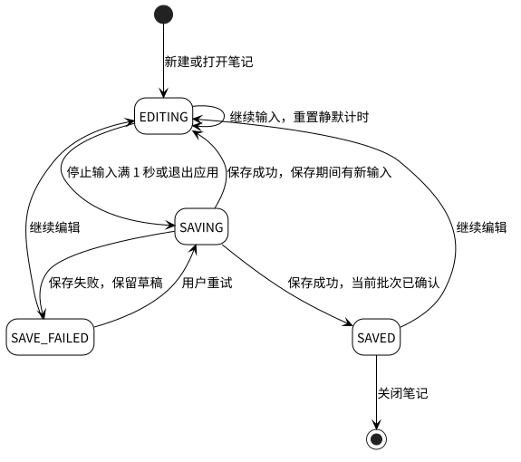

（2）FeedSource 状态（status）

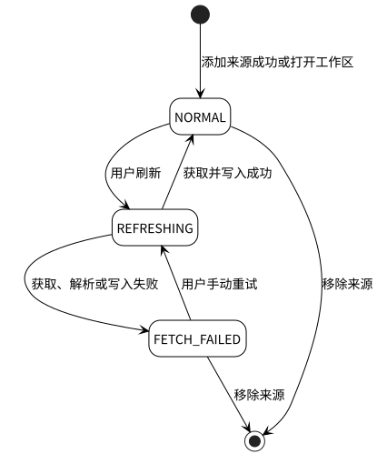

## 6. 用户界面设计

### 6.1 设计目标与原则

#### 6.1.1 设计目标

- **易用性**：订阅、文献、笔记三个入口固定在左侧导航，常用操作在一屏内完成，减少用户记忆负担。
- **一致性**：六个用例界面风格统一，标题栏、列表、表单、按钮和状态文字保持一致。
- **反馈及时**：刷新、导入、保存、索引构建等操作均显示进行中、成功或失败结果。
- **容错性**：对非法输入（如名称为空、地址协议无效）进行校验并保留输入；保存失败时保留草稿并提供重试。
- **可访问性**：支持键盘操作（Tab 切换输入项、Enter 提交、Esc 关闭对话框），界面文字为简体中文，日期按系统区域设置显示。

#### 6.1.2 设计原则

| 原则 | 说明 |
| --- | --- |
| 以用户为中心 | 按资料获取、阅读、记录、查找的使用顺序组织订阅、文献、笔记和检索入口 |
| 一致性 | 所有界面使用统一的导航栏、按钮样式和状态颜色（红色表示错误、绿色表示成功） |
| 最小化输入 | 工作区目录和 PDF 文件通过系统选择窗口输入；文献引用从已有文献列表中选择 |
| 即时校验 | 来源名称和地址在提交前校验，错误提示紧贴对应输入框 |
| 防止误操作 | 移除来源前显示确认对话框；退出应用时等待笔记保存完成 |
| 状态可见 | 来源状态、保存状态和索引状态以状态文字或标签直观展示 |

### 6.2 界面总体结构

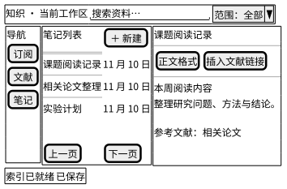

主窗口顶部显示工作区名称、搜索框和检索范围；左侧提供订阅、文献、笔记入口；中间区域显示来源或资料列表，每页 50 条；右侧内容区显示条目摘要、PDF 或笔记；底部状态栏显示索引进度和保存状态。启动时先显示工作区选择页，提供新建和打开两个入口。

### 6.3 通用界面元素

| 元素 | 内容与交互 |
| --- | --- |
| 列表 | 标题、类型、来源或更新时间；每页 50 条，提供上一页、下一页 |
| 表单 | 字段标题、输入框、字段错误提示、保存与取消按钮 |
| 状态区 | 加载中、刷新中、编辑中、保存中、已保存、保存失败 |
| 确认框 | 操作对象、影响说明、确认与取消按钮 |
| 空结果区 | 显示尚无资料或当前查询无匹配，并提供对应入口 |
| 错误区 | 显示错误原因、保留的输入及重试按钮 |

### 6.4 各模块界面设计

| 用例 | 主要界面 | 输入与操作 | 成功与异常反馈 |
| --- | --- | --- | --- |
| UC01 | 工作区选择页 | 名称、选择目录、新建、打开 | 成功进入主页；目录被占用或结构无效时停留原页并显示原因 |
| UC02 | 来源列表及编辑表单 | 名称、URL、保存、移除 | 更新来源列表；重复地址、协议无效或网络错误显示在表单内 |
| UC03 | 来源筛选、条目列表、摘要区 | 刷新、全部刷新、打开条目、打开原文 | 显示新增、重复与跳过数量及逐源失败原因；已读条目改变标记 |
| UC04 | 文献列表、PDF 阅读区 | 导入、翻页、缩放、查找、取消查找 | 显示首屏、页码和匹配数；加密文件提示输入密码，文件错误显示原因 |
| UC05 | 笔记列表、标题栏、编辑区 | 新建、修改标题、编辑内容块、插入文献链接 | 显示保存状态；保存失败提供重试，退出时等待保存完成 |
| UC06 | 搜索框、范围选择、结果列表 | 关键词、范围、翻页、打开结果 | 按类型显示标题与匹配片段；索引构建中显示进度，无结果显示空结果区 |

### 6.5 界面交互时序

（以 UC05 编辑与保存笔记为例）

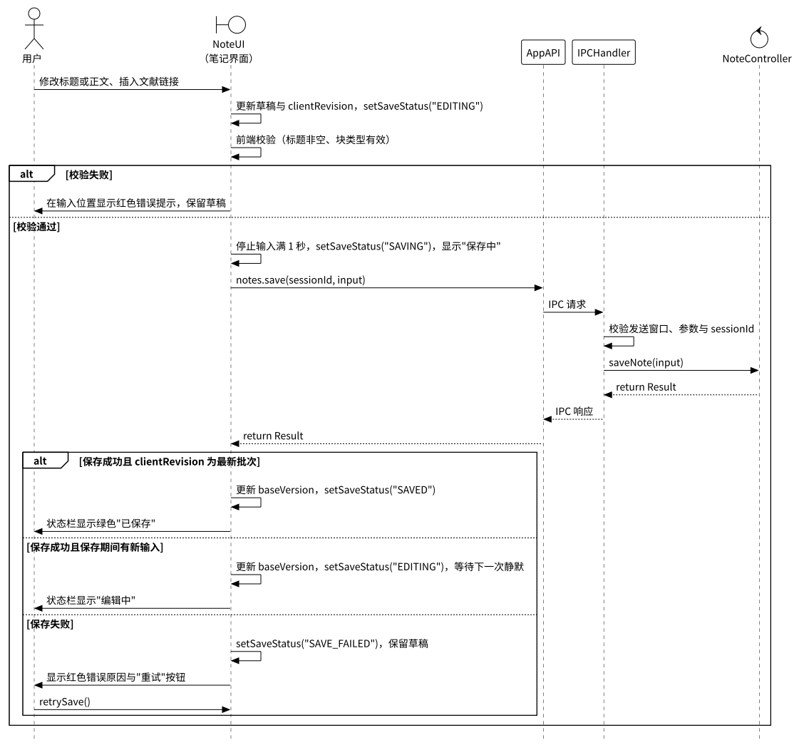

## 7. 非功能设计

### 7.1 性能设计

- 工作区选择界面冷启动不超过 5 秒（NFR-PERF-01）：首屏只装载基础界面，工作区数据和索引在选定目录后加载。
- 检索首批结果 P95 不超过 1 秒，新文本 5 秒内可检索（NFR-PERF-02）：使用词项索引和类型过滤，结果每页 50 条；IndexService 每秒处理一次增量任务。
- 常规 PDF 首屏不超过 3 秒，邻页切换 P95 不超过 500 毫秒（NFR-PERF-03）：按页渲染并缓存相邻页面，文内查找异步执行并可取消。
- 停止输入满 1 秒触发保存，常规提交后 1 秒内完成（NFR-REL-01）：输入去抖，同一笔记串行提交，标题、内容块和引用在一次事务中写入。
- 容量基线为 1 万页面、10 万内容块、10 万订阅条目、100 个来源、1 万个附件、附件总量 10 GB（NFR-CAP-01）：列表分页读取，联合索引覆盖排序字段，附件以文件形式保存，导入前检查磁盘空间。
- 测量环境采用四核 CPU、8 GB 内存和 SSD；冷启动连续测量 5 次，检索与邻页切换各测量 20 次，P95 取升序第 19 项；保存测试使用含 100 个普通文本块、正文约 20 KB 的笔记；PDF 测量使用不超过 100 页且不超过 50 MB 的含文本文件。

### 7.2 安全性设计

- 研究资料仅保存在本地工作区，联网仅用于用户发起的订阅获取和原文访问（NFR-SEC-01）。
- 渲染进程不直接访问 Node.js 与文件系统；IPCHandler 校验发送窗口、参数类型和 sessionId。
- 订阅地址、重定向地址和原文链接只接受 http／https 协议，ExternalBrowser 打开前再次校验。
- FileStore 将附件路径解析到当前工作区目录并核对规范化路径归属，拒绝访问工作区以外的路径。
- DAO 层使用参数绑定执行 SQL，防止 SQL 注入。
- 订阅摘要按安全文本或经过清理的标记显示；PDF 密码只在当前阅读会话的内存中使用，关闭阅读时释放。

### 7.3 可用性设计

- 笔记标题、内容块和文献引用在同一事务中保存；订阅刷新按来源分别提交，单个来源失败不影响其他来源。
- PDF 导入采用恢复记录、同盘发布和补偿清理，下次打开工作区时继续处理未完成的导入。
- 结构迁移前生成数据库保护副本，迁移在事务中执行，失败时回滚并保留保护副本。
- 数据库连接打开时启用外键检查；正常退出依次完成笔记保存、后台任务收尾、数据库关闭和目录锁释放；异常退出后按数据库已提交状态恢复。
- 已有本地资料可离线读取、编辑和检索；新增来源、修改地址、刷新订阅和打开原文需要网络，仅改来源名称和移除来源可离线完成（NFR-AVL-01）。
- 关键操作记录日志，包含操作类别、对象标识、时间和错误代码，便于故障排查。
- 控制类将异常统一转换为 Result 中的错误代码，界面按错误代码处理：
  - CANCELLED：取消文件或目录选择，返回原界面
  - INVALID_ARGUMENT：参数格式、类型或页码无效，标记对应输入项
  - INVALID_SESSION：工作区会话已失效，返回工作区选择界面
  - WORKSPACE_BUSY：目录已由其他实例打开，显示占用状态
  - WORKSPACE_INVALID／MIGRATION_FAILED：工作区结构校验失败或迁移失败，显示原因及可选目录
  - SOURCE_DUPLICATE／PROTOCOL_REJECTED：来源地址重复或协议无效，保留表单并显示原因
  - NETWORK_TIMEOUT／NETWORK_FAILED／FEED_INVALID：请求超时、网络失败或解析失败，显示来源失败状态及重试入口
  - PDF_INVALID／FILE_UNAVAILABLE／DISK_FULL：PDF 无效、附件不可用或磁盘空间不足，保留列表并显示原因
  - STORAGE_FAILED：数据库或文件写入失败，保留当前输入并提供重试
  - VERSION_CONFLICT：保存基线与数据库版本不同，保留草稿并提供重新读取与复制草稿入口
  - INDEX_NOT_READY／INDEX_FAILED：索引构建中或构建失败，显示构建进度或重建入口
  - QUERY_EXPIRED／TARGET_NOT_FOUND：查询快照失效或目标不存在，刷新查询或返回列表

### 7.4 可扩展性设计

- DAO 层隔离：数据库结构调整只影响 DAO 实现与迁移清单，业务逻辑层不受影响。
- 接口与实现分离：控制类依赖 DAO 接口和平台服务接口，便于替换具体实现（如更换订阅解析器或文件存储方式）。
- 页面公共属性集中在 Page，笔记与文献按子类扩展；新增页面类型时扩展 kind 取值和子类表。
- 数据库结构按迁移版本演进，schema_migrations 记录版本和校验值。
- 界面文字集中管理，日期和时间依据系统区域设置显示。

### 7.5 可测试性设计

- DAO 接口和平台服务接口可 Mock，控制类单元测试不依赖真实数据库、文件系统和网络。
- 数据库集成测试使用独立的临时工作区，覆盖唯一键、外键、事务回滚和迁移。
- 实体类为纯 PO，便于构造测试数据。
- 验收用例与设计对象对应：
  - TC-01、TC-08、TC-13：WorkspaceController、WorkspaceLock、MigrationRunner，验证创建与重开、独占访问、异常恢复、冷启动及迁移失败恢复
  - TC-02、TC-03：SourceController、RefreshController，验证地址校验、历史条目保留、去重、跳过统计、超时及已读持久化
  - TC-04、TC-05：PaperController、FileStore、PaperUI，验证重复导入、失败补偿、密码交互、附件缺失、翻页和查找
  - TC-06：NoteController、NoteUI、UnitOfWork，验证原子保存、后续输入批次、失败重试、退出保存和块归属
  - TC-07：SearchController、IndexService，验证索引状态、检索范围、50 条分页、稳定顺序及增量时延
  - TC-09、TC-10：全部控制类，验证容量基线、磁盘空间不足和离线本地操作
  - TC-11、TC-12、TC-14：IPCHandler、平台服务和六个界面，验证协议校验、状态反馈、简体中文和系统日期格式

## 8. 部署与实现约束

（Electron + Svelte + Tiptap + pdf.js + SQLite，DAO；Node.js 22 或更高版本、pnpm、TypeScript）


- 系统部署为 Windows、macOS 和 Linux 桌面应用，发布资源包含 PDF worker、字体及原生 SQLite 依赖。
- 应用安装目录：主进程、preload、渲染资源及依赖，由应用发布包管理。
- 应用数据目录：应用配置、日志和迁移前数据库保护副本，由平台服务和 MigrationRunner 管理。
- 工作区／workspace.sqlite：元数据、订阅、页面、内容块、附件记录及检索索引，由 DAO 和 UnitOfWork 管理。
- 工作区／attachments：以 attachmentId 命名的 PDF 副本，由 FileStore 管理。
- 工作区／.imports：导入临时文件及恢复记录，由 FileStore 和 PaperController 管理。
- 工作区／.workspace.lock：规范目录标识、持锁进程和启动标记，由 WorkspaceLock 管理；取得锁采用原子操作，异常退出遗留的记录结合进程存活信息确认后回收。
- 启动顺序为目录校验、取得锁、数据库检查与迁移、导入恢复、服务装配、界面装载和索引构建；关闭顺序为保存当前编辑、结束后台任务、关闭数据库、释放锁。

## 附录：PlantUML 代码

' 公共样式 _style.iuml（各图以 !include _style.iuml 引用）
```plantuml
skinparam defaultFontName Noto Sans CJK SC
skinparam defaultFontSize 14
skinparam monochrome true
skinparam shadowing false
skinparam backgroundColor white
skinparam ArrowColor black
skinparam ArrowThickness 1
skinparam LineThickness 1
skinparam classAttributeIconSize 0
skinparam packageStyle rectangle
skinparam class {
  BackgroundColor white
  HeaderBackgroundColor white
  BorderColor black
  FontColor black
  FontStyle plain
  AttributeFontColor black
  BorderThickness 1
}
skinparam rectangle {
  BackgroundColor white
  BorderColor black
  FontColor black
  BorderThickness 1
}
skinparam node {
  BackgroundColor white
  BorderColor black
  FontColor black
  BorderThickness 1
}
skinparam artifact {
  BackgroundColor white
  BorderColor black
  FontColor black
  BorderThickness 1
}
skinparam database {
  BackgroundColor white
  BorderColor black
  FontColor black
  BorderThickness 1
}
skinparam folder {
  BackgroundColor white
  BorderColor black
  FontColor black
  BorderThickness 1
}
skinparam cloud {
  BackgroundColor white
  BorderColor black
  FontColor black
  BorderThickness 1
}
skinparam state {
  BackgroundColor white
  BorderColor black
  FontColor black
  FontStyle plain
  RoundCorner 20
  BorderThickness 1
  StartColor black
  EndColor black
}
skinparam sequence {
  ArrowColor black
  ArrowThickness 1
  LifeLineBorderColor black
  LifeLineBorderThickness 1
  LifeLineBackgroundColor white
  ParticipantBackgroundColor white
  ParticipantBorderColor black
  ParticipantBorderThickness 1
  ParticipantFontColor black
  ActorBackgroundColor white
  ActorBorderColor black
  ActorFontColor black
  GroupBackgroundColor white
  GroupBodyBackgroundColor transparent
  GroupBorderColor black
  GroupBorderThickness 1
  GroupFontColor black
  DividerBackgroundColor white
  DividerBorderColor black
  ReferenceBackgroundColor white
  ReferenceBorderColor black
}
skinparam style strictuml
<style>
sequenceDiagram {
  actor {
    BackgroundColor white
    LineColor black
    LineThickness 1
  }
  boundary {
    BackgroundColor white
    LineColor black
    LineThickness 1
  }
  control {
    BackgroundColor white
    LineColor black
    LineThickness 1
  }
  entity {
    BackgroundColor white
    LineColor black
    LineThickness 1
  }
}
classDiagram {
  class {
    RoundCorner 0
  }
}
</style>
```

```plantuml
@startuml 知织体系结构图
!include _style.iuml
skinparam componentStyle uml1

package "表示层（渲染进程）" as PL {
  interface IWorkspaceUI
  [WorkspaceUI] - IWorkspaceUI
  interface ISourceUI
  [SourceUI] - ISourceUI
  interface IFeedUI
  [FeedUI] - IFeedUI
  interface IPaperUI
  [PaperUI] - IPaperUI
  interface INoteUI
  [NoteUI] - INoteUI
  interface ISearchUI
  [SearchUI] - ISearchUI
  [WorkspaceUI] -[hidden]down- [PaperUI]
  [SourceUI] -[hidden]down- [NoteUI]
  [FeedUI] -[hidden]down- [SearchUI]
}

package "跨进程桥接（preload／IPC）" as BR {
  interface IAppAPI
  [AppAPI] - IAppAPI
  [IPCHandler]
}

package "业务逻辑层（主进程）" as BL {
  interface IWorkspaceController
  [WorkspaceController] -up- IWorkspaceController
  interface ISourceController
  [SourceController] -up- ISourceController
  interface IRefreshController
  [RefreshController] -up- IRefreshController
  interface IPaperController
  [PaperController] -up- IPaperController
  interface INoteController
  [NoteController] -up- INoteController
  interface ISearchController
  [SearchController] -up- ISearchController
  interface IIndexService
  [IndexService] -up- IIndexService
  [WorkspaceController] -[hidden]down- [NoteController]
  [SourceController] -[hidden]down- [SearchController]
  [RefreshController] -[hidden]down- [IndexService]
}

package "平台服务（主进程）" as PS {
  interface IFileDialog
  [FileDialog] - IFileDialog
  interface IFileStore
  [FileStore] - IFileStore
  interface IWorkspaceLock
  [WorkspaceLock] - IWorkspaceLock
  interface IFeedGateway
  [FeedGateway] - IFeedGateway
  interface IExternalBrowser
  [ExternalBrowser] - IExternalBrowser
  [FileDialog] -[hidden]down- [WorkspaceLock]
  [FileStore] -[hidden]down- [FeedGateway]
  [WorkspaceLock] -[hidden]down- [ExternalBrowser]
}

package "数据访问层（DAO）" as DAL {
  interface IWorkspaceDAO
  [WorkspaceDAO] - IWorkspaceDAO
  interface IFeedSourceDAO
  [FeedSourceDAO] - IFeedSourceDAO
  interface IFeedItemDAO
  [FeedItemDAO] - IFeedItemDAO
  interface IPageDAO
  [PageDAO] - IPageDAO
  interface IBlockDAO
  [BlockDAO] - IBlockDAO
  interface IAttachmentDAO
  [AttachmentDAO] - IAttachmentDAO
  interface IReferenceDAO
  [ReferenceDAO] - IReferenceDAO
  interface ISearchDAO
  [SearchDAO] - ISearchDAO
  interface IUnitOfWork
  [UnitOfWork] - IUnitOfWork
  interface IMigrationRunner
  [MigrationRunner] - IMigrationRunner
  [WorkspaceDAO] -[hidden]down- [BlockDAO]
  [FeedSourceDAO] -[hidden]down- [AttachmentDAO]
  [FeedItemDAO] -[hidden]down- [ReferenceDAO]
  [PageDAO] -[hidden]down- [SearchDAO]
  [BlockDAO] -[hidden]down- [UnitOfWork]
  [AttachmentDAO] -[hidden]down- [MigrationRunner]
}

database "数据库（workspace.sqlite）\nworkspace_meta · schema_migrations · feed_sources\nfeed_items · pages · paper_metadata\nblocks · note_paper_refs · attachments\nsearch_documents · search_terms · index_queue\nindex_state" as DB

package "实体类（PO）" as PO {
  [Workspace]
  [FeedSource]
  [FeedItem]
  [Page]
  [NotePage]
  [PaperPage]
  [Block]
  [Attachment]
  [Workspace] -[hidden]down- [NotePage]
  [FeedSource] -[hidden]down- [PaperPage]
  [FeedItem] -[hidden]down- [Block]
  [Page] -[hidden]down- [Attachment]
}

' 版面：各层自上而下排列，平台服务位于业务逻辑层右侧
PL -[hidden]down- BR
BR -[hidden]down- BL
DB -[hidden]right- PO
[NoteController] -[hidden]down- [FeedSourceDAO]
[IndexService] -[hidden]down- [PageDAO]
[UnitOfWork] -[hidden]down- DB
' 表示层经 AppAPI 发起请求
WorkspaceUI ..> IAppAPI
SourceUI ..> IAppAPI
FeedUI ..> IAppAPI
PaperUI ..> IAppAPI
NoteUI ..> IAppAPI
SearchUI ..> IAppAPI
AppAPI ..> IPCHandler : IPC
' 桥接层调用业务逻辑层
IPCHandler ..> IWorkspaceController
IPCHandler ..> ISourceController
IPCHandler ..> IRefreshController
IPCHandler ..> IPaperController
IPCHandler ..> INoteController
IPCHandler ..> ISearchController
' 层间依赖（构件级依赖见 2.2 构件表与 5.2 构件级类图）
BL .down.> DAL : 调用 DAO 接口
BL .right.> PS : 调用平台服务接口
' DAO 访问数据库
WorkspaceDAO -down-> DB
FeedSourceDAO -down-> DB
FeedItemDAO -down-> DB
PageDAO -down-> DB
BlockDAO -down-> DB
AttachmentDAO -down-> DB
ReferenceDAO -down-> DB
SearchDAO -down-> DB
MigrationRunner -down-> DB
' 实体类被使用（虚线表示使用关系，不参与调用链）
DAL .down.> PO : 使用
BL ..> PO : 使用
@enduml
```

```plantuml
@startuml 数据设计类图（工作区与订阅）
!include _style.iuml
left to right direction

' ===== 实体类（PO） =====
class Workspace {
  - id: UUID
  - name: String
  - rootPath: String
  - schemaVersion: Integer
  - createdAt: Timestamp
  + rename(name: String): void
  + getName(): String
}
class FeedSource {
  - id: UUID
  - name: String
  - url: String
  - lastRefreshedAt: Timestamp
  - status: String
  + rename(name: String): void
  + changeUrl(url: String): void
  + recordRefresh(time: Timestamp): void
  + getStatus(): String
  + setStatus(status: String): void
}
class FeedItem {
  - id: UUID
  - sourceId: UUID
  - sourceName: String
  - title: String
  - url: String
  - summary: String
  - publishedAt: Timestamp
  - fetchedAt: Timestamp
  - isRead: Boolean
  + markRead(): void
  + isRead(): Boolean
}

' ===== DAO 接口 =====
interface IWorkspaceDAO <<interface>> {
  + insertMeta(workspace: Workspace, tx: Tx): void
  + selectMeta(): Workspace
  + selectSchemaVersion(): Integer
}
interface IFeedSourceDAO <<interface>> {
  + insert(source: FeedSource, tx: Tx): void
  + update(source: FeedSource, tx: Tx): void
  + updateRefreshTime(sourceId: UUID, time: Timestamp, tx: Tx): void
  + delete(sourceId: UUID, tx: Tx): void
  + selectAll(): List<FeedSource>
  + selectById(sourceId: UUID): FeedSource
  + selectByUrl(url: String): FeedSource
}
interface IFeedItemDAO <<interface>> {
  + insert(item: FeedItem, tx: Tx): void
  + updateRead(itemId: UUID, tx: Tx): void
  + selectById(itemId: UUID): FeedItem
  + selectByUrl(url: String): FeedItem
  + selectPage(filter: FeedFilter, page: Integer): PageResult<FeedItem>
  + selectIndexInput(): List<FeedItem>
}

' ===== DAO 实现 =====
class WorkspaceDAO
class FeedSourceDAO
class FeedItemDAO
WorkspaceDAO ..|> IWorkspaceDAO
FeedSourceDAO ..|> IFeedSourceDAO
FeedItemDAO ..|> IFeedItemDAO
WorkspaceDAO ..> Workspace : 使用
FeedSourceDAO ..> FeedSource : 使用
FeedItemDAO ..> FeedItem : 使用

' 实体关系
Workspace "1" *-- "0..*" FeedSource
Workspace "1" *-- "0..*" FeedItem
FeedSource "0..1" -- "0..*" FeedItem : 来源
@enduml
```

```plantuml
@startuml 数据设计类图（页面、内容块与附件）
!include _style.iuml

' ===== 实体类（PO） =====
abstract class Page {
  - id: UUID
  - kind: String
  - title: String
  - createdAt: Timestamp
  - updatedAt: Timestamp
  - version: Integer
  + rename(title: String): void
  + getKind(): String
  + getVersion(): Integer
}
class NotePage {
  - blocks: List<Block>
  - paperIds: List<UUID>
  - saveStatus: String
  + applyContent(blocks: List<Block>, paperIds: List<UUID>): void
  + getBlocks(): List<Block>
  + getPaperIds(): List<UUID>
  + getSaveStatus(): String
  + setSaveStatus(status: String): void
}
class PaperPage {
  - authors: String
  - doi: String
  - attachmentId: UUID
  + bindAttachment(attachmentId: UUID): void
  + getAttachmentId(): UUID
}
class Block {
  - id: UUID
  - pageId: UUID
  - order: Integer
  - type: String
  - content: JSON
  + changeContent(type: String, content: JSON): void
  + moveTo(order: Integer): void
}
class Attachment {
  - id: UUID
  - paperId: UUID
  - relativePath: String
  - originalName: String
  - size: Integer
  - mediaType: String
  + getRelativePath(): String
  + getSize(): Integer
}

' ===== DAO 接口 =====
interface IPageDAO <<interface>> {
  + insert(page: Page, tx: Tx): void
  + updateNote(note: NotePage, expectedVersion: Integer, tx: Tx): Integer
  + selectById(pageId: UUID): Page
  + selectByIds(pageIds: List<UUID>): List<Page>
  + selectByKind(kind: String, page: Integer): PageResult<Page>
  + selectIndexInput(): List<Page>
}
interface IBlockDAO <<interface>> {
  + batchInsert(blocks: List<Block>, tx: Tx): void
  + deleteByPage(pageId: UUID, tx: Tx): void
  + selectByPage(pageId: UUID): List<Block>
  + selectByIds(blockIds: List<UUID>): List<Block>
  + selectNoteText(pageId: UUID): String
}
interface IAttachmentDAO <<interface>> {
  + insert(attachment: Attachment, tx: Tx): void
  + selectById(attachmentId: UUID): Attachment
  + selectByPaper(paperId: UUID): Attachment
}
interface IReferenceDAO <<interface>> {
  + batchInsert(noteId: UUID, paperIds: List<UUID>, tx: Tx): void
  + deleteByNote(noteId: UUID, tx: Tx): void
  + selectByNote(noteId: UUID): List<UUID>
}

' ===== DAO 实现 =====
class PageDAO
class BlockDAO
class AttachmentDAO
class ReferenceDAO
PageDAO ..|> IPageDAO
BlockDAO ..|> IBlockDAO
AttachmentDAO ..|> IAttachmentDAO
ReferenceDAO ..|> IReferenceDAO
PageDAO ..> Page : 使用
PageDAO ..> NotePage : 使用
PageDAO ..> PaperPage : 使用
BlockDAO ..> Block : 使用
AttachmentDAO ..> Attachment : 使用

' 实体关系
Page <|-- NotePage
Page <|-- PaperPage
NotePage "1" *-- "0..*" Block : 页内有序
PaperPage "1" *-- "1" Attachment
NotePage "0..*" -- "0..*" PaperPage : 引用
@enduml
```

```plantuml
@startuml 数据设计类图（检索索引）
!include _style.iuml

' ===== 数据传输对象 =====
class SearchDocument <<DTO>> {
  - kind: String
  - targetId: UUID
  - title: String
  - searchText: String
  - updatedAt: Timestamp
}
class IndexTask <<DTO>> {
  - kind: String
  - targetId: UUID
  - revision: Integer
}
class IndexStatus <<DTO>> {
  - status: String
  - processed: Integer
  - total: Integer
  - generation: Integer
}

' ===== DAO 接口 =====
interface ISearchDAO <<interface>> {
  + insertTask(kind: String, targetId: UUID, tx: Tx): void
  + deleteTask(task: IndexTask, tx: Tx): void
  + updateDocument(document: SearchDocument, terms: List<String>, tx: Tx): void
  + updateStatus(status: String, errorCode: String, tx: Tx): void
  + selectPendingTasks(limit: Integer): List<IndexTask>
  + selectCandidates(terms: List<String>, scope: String): List<SearchDocument>
  + selectStatus(): IndexStatus
}

' ===== DAO 实现 =====
class SearchDAO
SearchDAO ..|> ISearchDAO
SearchDAO ..> SearchDocument : 使用
SearchDAO ..> IndexTask : 使用
SearchDAO ..> IndexStatus : 使用
@enduml
```

```plantuml
@startuml UC01 创建工作区顺序图
!include _style.iuml
actor 用户
boundary WorkspaceUI
control WorkspaceController
participant IFileDialog
participant IFileStore
participant IWorkspaceLock
participant IUnitOfWork
participant IMigrationRunner
participant IWorkspaceDAO
participant IIndexService
entity Workspace

用户 -> WorkspaceUI: createWorkspace(name)
WorkspaceUI -> WorkspaceController: createWorkspace(name)
WorkspaceController -> IFileDialog: chooseDirectory("create")
IFileDialog --> WorkspaceController: return path
alt 用户取消选择
  WorkspaceController --> WorkspaceUI: return Result(success=false, code=CANCELLED)
else 已选定目录
  WorkspaceController -> IFileStore: checkDirectory(path, "create")
  IFileStore --> WorkspaceController: return rootPath
  WorkspaceController -> IWorkspaceLock: acquire(rootPath)
  IWorkspaceLock --> WorkspaceController: return lockHandle
  alt 目录无效或已被其他实例打开
    WorkspaceController --> WorkspaceUI: return Result(success=false, code=INVALID_ARGUMENT／WORKSPACE_BUSY)
  else 目录有效且取得锁
    WorkspaceController -> IFileStore: initLayout(rootPath)
    WorkspaceController -> IUnitOfWork: open(dbPath)
    WorkspaceController -> IMigrationRunner: migrate(0)
    IMigrationRunner --> WorkspaceController: return schemaVersion
    WorkspaceController -> Workspace: new Workspace(name)
    WorkspaceController -> IUnitOfWork: begin()
    IUnitOfWork --> WorkspaceController: return tx
    WorkspaceController -> IWorkspaceDAO: insertMeta(workspace, tx)
    WorkspaceController -> IUnitOfWork: commit(tx)
    alt 初始化成功
      WorkspaceController -> IIndexService: start()
      WorkspaceController --> WorkspaceUI: return Result(success=true, data=session)
    else 初始化失败
      WorkspaceController -> IUnitOfWork: rollback(tx)
      WorkspaceController -> IUnitOfWork: close()
      WorkspaceController -> IFileStore: removeLayout(rootPath)
      WorkspaceController -> IWorkspaceLock: release(lockHandle)
      WorkspaceController --> WorkspaceUI: return Result(success=false, code=STORAGE_FAILED)
    end
  end
end
WorkspaceUI --> 用户: show workspaceResult
@enduml
```

```plantuml
@startuml UC01 打开工作区顺序图
!include _style.iuml
actor 用户
boundary WorkspaceUI
control WorkspaceController
participant IFileDialog
participant IFileStore
participant IWorkspaceLock
participant IUnitOfWork
participant IMigrationRunner
participant IWorkspaceDAO
participant IAttachmentDAO
participant IIndexService

用户 -> WorkspaceUI: openWorkspace()
WorkspaceUI -> WorkspaceController: openWorkspace()
WorkspaceController -> IFileDialog: chooseDirectory("open")
IFileDialog --> WorkspaceController: return path
alt 用户取消选择
  WorkspaceController --> WorkspaceUI: return Result(success=false, code=CANCELLED)
else 已选定目录
  WorkspaceController -> IFileStore: checkDirectory(path, "open")
  IFileStore --> WorkspaceController: return rootPath
  WorkspaceController -> IWorkspaceLock: acquire(rootPath)
  IWorkspaceLock --> WorkspaceController: return lockHandle
  alt 工作区结构无效或已被其他实例打开
    WorkspaceController --> WorkspaceUI: return Result(success=false, code=WORKSPACE_INVALID／WORKSPACE_BUSY)
  else 取得锁
    WorkspaceController -> IUnitOfWork: open(dbPath)
    WorkspaceController -> IWorkspaceDAO: selectSchemaVersion()
    IWorkspaceDAO --> WorkspaceController: return schemaVersion
    opt schemaVersion 低于当前版本
      WorkspaceController -> IMigrationRunner: migrate(schemaVersion)
      IMigrationRunner -> IFileStore: backupDatabase(dbPath)
      IMigrationRunner --> WorkspaceController: return Result(newVersion)
    end
    WorkspaceController -> IWorkspaceDAO: selectMeta()
    IWorkspaceDAO --> WorkspaceController: return workspace
    WorkspaceController -> IFileStore: listPendingImports()
    IFileStore --> WorkspaceController: return ticketList
    loop 每条未完成导入
      WorkspaceController -> IAttachmentDAO: selectById(attachmentId)
      IAttachmentDAO --> WorkspaceController: return attachment
      alt 附件记录存在
        WorkspaceController -> IFileStore: finishImport(ticket)
      else 附件记录缺失
        WorkspaceController -> IFileStore: rollbackImport(ticket)
      end
    end
    alt 打开成功
      WorkspaceController -> IIndexService: start()
      WorkspaceController --> WorkspaceUI: return Result(success=true, data=session)
    else 迁移或读写失败
      WorkspaceController -> IUnitOfWork: close()
      WorkspaceController -> IWorkspaceLock: release(lockHandle)
      WorkspaceController --> WorkspaceUI: return Result(success=false, code=MIGRATION_FAILED／STORAGE_FAILED)
    end
  end
end
WorkspaceUI --> 用户: show workspaceResult
@enduml
```

```plantuml
@startuml UC02 管理订阅源顺序图
!include _style.iuml
actor 用户
boundary SourceUI
control SourceController
participant IFeedGateway
participant IUnitOfWork
participant IFeedSourceDAO
entity FeedSource

== 添加订阅源 ==
用户 -> SourceUI: addSource(name, url)
SourceUI -> SourceController: addSource(input)
SourceController -> SourceController: 校验名称与 http／https 协议
SourceController -> IFeedSourceDAO: selectByUrl(url)
IFeedSourceDAO --> SourceController: return existingSource
alt 协议无效或地址重复
  SourceController --> SourceUI: return Result(success=false, code=PROTOCOL_REJECTED／SOURCE_DUPLICATE)
else 地址可用
  SourceController -> IFeedGateway: fetchAndParse(url, 30000)
  IFeedGateway --> SourceController: return parsedFeed
  alt 获取并解析成功
    SourceController -> FeedSource: new FeedSource(name, url)
    SourceController -> IUnitOfWork: begin()
    IUnitOfWork --> SourceController: return tx
    SourceController -> IFeedSourceDAO: insert(source, tx)
    SourceController -> IUnitOfWork: commit(tx)
    SourceController --> SourceUI: return Result(success=true, data=source)
  else 获取或解析失败
    SourceController --> SourceUI: return Result(success=false, code=NETWORK_TIMEOUT／NETWORK_FAILED／FEED_INVALID)
  end
end
SourceUI --> 用户: show sourceList

== 修改订阅源 ==
用户 -> SourceUI: editSource(sourceId, name, url)
SourceUI -> SourceController: updateSource(sourceId, input)
SourceController -> IFeedSourceDAO: selectById(sourceId)
IFeedSourceDAO --> SourceController: return source
opt 地址发生变化
  SourceController -> IFeedSourceDAO: selectByUrl(url)
  SourceController -> IFeedGateway: fetchAndParse(url, 30000)
  IFeedGateway --> SourceController: return parsedFeed
  SourceController -> FeedSource: changeUrl(url)
end
opt 名称发生变化
  SourceController -> FeedSource: rename(name)
end
SourceController -> IUnitOfWork: begin()
SourceController -> IFeedSourceDAO: update(source, tx)
SourceController -> IUnitOfWork: commit(tx)
SourceController --> SourceUI: return Result(success=true, data=source)
SourceUI --> 用户: show sourceList

== 移除订阅源 ==
用户 -> SourceUI: removeSource(sourceId)
SourceUI -> SourceUI: 显示确认对话框
SourceUI -> SourceController: removeSource(sourceId)
SourceController -> IUnitOfWork: begin()
SourceController -> IFeedSourceDAO: delete(sourceId, tx)
note right of IFeedSourceDAO: feed_items.source_id 置空\n保留 source_name 与 is_read
SourceController -> IUnitOfWork: commit(tx)
SourceController --> SourceUI: return Result(success=true)
SourceUI --> 用户: show sourceList
@enduml
```

```plantuml
@startuml UC03 刷新与阅读订阅顺序图
!include _style.iuml
actor 用户
boundary FeedUI
control RefreshController
participant IFeedGateway
participant IUnitOfWork
participant IFeedSourceDAO
participant IFeedItemDAO
participant ISearchDAO
participant IExternalBrowser
entity FeedSource
entity FeedItem

== 刷新订阅 ==
用户 -> FeedUI: refreshFeed(sourceId)
FeedUI -> RefreshController: refresh(sourceId)
RefreshController -> IFeedSourceDAO: selectAll() 或 selectById(sourceId)
IFeedSourceDAO --> RefreshController: return sourceList
loop 每个订阅源
  RefreshController -> FeedSource: setStatus("REFRESHING")
  RefreshController -> IFeedGateway: fetchAndParse(url, 30000)
  IFeedGateway --> RefreshController: return parsedFeed
  alt 获取并解析成功
    RefreshController -> RefreshController: 规范化原文链接，无可用链接计入 skipped
    RefreshController -> IUnitOfWork: begin()
    IUnitOfWork --> RefreshController: return tx
    RefreshController -> IFeedSourceDAO: selectById(sourceId)
    loop 每个候选条目
      RefreshController -> IFeedItemDAO: selectByUrl(url)
      IFeedItemDAO --> RefreshController: return existingItem
      alt 条目不存在
        RefreshController -> IFeedItemDAO: insert(item, tx)
        RefreshController -> ISearchDAO: insertTask("feed", itemId, tx)
      else 条目已存在
        RefreshController -> RefreshController: 计入 duplicate
      end
    end
    RefreshController -> FeedSource: recordRefresh(now)
    RefreshController -> IFeedSourceDAO: updateRefreshTime(sourceId, now, tx)
    RefreshController -> IUnitOfWork: commit(tx)
    alt 提交成功
      RefreshController -> FeedSource: setStatus("NORMAL")
    else 写入失败
      RefreshController -> IUnitOfWork: rollback(tx)
      RefreshController -> FeedSource: setStatus("FETCH_FAILED")
    end
  else 获取或解析失败
    RefreshController -> FeedSource: setStatus("FETCH_FAILED")
  end
end
RefreshController --> FeedUI: return Result(success=true, data=summary)
FeedUI --> 用户: show refreshSummary

== 阅读条目 ==
用户 -> FeedUI: openItem(itemId)
FeedUI -> RefreshController: readItem(itemId)
RefreshController -> IFeedItemDAO: selectById(itemId)
IFeedItemDAO --> RefreshController: return item
opt 条目未读
  RefreshController -> FeedItem: markRead()
  RefreshController -> IUnitOfWork: begin()
  RefreshController -> IFeedItemDAO: updateRead(itemId, tx)
  RefreshController -> IUnitOfWork: commit(tx)
end
RefreshController --> FeedUI: return Result(success=true, data=item)
FeedUI --> 用户: show itemSummary

== 打开原文 ==
用户 -> FeedUI: openOriginal(itemId)
FeedUI -> RefreshController: openOriginal(itemId)
RefreshController -> IFeedItemDAO: selectById(itemId)
IFeedItemDAO --> RefreshController: return item
alt 链接为 http／https
  RefreshController -> IExternalBrowser: open(url)
  RefreshController --> FeedUI: return Result(success=true)
else 其他协议
  RefreshController --> FeedUI: return Result(success=false, code=PROTOCOL_REJECTED)
end
@enduml
```

```plantuml
@startuml UC04 导入与阅读 PDF 顺序图
!include _style.iuml
actor 用户
boundary PaperUI
control PaperController
participant IFileDialog
participant IFileStore
participant IUnitOfWork
participant IPageDAO
participant IAttachmentDAO
participant ISearchDAO
entity PaperPage
entity Attachment

== 导入 PDF ==
用户 -> PaperUI: importPDF()
PaperUI -> PaperController: importPDF()
PaperController -> IFileDialog: choosePDF()
IFileDialog --> PaperController: return path
alt 用户取消选择
  PaperController --> PaperUI: return Result(success=false, code=CANCELLED)
else 已选择文件
  PaperController -> IFileStore: checkPDF(path)
  IFileStore --> PaperController: return size
  alt 文件不可读、格式无效或空间不足
    PaperController --> PaperUI: return Result(success=false, code=PDF_INVALID／FILE_UNAVAILABLE／DISK_FULL)
  else 检查通过
    PaperController -> PaperPage: new PaperPage(title)
    PaperController -> Attachment: new Attachment(paperId, originalName, size)
    PaperController -> PaperPage: bindAttachment(attachmentId)
    PaperController -> IFileStore: prepareImport(path, attachmentId)
    IFileStore --> PaperController: return ticket
    PaperController -> IFileStore: publishImport(ticket)
    IFileStore --> PaperController: return relativePath
    PaperController -> IUnitOfWork: begin()
    IUnitOfWork --> PaperController: return tx
    PaperController -> IPageDAO: insert(paper, tx)
    PaperController -> IAttachmentDAO: insert(attachment, tx)
    PaperController -> ISearchDAO: insertTask("paper", paperId, tx)
    PaperController -> IUnitOfWork: commit(tx)
    alt 提交成功
      PaperController -> IFileStore: finishImport(ticket)
      PaperController --> PaperUI: return Result(success=true, data=paper)
    else 文件或数据库操作失败
      PaperController -> IUnitOfWork: rollback(tx)
      PaperController -> IFileStore: rollbackImport(ticket)
      PaperController --> PaperUI: return Result(success=false, code=STORAGE_FAILED／DISK_FULL)
    end
  end
end
PaperUI --> 用户: show paperList

== 阅读 PDF ==
用户 -> PaperUI: openPaper(paperId)
PaperUI -> PaperController: readPDF(paperId)
PaperController -> IAttachmentDAO: selectByPaper(paperId)
IAttachmentDAO --> PaperController: return attachment
PaperController -> IFileStore: readAttachment(relativePath)
IFileStore --> PaperController: return bytes
alt 附件可读
  PaperController --> PaperUI: return Result(success=true, data=pdfResource)
  PaperUI --> 用户: show 首屏页面（加密文件先输入密码）
  用户 -> PaperUI: turnPage(pageNo)／zoom(scale)／findText(keyword)
  PaperUI --> 用户: show 页面与匹配位置
else 附件缺失
  PaperController --> PaperUI: return Result(success=false, code=FILE_UNAVAILABLE)
  PaperUI --> 用户: show 错误提示
end
@enduml
```

```plantuml
@startuml UC05 编辑与保存笔记顺序图
!include _style.iuml
actor 用户
boundary NoteUI
control NoteController
participant IUnitOfWork
participant IPageDAO
participant IBlockDAO
participant IReferenceDAO
participant ISearchDAO
entity NotePage

== 打开笔记 ==
用户 -> NoteUI: openNote(noteId)
NoteUI -> NoteController: loadNote(noteId)
NoteController -> IPageDAO: selectById(noteId)
IPageDAO --> NoteController: return note
NoteController -> IBlockDAO: selectByPage(noteId)
IBlockDAO --> NoteController: return blocks
NoteController -> IReferenceDAO: selectByNote(noteId)
IReferenceDAO --> NoteController: return paperIds
NoteController --> NoteUI: return Result(success=true, data=snapshot)
NoteUI --> 用户: show 笔记内容

== 编辑并自动保存 ==
用户 -> NoteUI: editNote(title, blocks)／insertPaperLink(paperId)
NoteUI -> NoteUI: 停止输入满 1 秒，生成 NoteSaveInput
NoteUI -> NoteController: saveNote(input)
NoteController -> NoteController: 校验块类型、标识与 order，提取 paperIds
NoteController -> IUnitOfWork: begin()
IUnitOfWork --> NoteController: return tx
NoteController -> IPageDAO: selectById(pageId)
IPageDAO --> NoteController: return note
NoteController -> IBlockDAO: selectByIds(blockIds)
IBlockDAO --> NoteController: return existingBlocks
NoteController -> IPageDAO: selectByIds(paperIds)
IPageDAO --> NoteController: return papers
alt 版本一致且块与引用目标有效
  NoteController -> NotePage: rename(title)
  NoteController -> NotePage: applyContent(blocks, paperIds)
  NoteController -> IPageDAO: updateNote(note, baseVersion, tx)
  IPageDAO --> NoteController: return 1
  NoteController -> IBlockDAO: deleteByPage(pageId, tx)
  NoteController -> IBlockDAO: batchInsert(blocks, tx)
  NoteController -> IReferenceDAO: deleteByNote(pageId, tx)
  NoteController -> IReferenceDAO: batchInsert(pageId, paperIds, tx)
  NoteController -> ISearchDAO: insertTask("note", pageId, tx)
  NoteController -> IUnitOfWork: commit(tx)
  alt 提交成功
    NoteController --> NoteUI: return Result(success=true, data=receipt)
    NoteUI --> 用户: show 已保存
  else 写入失败
    NoteController -> IUnitOfWork: rollback(tx)
    NoteController --> NoteUI: return Result(success=false, code=STORAGE_FAILED)
    NoteUI --> 用户: show 保存失败，保留草稿并提供重试
  end
else 版本冲突或校验失败
  NoteController -> IUnitOfWork: rollback(tx)
  NoteController --> NoteUI: return Result(success=false, code=VERSION_CONFLICT／INVALID_ARGUMENT)
  NoteUI --> 用户: show 保留草稿并显示原因
end
@enduml
```

```plantuml
@startuml UC06 检索资料顺序图
!include _style.iuml
actor 用户
boundary SearchUI
control SearchController
participant IIndexService
participant ISearchDAO
boundary "NoteUI／PaperUI／FeedUI" as TargetUI

用户 -> SearchUI: submitSearch(keyword, scope)
SearchUI -> SearchController: search(input)
SearchController -> SearchController: 校验 keyword、scope、page
SearchController -> IIndexService: getStatus()
IIndexService --> SearchController: return indexStatus
alt READY
  alt queryId 为空（首次查询）
    SearchController -> IIndexService: tokenize(keyword)
    IIndexService --> SearchController: return terms
    SearchController -> ISearchDAO: selectCandidates(terms, scope)
    ISearchDAO --> SearchController: return documentList
    SearchController -> SearchController: 核对完整关键词，生成片段\n按类型分组排序，保存 queryId 快照
  else queryId 非空（翻页）
    SearchController -> SearchController: 核对 queryId、keyword 与 scope
  end
  alt 快照有效
    SearchController --> SearchUI: return Result(success=true, data=pageResult)
    SearchUI --> 用户: show 分类结果与匹配片段
    用户 -> SearchUI: openResult(hit)
    SearchUI -> TargetUI: 按 kind 打开 targetId
    TargetUI --> 用户: show 目标笔记、文献或条目
  else 快照失效
    SearchController --> SearchUI: return Result(success=false, code=QUERY_EXPIRED)
    SearchUI --> 用户: show 重新检索提示
  end
else BUILDING
  SearchController --> SearchUI: return Result(success=false, code=INDEX_NOT_READY)
  SearchUI --> 用户: show 索引构建进度
else FAILED
  SearchController --> SearchUI: return Result(success=false, code=INDEX_FAILED)
  SearchUI --> 用户: show 重建索引入口
end
@enduml
```

```plantuml
@startuml UC01 构件级类图
!include _style.iuml
left to right direction

interface IWorkspaceUI <<interface>> {
  + createWorkspace(name: String): Result<WorkspaceSession>
  + openWorkspace(): Result<WorkspaceSession>
  + closeWorkspace(): Result<Void>
}
interface IWorkspaceController <<interface>> {
  + createWorkspace(name: String): Result<WorkspaceSession>
  + openWorkspace(): Result<WorkspaceSession>
  + closeWorkspace(): Result<Void>
}
interface IFileDialog <<interface>> {
  + chooseDirectory(mode: String): Result<String>
  + choosePDF(): Result<String>
}
interface IFileStore <<interface>> {
  + checkDirectory(path: String, mode: String): Result<String>
  + initLayout(rootPath: String): void
  + removeLayout(rootPath: String): void
  + backupDatabase(dbPath: String): String
  + checkPDF(path: String): Result<Integer>
  + prepareImport(path: String, attachmentId: UUID): ImportTicket
  + publishImport(ticket: ImportTicket): String
  + finishImport(ticket: ImportTicket): void
  + rollbackImport(ticket: ImportTicket): Boolean
  + listPendingImports(): List<ImportTicket>
  + readAttachment(relativePath: String): Byte[]
}
interface IWorkspaceLock <<interface>> {
  + acquire(rootPath: String): Result<String>
  + release(lockHandle: String): void
}
interface IUnitOfWork <<interface>> {
  + open(dbPath: String): void
  + begin(): Tx
  + commit(tx: Tx): void
  + rollback(tx: Tx): void
  + close(): void
}
interface IMigrationRunner <<interface>> {
  + migrate(fromVersion: Integer): Result<Integer>
}
interface IWorkspaceDAO <<interface>> {
  + insertMeta(workspace: Workspace, tx: Tx): void
  + selectMeta(): Workspace
  + selectSchemaVersion(): Integer
}
interface IAttachmentDAO <<interface>> {
  + insert(attachment: Attachment, tx: Tx): void
  + selectById(attachmentId: UUID): Attachment
  + selectByPaper(paperId: UUID): Attachment
}
interface IIndexService <<interface>> {
  + start(): void
  + stop(): void
  + getStatus(): IndexStatus
  + rebuild(): void
  + processQueue(): Integer
  + tokenize(text: String): List<String>
}
class WorkspaceUI
class WorkspaceController
class WorkspaceDAO
class Workspace {
  - id: UUID
  - name: String
  - rootPath: String
  - schemaVersion: Integer
  - createdAt: Timestamp
  + rename(name: String): void
  + getName(): String
}

' 实现关系
WorkspaceUI ..|> IWorkspaceUI
WorkspaceController ..|> IWorkspaceController
WorkspaceDAO ..|> IWorkspaceDAO

' 依赖关系
WorkspaceUI ..> IWorkspaceController
WorkspaceController ..> IFileDialog
WorkspaceController ..> IFileStore
WorkspaceController ..> IWorkspaceLock
WorkspaceController ..> IUnitOfWork
WorkspaceController ..> IMigrationRunner
WorkspaceController ..> IWorkspaceDAO
WorkspaceController ..> IAttachmentDAO
WorkspaceController ..> IIndexService

' DAO 与实体（使用关系）
WorkspaceDAO ..> Workspace : 使用
@enduml
```

```plantuml
@startuml UC02、UC03 构件级类图
!include _style.iuml
left to right direction

interface ISourceUI <<interface>> {
  + querySources(): List<FeedSource>
  + addSource(name: String, url: String): Result<FeedSource>
  + editSource(sourceId: UUID, name: String, url: String): Result<FeedSource>
  + removeSource(sourceId: UUID): Result<Void>
}
interface ISourceController <<interface>> {
  + listSources(): Result<List<FeedSource>>
  + addSource(input: SourceInput): Result<FeedSource>
  + updateSource(sourceId: UUID, input: SourceInput): Result<FeedSource>
  + removeSource(sourceId: UUID): Result<Void>
}
interface IFeedUI <<interface>> {
  + refreshFeed(sourceId: UUID): Result<RefreshSummary>
  + queryItems(filter: FeedFilter, page: Integer): PageResult<FeedItem>
  + openItem(itemId: UUID): Result<FeedItem>
  + openOriginal(itemId: UUID): Result<Void>
}
interface IRefreshController <<interface>> {
  + refresh(sourceId: UUID): Result<RefreshSummary>
  + listItems(filter: FeedFilter, page: Integer): Result<PageResult<FeedItem>>
  + readItem(itemId: UUID): Result<FeedItem>
  + openOriginal(itemId: UUID): Result<Void>
}
interface IFeedGateway <<interface>> {
  + fetchAndParse(url: String, timeoutMs: Integer): Result<ParsedFeed>
}
interface IUnitOfWork <<interface>> {
  + open(dbPath: String): void
  + begin(): Tx
  + commit(tx: Tx): void
  + rollback(tx: Tx): void
  + close(): void
}
interface IFeedSourceDAO <<interface>> {
  + insert(source: FeedSource, tx: Tx): void
  + update(source: FeedSource, tx: Tx): void
  + updateRefreshTime(sourceId: UUID, time: Timestamp, tx: Tx): void
  + delete(sourceId: UUID, tx: Tx): void
  + selectAll(): List<FeedSource>
  + selectById(sourceId: UUID): FeedSource
  + selectByUrl(url: String): FeedSource
}
interface IExternalBrowser <<interface>> {
  + open(url: String): Result<Void>
}
interface IFeedItemDAO <<interface>> {
  + insert(item: FeedItem, tx: Tx): void
  + updateRead(itemId: UUID, tx: Tx): void
  + selectById(itemId: UUID): FeedItem
  + selectByUrl(url: String): FeedItem
  + selectPage(filter: FeedFilter, page: Integer): PageResult<FeedItem>
  + selectIndexInput(): List<FeedItem>
}
interface ISearchDAO <<interface>> {
  + insertTask(kind: String, targetId: UUID, tx: Tx): void
  + deleteTask(task: IndexTask, tx: Tx): void
  + updateDocument(document: SearchDocument, terms: List<String>, tx: Tx): void
  + updateStatus(status: String, errorCode: String, tx: Tx): void
  + selectPendingTasks(limit: Integer): List<IndexTask>
  + selectCandidates(terms: List<String>, scope: String): List<SearchDocument>
  + selectStatus(): IndexStatus
}
class SourceUI
class FeedUI
class SourceController
class RefreshController
class FeedSourceDAO
class FeedItemDAO
class FeedSource {
  - id: UUID
  - name: String
  - url: String
  - lastRefreshedAt: Timestamp
  - status: String
  + rename(name: String): void
  + changeUrl(url: String): void
  + recordRefresh(time: Timestamp): void
  + getStatus(): String
  + setStatus(status: String): void
}
class FeedItem {
  - id: UUID
  - sourceId: UUID
  - sourceName: String
  - title: String
  - url: String
  - summary: String
  - publishedAt: Timestamp
  - fetchedAt: Timestamp
  - isRead: Boolean
  + markRead(): void
  + isRead(): Boolean
}

' 实现关系
SourceUI ..|> ISourceUI
FeedUI ..|> IFeedUI
SourceController ..|> ISourceController
RefreshController ..|> IRefreshController
FeedSourceDAO ..|> IFeedSourceDAO
FeedItemDAO ..|> IFeedItemDAO

' 依赖关系
SourceUI ..> ISourceController
FeedUI ..> IRefreshController
SourceController ..> IFeedGateway
SourceController ..> IUnitOfWork
SourceController ..> IFeedSourceDAO
RefreshController ..> IFeedGateway
RefreshController ..> IExternalBrowser
RefreshController ..> IUnitOfWork
RefreshController ..> IFeedSourceDAO
RefreshController ..> IFeedItemDAO
RefreshController ..> ISearchDAO

' DAO 与实体（使用关系）
FeedSourceDAO ..> FeedSource : 使用
FeedItemDAO ..> FeedItem : 使用

' 实体关系
FeedSource "0..1" -- "0..*" FeedItem : 来源
@enduml
```

```plantuml
@startuml UC04 构件级类图
!include _style.iuml
left to right direction

interface IPaperUI <<interface>> {
  + importPDF(): Result<PaperPage>
  + queryPapers(page: Integer): PageResult<PaperPage>
  + openPaper(paperId: UUID): Result<PDFResource>
  + turnPage(pageNo: Integer): void
  + zoom(scale: Float): void
  + findText(keyword: String): Integer
  + cancelFind(): void
}
interface IPaperController <<interface>> {
  + importPDF(): Result<PaperPage>
  + listPapers(page: Integer): Result<PageResult<PaperPage>>
  + readPDF(paperId: UUID): Result<PDFResource>
}
interface IFileDialog <<interface>> {
  + chooseDirectory(mode: String): Result<String>
  + choosePDF(): Result<String>
}
interface IFileStore <<interface>> {
  + checkDirectory(path: String, mode: String): Result<String>
  + initLayout(rootPath: String): void
  + removeLayout(rootPath: String): void
  + backupDatabase(dbPath: String): String
  + checkPDF(path: String): Result<Integer>
  + prepareImport(path: String, attachmentId: UUID): ImportTicket
  + publishImport(ticket: ImportTicket): String
  + finishImport(ticket: ImportTicket): void
  + rollbackImport(ticket: ImportTicket): Boolean
  + listPendingImports(): List<ImportTicket>
  + readAttachment(relativePath: String): Byte[]
}
interface IUnitOfWork <<interface>> {
  + open(dbPath: String): void
  + begin(): Tx
  + commit(tx: Tx): void
  + rollback(tx: Tx): void
  + close(): void
}
interface IPageDAO <<interface>> {
  + insert(page: Page, tx: Tx): void
  + updateNote(note: NotePage, expectedVersion: Integer, tx: Tx): Integer
  + selectById(pageId: UUID): Page
  + selectByIds(pageIds: List<UUID>): List<Page>
  + selectByKind(kind: String, page: Integer): PageResult<Page>
  + selectIndexInput(): List<Page>
}
interface IAttachmentDAO <<interface>> {
  + insert(attachment: Attachment, tx: Tx): void
  + selectById(attachmentId: UUID): Attachment
  + selectByPaper(paperId: UUID): Attachment
}
interface ISearchDAO <<interface>> {
  + insertTask(kind: String, targetId: UUID, tx: Tx): void
  + deleteTask(task: IndexTask, tx: Tx): void
  + updateDocument(document: SearchDocument, terms: List<String>, tx: Tx): void
  + updateStatus(status: String, errorCode: String, tx: Tx): void
  + selectPendingTasks(limit: Integer): List<IndexTask>
  + selectCandidates(terms: List<String>, scope: String): List<SearchDocument>
  + selectStatus(): IndexStatus
}
class PaperUI
class PaperController
class PageDAO
class AttachmentDAO
abstract class Page {
  - id: UUID
  - kind: String
  - title: String
  - createdAt: Timestamp
  - updatedAt: Timestamp
  - version: Integer
  + rename(title: String): void
  + getKind(): String
  + getVersion(): Integer
}
class PaperPage {
  - authors: String
  - doi: String
  - attachmentId: UUID
  + bindAttachment(attachmentId: UUID): void
  + getAttachmentId(): UUID
}
class Attachment {
  - id: UUID
  - paperId: UUID
  - relativePath: String
  - originalName: String
  - size: Integer
  - mediaType: String
  + getRelativePath(): String
  + getSize(): Integer
}

' 实现关系
PaperUI ..|> IPaperUI
PaperController ..|> IPaperController
PageDAO ..|> IPageDAO
AttachmentDAO ..|> IAttachmentDAO

' 依赖关系
PaperUI ..> IPaperController
PaperController ..> IFileDialog
PaperController ..> IFileStore
PaperController ..> IUnitOfWork
PaperController ..> IPageDAO
PaperController ..> IAttachmentDAO
PaperController ..> ISearchDAO

' DAO 与实体（使用关系）
PageDAO ..> Page : 使用
PageDAO ..> PaperPage : 使用
AttachmentDAO ..> Attachment : 使用

' 实体关系
Page <|-- PaperPage
PaperPage "1" *-- "1" Attachment
@enduml
```

```plantuml
@startuml UC05 构件级类图
!include _style.iuml
left to right direction

interface INoteUI <<interface>> {
  + createNote(title: String): Result<NoteSnapshot>
  + queryNotes(page: Integer): PageResult<NotePage>
  + openNote(noteId: UUID): Result<NoteSnapshot>
  + editNote(title: String, blocks: List<Block>): void
  + insertPaperLink(paperId: UUID): void
  + retrySave(): Result<SaveReceipt>
}
interface INoteController <<interface>> {
  + createNote(title: String): Result<NoteSnapshot>
  + listNotes(page: Integer): Result<PageResult<NotePage>>
  + loadNote(noteId: UUID): Result<NoteSnapshot>
  + saveNote(input: NoteSaveInput): Result<SaveReceipt>
}
interface IPaperController <<interface>> {
  + importPDF(): Result<PaperPage>
  + listPapers(page: Integer): Result<PageResult<PaperPage>>
  + readPDF(paperId: UUID): Result<PDFResource>
}
interface IUnitOfWork <<interface>> {
  + open(dbPath: String): void
  + begin(): Tx
  + commit(tx: Tx): void
  + rollback(tx: Tx): void
  + close(): void
}
interface IPageDAO <<interface>> {
  + insert(page: Page, tx: Tx): void
  + updateNote(note: NotePage, expectedVersion: Integer, tx: Tx): Integer
  + selectById(pageId: UUID): Page
  + selectByIds(pageIds: List<UUID>): List<Page>
  + selectByKind(kind: String, page: Integer): PageResult<Page>
  + selectIndexInput(): List<Page>
}
interface IBlockDAO <<interface>> {
  + batchInsert(blocks: List<Block>, tx: Tx): void
  + deleteByPage(pageId: UUID, tx: Tx): void
  + selectByPage(pageId: UUID): List<Block>
  + selectByIds(blockIds: List<UUID>): List<Block>
  + selectNoteText(pageId: UUID): String
}
interface IReferenceDAO <<interface>> {
  + batchInsert(noteId: UUID, paperIds: List<UUID>, tx: Tx): void
  + deleteByNote(noteId: UUID, tx: Tx): void
  + selectByNote(noteId: UUID): List<UUID>
}
interface ISearchDAO <<interface>> {
  + insertTask(kind: String, targetId: UUID, tx: Tx): void
  + deleteTask(task: IndexTask, tx: Tx): void
  + updateDocument(document: SearchDocument, terms: List<String>, tx: Tx): void
  + updateStatus(status: String, errorCode: String, tx: Tx): void
  + selectPendingTasks(limit: Integer): List<IndexTask>
  + selectCandidates(terms: List<String>, scope: String): List<SearchDocument>
  + selectStatus(): IndexStatus
}
class NoteUI
class NoteController
class PageDAO
class BlockDAO
class ReferenceDAO
abstract class Page {
  - id: UUID
  - kind: String
  - title: String
  - createdAt: Timestamp
  - updatedAt: Timestamp
  - version: Integer
  + rename(title: String): void
  + getKind(): String
  + getVersion(): Integer
}
class NotePage {
  - blocks: List<Block>
  - paperIds: List<UUID>
  - saveStatus: String
  + applyContent(blocks: List<Block>, paperIds: List<UUID>): void
  + getBlocks(): List<Block>
  + getPaperIds(): List<UUID>
  + getSaveStatus(): String
  + setSaveStatus(status: String): void
}
class Block {
  - id: UUID
  - pageId: UUID
  - order: Integer
  - type: String
  - content: JSON
  + changeContent(type: String, content: JSON): void
  + moveTo(order: Integer): void
}

' 实现关系
NoteUI ..|> INoteUI
NoteController ..|> INoteController
PageDAO ..|> IPageDAO
BlockDAO ..|> IBlockDAO
ReferenceDAO ..|> IReferenceDAO

' 依赖关系
NoteUI ..> INoteController
NoteUI ..> IPaperController
NoteController ..> IUnitOfWork
NoteController ..> IPageDAO
NoteController ..> IBlockDAO
NoteController ..> IReferenceDAO
NoteController ..> ISearchDAO

' DAO 与实体（使用关系）
PageDAO ..> Page : 使用
PageDAO ..> NotePage : 使用
BlockDAO ..> Block : 使用

' 实体关系
Page <|-- NotePage
NotePage "1" *-- "0..*" Block : 页内有序
@enduml
```

```plantuml
@startuml UC06 构件级类图
!include _style.iuml
left to right direction

interface ISearchUI <<interface>> {
  + submitSearch(keyword: String, scope: String): PageResult<SearchHit>
  + changePage(page: Integer): PageResult<SearchHit>
  + openResult(hit: SearchHit): void
}
interface ISearchController <<interface>> {
  + getIndexStatus(): Result<IndexStatus>
  + rebuildIndex(): Result<IndexStatus>
  + search(input: SearchInput): Result<PageResult<SearchHit>>
}
interface IIndexService <<interface>> {
  + start(): void
  + stop(): void
  + getStatus(): IndexStatus
  + rebuild(): void
  + processQueue(): Integer
  + tokenize(text: String): List<String>
}
interface ISearchDAO <<interface>> {
  + insertTask(kind: String, targetId: UUID, tx: Tx): void
  + deleteTask(task: IndexTask, tx: Tx): void
  + updateDocument(document: SearchDocument, terms: List<String>, tx: Tx): void
  + updateStatus(status: String, errorCode: String, tx: Tx): void
  + selectPendingTasks(limit: Integer): List<IndexTask>
  + selectCandidates(terms: List<String>, scope: String): List<SearchDocument>
  + selectStatus(): IndexStatus
}
interface IUnitOfWork <<interface>> {
  + open(dbPath: String): void
  + begin(): Tx
  + commit(tx: Tx): void
  + rollback(tx: Tx): void
  + close(): void
}
interface IPageDAO <<interface>> {
  + insert(page: Page, tx: Tx): void
  + updateNote(note: NotePage, expectedVersion: Integer, tx: Tx): Integer
  + selectById(pageId: UUID): Page
  + selectByIds(pageIds: List<UUID>): List<Page>
  + selectByKind(kind: String, page: Integer): PageResult<Page>
  + selectIndexInput(): List<Page>
}
interface IBlockDAO <<interface>> {
  + batchInsert(blocks: List<Block>, tx: Tx): void
  + deleteByPage(pageId: UUID, tx: Tx): void
  + selectByPage(pageId: UUID): List<Block>
  + selectByIds(blockIds: List<UUID>): List<Block>
  + selectNoteText(pageId: UUID): String
}
interface IFeedItemDAO <<interface>> {
  + insert(item: FeedItem, tx: Tx): void
  + updateRead(itemId: UUID, tx: Tx): void
  + selectById(itemId: UUID): FeedItem
  + selectByUrl(url: String): FeedItem
  + selectPage(filter: FeedFilter, page: Integer): PageResult<FeedItem>
  + selectIndexInput(): List<FeedItem>
}
class SearchUI
class SearchController
class IndexService
class SearchDAO

' 实现关系
SearchUI ..|> ISearchUI
SearchController ..|> ISearchController
IndexService ..|> IIndexService
SearchDAO ..|> ISearchDAO

' 依赖关系
SearchUI ..> ISearchController
SearchController ..> IIndexService
SearchController ..> ISearchDAO
IndexService ..> IUnitOfWork
IndexService ..> ISearchDAO
IndexService ..> IPageDAO
IndexService ..> IBlockDAO
IndexService ..> IFeedItemDAO
@enduml
```

```plantuml
@startuml NotePage 保存状态图
!include _style.iuml
hide empty description
[*] --> EDITING: 新建或打开笔记
EDITING --> EDITING: 继续输入，重置静默计时
EDITING --> SAVING: 停止输入满 1 秒或退出应用
SAVING --> SAVED: 保存成功，当前批次已确认
SAVING --> EDITING: 保存成功，保存期间有新输入
SAVING --> SAVE_FAILED: 保存失败，保留草稿
SAVED --> EDITING: 继续编辑
SAVE_FAILED --> SAVING: 用户重试
SAVE_FAILED --> EDITING: 继续编辑
SAVED --> [*]: 关闭笔记
@enduml
```

```plantuml
@startuml FeedSource 状态图
!include _style.iuml
hide empty description
[*] --> NORMAL: 添加来源成功或打开工作区
NORMAL --> REFRESHING: 用户刷新
REFRESHING --> NORMAL: 获取并写入成功
REFRESHING --> FETCH_FAILED: 获取、解析或写入失败
FETCH_FAILED --> REFRESHING: 用户手动重试
NORMAL --> [*]: 移除来源
FETCH_FAILED --> [*]: 移除来源
@enduml
```

```plantuml
@startsalt 主窗口界面结构
!include _style.iuml
!function $cn($text)
!return "<font:Noto Sans CJK SC>" + $text + "</font>"
!endfunction
{
  {+ $cn("知织 · 当前工作区") | "$cn('搜索资料…')             " | ^$cn("范围：全部")^ }
  {
    {+ $cn("导航")
      [ $cn("订阅") ]
      [ $cn("文献") ]
      [ $cn("笔记") ]
      .
      .
      .
      .
    } |
    {+ $cn("笔记列表") | [ $cn("＋ 新建") ]
      ==
      $cn("课题阅读记录") | $cn("11 月 10 日")
      --
      $cn("相关论文整理") | $cn("11 月 10 日")
      --
      $cn("实验计划") | $cn("11 月 10 日")
      . | .
      . | .
      [ $cn("上一页") ] | [ $cn("下一页") ]
    } |
    {+ $cn("课题阅读记录")
      --
      { [ $cn("正文格式") ] | [ $cn("插入文献链接") ] }
      --
      $cn("本周阅读内容")
      $cn("整理研究问题、方法与结论。")
      .
      $cn("参考文献：相关论文")
      .
      .
    }
  }
  {+ $cn("索引已就绪") | $cn("已保存") }
}
@endsalt
```

```plantuml
@startuml UC05 界面交互时序图
!include _style.iuml
actor 用户
boundary NoteUI as "NoteUI\n（笔记界面）"
participant AppAPI
participant IPCHandler
control NoteController

用户 -> NoteUI: 修改标题或正文、插入文献链接
NoteUI -> NoteUI: 更新草稿与 clientRevision，setSaveStatus("EDITING")
NoteUI -> NoteUI: 前端校验（标题非空、块类型有效）
alt 校验失败
  NoteUI -> 用户: 在输入位置显示红色错误提示，保留草稿
else 校验通过
  NoteUI -> NoteUI: 停止输入满 1 秒，setSaveStatus("SAVING")，显示"保存中"
  NoteUI -> AppAPI: notes.save(sessionId, input)
  AppAPI -> IPCHandler: IPC 请求
  IPCHandler -> IPCHandler: 校验发送窗口、参数与 sessionId
  IPCHandler -> NoteController: saveNote(input)
  NoteController --> IPCHandler: return Result
  IPCHandler --> AppAPI: IPC 响应
  AppAPI --> NoteUI: return Result
  alt 保存成功且 clientRevision 为最新批次
    NoteUI -> NoteUI: 更新 baseVersion，setSaveStatus("SAVED")
    NoteUI -> 用户: 状态栏显示绿色"已保存"
  else 保存成功且保存期间有新输入
    NoteUI -> NoteUI: 更新 baseVersion，setSaveStatus("EDITING")，等待下一次静默
    NoteUI -> 用户: 状态栏显示"编辑中"
  else 保存失败
    NoteUI -> NoteUI: setSaveStatus("SAVE_FAILED")，保留草稿
    NoteUI -> 用户: 显示红色错误原因与"重试"按钮
    用户 -> NoteUI: retrySave()
  end
end
@enduml
```

```plantuml
@startuml 运行部署图
!include _style.iuml
node "用户桌面计算机" as Desktop {
  node "Electron 渲染进程" as Renderer {
    artifact "Svelte：六个用例界面\nTiptap：笔记编辑\npdf.js：PDF 阅读" as UI
    artifact "preload\n受限 AppAPI" as Preload
  }
  node "Electron 主进程" as Main {
    artifact "IPCHandler\n六个 Controller · IndexService\nDAO · UnitOfWork · MigrationRunner\n文件／网络／锁／浏览器适配器" as Services
  }
  folder "工作区目录" as Workspace {
    database "SQLite" as DB
    artifact "attachments／.imports" as Files
  }
  folder "应用数据目录\n配置／日志／迁移保护副本" as AppData
}
cloud "订阅来源\nRSS 2.0／Atom 1.0" as Feed
node "系统默认浏览器" as Browser
UI -right-> Preload : AppAPI
Preload -down-> Services : IPC 请求／响应
Services -down-> DB : 查询／事务
Services -down-> Files : 受管文件访问
Services --> AppData : 配置／日志／保护副本
Services -left-> Feed : HTTP／HTTPS
Services -right-> Browser : 打开原文 URL
@enduml
```
